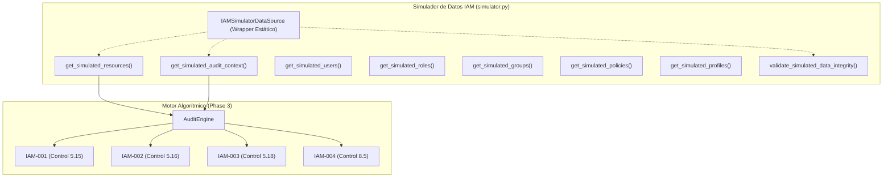

# DOCUMENTACIÓN TÉCNICA — FASE 4, ENTREGA 1
## Consolidación del Simulador de Datos de Auditoría IAM

---

## 1. Portada Técnica y Metadatos

| Atributo | Detalle |
| :--- | :--- |
| **Proyecto** | Modelo automatizado para la auditoría de gestión de identidades y accesos en entornos de nube basado en el estándar ISO 27001 para UPHARVEN C.A. |
| **Fase** | Fase 4: Integración de Fuentes de Datos y Escenarios de Simulación |
| **Entrega** | Entrega 1: Consolidación del Simulador de Datos |
| **Fecha de emisión** | Noviembre 2026 |
| **Versión** | 1.0.0 |
| **Estado** | Implementado y Validado (118/118 pruebas superadas) |
| **Entorno de ejecución** | Python 3.13 / Windows 11 / pytest 9.2.0 |
| **Módulo central** | `src/auditoria_iam/data_sources/simulator/simulator.py` |

---

## 2. Resumen Ejecutivo

El propósito central de la **Fase 4 — Entrega 1** es consolidar, formalizar y desacoplar el componente de simulación de datos (`simulator.py`) dentro de la arquitectura modular del sistema de auditoría IAM. 

Este simulador constituye la fuente primaria de información estructurada para evaluar identidades de usuario, roles de servicio, grupos de asignación, políticas técnicas en sintaxis JSON y perfiles de referencia autorizados contra los controles seleccionados del estándar internacional **ISO/IEC 27001:2022**.

### Alcance y Limitaciones
1. **Datos estrictamente simulados**: UPHARVEN C.A. autorizó el uso de su denominación institucional para el desarrollo de esta tesis de grado, pero **no suministró acceso a su infraestructura productiva ni información confidencial real de nube**. 
2. **Ambiente desacoplado**: La implementación opera de forma autónoma en memoria local sin requerir credenciales de AWS IAM, llamadas Boto3 ni dependencias activas del gestor relacional MySQL.
3. **Determinismo y reproducibilidad**: El simulador garantiza un conjunto controlado de 10 identidades/recursos técnicos que producen exactamente la **matriz de referencia de 67 evaluaciones** (36 Conforme, 25 No evaluable y 6 Hallazgo), validando con precisión analítica el motor algorítmico de la Fase 3.

---

## 3. Justificación Académica del Uso de Datos Simulados

En investigaciones de ciberseguridad aplicada y auditoría de sistemas de información, el acceso a infraestructuras en producción suele estar restringido por acuerdos de confidencialidad, riesgos operacionales y protección de secretos comerciales. Para UPHARVEN C.A., el uso de un dataset simulado responde a los siguientes pilares metodológicos:

1. **Seguridad y Confidencialidad**: Se previene cualquier riesgo de fuga o exposición accidental de topologías, identificadores reales o vectores de ataque empresariales.
2. **Cobertura exhaustiva de casos de frontera**: En una infraestructura real bien configurada, la presencia de hallazgos críticos (p. ej., políticas `*/*` o cuentas de servicio no autorizadas) es infrecuente o transitoria. El simulador introduce de manera intencional anomalías controladas, errores de sintaxis y casos no deterministas para someter a prueba la resiliencia del motor.
3. **Reproducibilidad científica**: Cualquier evaluador, jurado o auditor puede ejecutar la suite completa de pruebas unitarias sobre cualquier estación de trabajo con Python 3.13, obteniendo resultados idénticos e invariables.

---

## 4. Arquitectura y Estructura del Simulador Consolidado

El simulador se ubica en el paquete `src/auditoria_iam/data_sources/simulator/`, coexistiendo de forma simétrica con la futura fuente de datos de nube (`data_sources/aws/`).

```
src/auditoria_iam/data_sources/
├── __init__.py
├── aws/
│   └── __init__.py
└── simulator/
    ├── __init__.py
    └── simulator.py
```

### Componentes Principales



- **`get_simulated_resources()`**: Retorna la lista canónica de 10 diccionarios estructurados que representan identidades de usuario (`IAM_USER`) y roles asumibles (`IAM_ROLE`).
- **`get_simulated_audit_context()`**: Construye el objeto `AuditContext` que contiene los perfiles corporativos autorizados, los grupos esperados y las entidades de confianza permitidas.
- **Acceso especializado**: `get_simulated_users()`, `get_simulated_roles()`, `get_simulated_groups()`, `get_simulated_policies()`, `get_simulated_profiles()`.
- **Auditoría interna de dataset**: `validate_simulated_data_integrity()` que comprueba la coherencia referencial entre grupos, usuarios, roles, políticas y perfiles.
- **`IAMSimulatorDataSource`**: Clase envolvente con métodos de clase que estandariza la interfaz programática para su posterior consumo desde capas de servicio y GUI.

---

## 5. Catálogo Exhaustivo de Datos Simulados

### 5.1 Identidades de Usuario (`IAM_USER`)

| ID | Clave (`resource_key`) | Nombre para mostrar | Grupos asignados | Inactividad (días) | MFA | Políticas adjuntas | Perfil asignado |
| :---: | :--- | :--- | :--- | :---: | :---: | :---: | :--- |
| **1** | `ana.operaciones` | Ana Morales (Operaciones) | Operaciones, LecturaContratos | 2 | Sí | `UpharvenOperacionesS3Policy` | `PRF-USR-OPERACIONES` |
| **2** | `carlos.soporte` | Carlos Rodríguez (Soporte Técnico) | SoporteTI, SeguridadTI | 1 | Sí | `AdministratorAccessSimulated` | `PRF-USR-SOPORTE` |
| **3** | `usuario.inactivo` | Cuenta Inactiva Temporal | Operaciones, LecturaContratos | 120 | Sí | Ninguna | `PRF-USR-OPERACIONES` |
| **4** | `cuenta.sin_mfa` | Usuario Operativo Sin MFA | Operaciones, LecturaContratos | 5 | No | Ninguna | `PRF-USR-OPERACIONES` |
| **5** | `usuario.sin_perfil` | Usuario Externo Sin Perfil | Operaciones | 15 | Sí | Ninguna | *Ninguno (No asignado)* |
| **6** | `usuario.grupos_discrepantes` | Usuario Asignación Errónea | Finanzas, AuditoriaInterna | 10 | Sí | Ninguna | `PRF-USR-OPERACIONES` |
| **10** | `usuario.datos_incompletos` | Usuario Metadatos Parciales | *Sin atributo groups* | *No registrado* | *No* | *Ninguna* | `PRF-USR-OPERACIONES` |

### 5.2 Roles de Servicio (`IAM_ROLE`)

| ID | Clave (`resource_key`) | Nombre para mostrar | Entidad de Confianza (`Principal`) | Acción Confianza | Condición (`Condition`) | Políticas adjuntas | Perfil asignado |
| :---: | :--- | :--- | :--- | :--- | :--- | :--- | :--- |
| **7** | `rol.operaciones_valido` | Rol EC2 Operaciones | `Service: ec2.amazonaws.com` | `sts:AssumeRole` | Ninguna | `UpharvenEC2S3ReadPolicy` | `PRF-ROL-EC2-OPS` |
| **8** | `rol.principal_no_autorizado` | Rol Confianza No Autorizada | `Service: lambda.amazonaws.com` | `sts:AssumeRole` | Ninguna | Ninguna | `PRF-ROL-EC2-OPS` |
| **9** | `rol.politica_no_soportada` | Rol Política No Determinista | `Service: ec2.amazonaws.com` | `sts:AssumeRole` | `StringLike: {Department: Fin*}` | Ninguna | `PRF-ROL-EC2-OPS` |

### 5.3 Catálogo de Grupos IAM

| Grupo | ARN Simulado | Descripción Funcional | Miembros Asignados |
| :--- | :--- | :--- | :--- |
| **Operaciones** | `arn:aws:iam::123456789012:group/Operaciones` | Personal operativo de gestión de contratos y operaciones generales | `ana.operaciones`, `usuario.inactivo`, `cuenta.sin_mfa`, `usuario.sin_perfil` |
| **LecturaContratos** | `arn:aws:iam::123456789012:group/LecturaContratos` | Acceso de solo lectura a documentación operativa y contratos | `ana.operaciones`, `usuario.inactivo`, `cuenta.sin_mfa` |
| **SoporteTI** | `arn:aws:iam::123456789012:group/SoporteTI` | Personal técnico encargado de soporte de infraestructura | `carlos.soporte` |
| **SeguridadTI** | `arn:aws:iam::123456789012:group/SeguridadTI` | Equipo de seguridad de la información y monitoreo | `carlos.soporte` |
| **Finanzas** | `arn:aws:iam::123456789012:group/Finanzas` | Personal del departamento financiero y facturación | `usuario.grupos_discrepantes` |
| **AuditoriaInterna** | `arn:aws:iam::123456789012:group/AuditoriaInterna` | Equipo de auditoría interna y verificación de cumplimiento | `usuario.grupos_discrepantes` |

### 5.4 Catálogo de Políticas Técnicas en Formato JSON

#### 1. `UpharvenOperacionesS3Policy` (Adjunta a `ana.operaciones`)
```json
{
  "Version": "2012-10-17",
  "Statement": [
    {
      "Effect": "Allow",
      "Action": ["s3:GetObject", "s3:ListBucket"],
      "Resource": "arn:aws:s3:::upharven-operaciones/*"
    }
  ]
}
```
*Interpretación*: Permiso acotado de lectura sobre bucket específico de operaciones. No contiene patrones de comodines globales excesivamente amplios.

#### 2. `AdministratorAccessSimulated` (Adjunta a `carlos.soporte`)
```json
{
  "Version": "2012-10-17",
  "Statement": [
    {
      "Effect": "Allow",
      "Action": "*",
      "Resource": "*"
    }
  ]
}
```
*Interpretación*: Patrón de permisos IAM excesivamente amplio (`Action: *`, `Resource: *`). Detona Hallazgo en IAM-003 (C18-01) estrictamente por el análisis sintáctico de la declaración JSON (`Action: *` y `Resource: *`), no por el nombre de la política ni como una evaluación de gestión de accesos privilegiados del control 8.2 (el cual se encuentra fuera del alcance del sistema).

#### 3. `UpharvenEC2S3ReadPolicy` (Adjunta a `rol.operaciones_valido`)
```json
{
  "Version": "2012-10-17",
  "Statement": [
    {
      "Effect": "Allow",
      "Action": ["s3:GetObject"],
      "Resource": "arn:aws:s3:::upharven-datos/*"
    }
  ]
}
```
*Interpretación*: Permiso específico de lectura para la instancia EC2 sobre objetos de datos. Acotado y conforme.

### 5.5 Perfiles de Referencia Autorizados

| ID | Código de Perfil | Nombre del Perfil | Tipo | Grupos Esperados | Relaciones de Confianza Esperadas |
| :---: | :--- | :--- | :---: | :--- | :--- |
| **1** | `PRF-USR-OPERACIONES` | Perfil Estándar de Operaciones | Usuario | `Operaciones`, `LecturaContratos` | *No aplica a usuarios* |
| **2** | `PRF-USR-SOPORTE` | Perfil de Soporte Técnico | Usuario | `SoporteTI` | *No aplica a usuarios* |
| **3** | `PRF-ROL-EC2-OPS` | Perfil de Confianza Rol EC2 Operaciones | Rol | *No aplica a roles* | `Principal: ec2.amazonaws.com`, `Action: sts:AssumeRole` |

---

## 6. Mapeo de Escenarios de Prueba vs. Criterios de Control

Cada uno de los 10 recursos simulados es sometido a los 8 criterios de evaluación implementados en las 4 reglas del motor algorítmico:
- **IAM-001 (ISO 5.15)**: C15-01 (Grupos), C15-02 (Confianza de Roles), C15-03 (Acceso a Servicios).
- **IAM-002 (ISO 5.16)**: C16-01 (Ciclo de Vida/Desaprovisionamiento), C16-02 (Inactividad > 90 días).
- **IAM-003 (ISO 5.18)**: C18-01 (Patrón de permisos IAM excesivamente amplio: Action: *, Resource: *), C18-02 (Alineación con Catálogo).
- **IAM-004 (ISO 8.5)**: C85-01 (Autenticación Multifactor - MFA).

### Matriz Detallada de Evaluación

| ID | Recurso | C15-01 | C15-02 | C15-03 | C16-01 | C16-02 | C18-01 | C18-02 | C85-01 | Total Evaluaciones |
| :---: | :--- | :---: | :---: | :---: | :---: | :---: | :---: | :---: | :---: | :---: |
| **1** | `ana.operaciones` | Conforme | N/A* | Conforme | Conforme | Conforme | Conforme | No evaluable | Conforme | 7 |
| **2** | `carlos.soporte` | Hallazgo | N/A* | Conforme | Conforme | Conforme | Hallazgo | No evaluable | Conforme | 7 |
| **3** | `usuario.inactivo` | Conforme | N/A* | Conforme | No evaluable | Hallazgo | Conforme | No evaluable | Conforme | 7 |
| **4** | `cuenta.sin_mfa` | Conforme | N/A* | Conforme | Conforme | Conforme | Conforme | No evaluable | Hallazgo | 7 |
| **5** | `usuario.sin_perfil` | No evaluable | N/A* | No evaluable | Conforme | Conforme | Conforme | No evaluable | Conforme | 7 |
| **6** | `usuario.grupos_discrepantes`| Hallazgo | N/A* | Conforme | Conforme | Conforme | Conforme | No evaluable | Conforme | 7 |
| **7** | `rol.operaciones_valido` | N/A* | Conforme | Conforme | Conforme | Conforme | Conforme | No evaluable | N/A** | 6 |
| **8** | `rol.principal_no_autorizado`| N/A* | Hallazgo | Conforme | Conforme | Conforme | Conforme | No evaluable | N/A** | 6 |
| **9** | `rol.politica_no_soportada` | N/A* | No evaluable| Conforme | Conforme | Conforme | Conforme | No evaluable | N/A** | 6 |
| **10**| `usuario.datos_incompletos` | No evaluable | N/A* | No evaluable | No evaluable| No evaluable| Conforme | No evaluable | No evaluable| 7 |

*\* N/A en C15-01/C15-02 corresponde a la exclusión natural de tipo (C15-01 solo evalúa usuarios; C15-02 solo evalúa roles).*  
*\*\* N/A en C85-01 corresponde a la exclusión natural de roles en IAM-004 (los roles no poseen credenciales permanentes ni MFA de consola).*

---

## 7. Matriz de Resultados de Referencia

La ejecución exhaustiva del motor algorítmico sobre los 10 recursos simulados arroja exactamente **67 evaluaciones técnicas individuales**:

### 7.1 Distribución General

| Estado | Total de Evaluaciones | Porcentaje Relativo |
| :--- | :---: | :---: |
| **Conforme** | **36** | **53.73 %** |
| **No evaluable** | **25** | **37.31 %** |
| **Hallazgo** | **6** | **8.96 %** |
| **TOTAL** | **67** | **100.00 %** |

### 7.2 Desglose por Criterio de Control

| Regla | Criterio de Auditoría | Conforme | Hallazgo | No evaluable | Total |
| :--- | :--- | :---: | :---: | :---: | :---: |
| **IAM-001** | C15-01 (Membresía a grupos autorizados) | 3 | 2 | 2 | 7 |
| **IAM-001** | C15-02 (Confianza en roles asumibles) | 1 | 1 | 1 | 3 |
| **IAM-001** | C15-03 (Acceso a servicios autorizados) | 8 | 0 | 2 | 10 |
| **IAM-002** | C16-01 (Ciclo de vida y desaprovisionamiento) | 8 | 0 | 2 | 10 |
| **IAM-002** | C16-02 (Gestión de inactividad de credenciales) | 8 | 1 | 1 | 10 |
| **IAM-003** | C18-01 (Patrón de permisos IAM excesivamente amplio: Action: *, Resource: *) | 9 | 1 | 0 | 10 |
| **IAM-003** | C18-02 (Alineación con catálogo de privilegios) | 0 | 0 | 10 | 10 |
| **IAM-004** | C85-01 (Autenticación multifactor obligatoria) | 5 | 1 | 1 | 7 |
| **TOTAL** | | **36** | **6** | **25** | **67** |

### 7.3 Desglose de los 6 Hallazgos Detectados

1. **`carlos.soporte` (C15-01)**: Posee el grupo no autorizado `SeguridadTI`, ausente en su perfil `PRF-USR-SOPORTE`.
2. **`carlos.soporte` (C18-01)**: Presenta un patrón de permisos IAM excesivamente amplio (Action: *, Resource: *) identificado al inspeccionar el contenido del documento JSON de la política `AdministratorAccessSimulated`. El hallazgo es detonado estrictamente por la presencia de comodines globales en la estructura de la política y no por el nombre de esta ni como una evaluación de administración privilegiada (control 8.2).
3. **`usuario.inactivo` (C16-02)**: Cuenta con 120 días de inactividad, superando el umbral corporativo de 90 días.
4. **`cuenta.sin_mfa` (C85-01)**: Usuario activo con autenticación multifactor deshabilitada (`mfa_enabled: false`).
5. **`usuario.grupos_discrepantes` (C15-01)**: Grupos asignados (`Finanzas`, `AuditoriaInterna`) totalmente disjuntos con el perfil `PRF-USR-OPERACIONES` (`Operaciones`, `LecturaContratos`).
6. **`rol.principal_no_autorizado` (C15-02)**: Confianza concedida a `lambda.amazonaws.com`, no contemplada en el perfil `PRF-ROL-EC2-OPS` (autorizado solo para `ec2.amazonaws.com`).

---

## 8. Mecanismos de Validación y Consistencia Interna

Para garantizar que el dataset simulado no presente incoherencias estructurales ni referencias rotas, se implementó la función:

```python
validate_simulated_data_integrity() -> Dict[str, Any]
```

### Reglas de Verificación Ejecutadas:
1. **Unicidad de Identificadores**: Cada recurso posee un identificador entero único (`id`) y una clave alfanumérica única (`resource_key`).
2. **Esquema de Atributos**: Todos los recursos incluyen los campos obligatorios del esquema relacional (`id`, `resource_key`, `resource_type`, `display_name`, `source_type`, `resource_status`, `attributes`).
3. **Integridad Referencial de Grupos**: Cada cadena en `attributes["groups"]` debe corresponder a un grupo registrado en el catálogo oficial de grupos (`get_simulated_groups()`).
4. **Integridad de Membresía Inversa**: Los miembros declarados en el catálogo de grupos reflejan exactamente las identidades que poseen dicho grupo asignado.
5. **Integridad Referencial de Perfiles**: Las asignaciones en `resource_profiles` mapean a identificadores válidos en el diccionario `profiles` del `AuditContext`.
6. **Clasificación Explícita de Recursos Degradados**: Separa las identidades técnicamente válidas de aquellas diseñadas intencionalmente para pruebas negativas o casos de borde (e.g. `usuario.sin_perfil`, `usuario.datos_incompletos`, `rol.politica_no_soportada`).

---

## 9. Interfaz Programática del Simulador

El paquete `src.auditoria_iam.data_sources.simulator` expone la interfaz pública mediante funciones modulares y la clase unificada `IAMSimulatorDataSource`.

### Funciones Públicas

| Función | Tipo de Retorno | Descripción |
| :--- | :--- | :--- |
| `get_simulated_resources()` | `List[Dict[str, Any]]` | Retorna las 10 identidades y roles simulados normalizados. |
| `get_simulated_audit_context()` | `AuditContext` | Retorna los perfiles y relaciones de confianza de referencia. |
| `get_simulated_users()` | `List[Dict[str, Any]]` | Filtra y retorna los 7 recursos de tipo usuario (`IAM_USER`). |
| `get_simulated_roles()` | `List[Dict[str, Any]]` | Filtra y retorna los 3 recursos de tipo rol (`IAM_ROLE`). |
| `get_simulated_groups()` | `List[Dict[str, Any]]` | Catálogo de los 6 grupos IAM simulados con miembros calculados. |
| `get_simulated_policies()` | `List[Dict[str, Any]]` | Catálogo de las 3 políticas técnicas JSON simuladas. |
| `get_simulated_profiles()` | `Dict[int, Dict[str, Any]]` | Perfiles de referencia enriquecidos con grupos y entidades de confianza. |
| `validate_simulated_data_integrity()` | `Dict[str, Any]` | Reporte de integridad estructural y referencial del dataset. |

### Clase `IAMSimulatorDataSource`
Permite el consumo estático desacoplado:
```python
from src.auditoria_iam.data_sources.simulator import IAMSimulatorDataSource

# Obtener recursos y contexto
resources = IAMSimulatorDataSource.get_resources()
context = IAMSimulatorDataSource.get_audit_context()

# Validar integridad interna
report = IAMSimulatorDataSource.validate_integrity()
assert report["valid"] is True
```

---

## 10. Evidencia de Pruebas Unitarias

La suite de pruebas automatizadas del proyecto cuenta con **118 pruebas unitarias**, ejecutadas y superadas satisfactoriamente mediante `pytest`:

```
============================= test session starts =============================
platform win32 -- Python 3.13.5, pytest-9.2.0, pluggy-1.7.0
rootdir: C:\Users\andre\Desktop\TESIS\sistema
collecting ... collected 118 items

tests/test_audit_engine.py .................................. [ 7%]
tests/test_audit_models.py .................................. [ 12%]
tests/test_connection.py .................................... [ 16%]
tests/test_repository.py .................................... [ 33%]
tests/test_rule_iam_001.py .................................. [ 53%]
tests/test_rule_iam_002.py .................................. [ 61%]
tests/test_rule_iam_003.py .................................. [ 76%]
tests/test_rule_iam_004.py .................................. [ 81%]
tests/test_settings.py ...................................... [ 92%]
tests/test_simulator.py ..................................... [100%]

============================= 118 passed in 0.73s =============================
```

### Pruebas Específicas del Simulador (`tests/test_simulator.py`)
1. `test_simulator_data_integrity`: Valida cardinalidad básica de recursos (10) y perfiles (3).
2. `test_simulator_produces_all_three_statuses_in_engine`: Verifica generación efectiva de los 3 estados en el motor.
3. `test_simulator_get_users_and_roles_filtering`: Comprueba discriminación de usuarios (7) y roles (3).
4. `test_simulator_groups_catalog_and_memberships`: Valida los 6 grupos y sus membresías cruzadas.
5. `test_simulator_policies_catalog`: Verifica sintaxis y presencia de las 3 políticas técnicas.
6. `test_simulator_profiles_catalog`: Valida el catálogo enriquecido de perfiles corporativos.
7. `test_validate_simulated_data_integrity`: Valida que el dataset no presente anomalías de integridad.
8. `test_iam_simulator_data_source_class`: Valida la interfaz estática unificada `IAMSimulatorDataSource`.
9. `test_simulator_reference_matrix_exact_match`: Aserción estricta de la matriz de referencia (67 evaluaciones: 36 Conforme, 25 No evaluable, 6 Hallazgo).

---

## 11. Declaración de Limitaciones y Trabajo Futuro

### Lo que Cubre Esta Entrega
- Dataset simulado determinista, validado y completo en memoria.
- Cobertura exhaustiva de usuarios, roles, grupos, políticas JSON y perfiles de referencia.
- Verificación programática de integridad interna y trazabilidad contra ISO/IEC 27001:2022.
- 100% de compatibilidad con las 4 reglas del motor algorítmico y 118 pruebas unitarias aprobadas.

### Lo que No Cubre (Reservado para Entregas y Fases Posteriores)
- **AWS Real / Boto3**: No se realizan llamadas a APIs reales de AWS ni se gestionan credenciales productivas de nube.
- **Persistencia MySQL en Simulador**: Esta entrega mantiene los datos en memoria para pruebas desacopladas; la carga o persistencia de auditorías en base de datos corresponde al flujo de integración de ejecuciones de auditoría.
- **Interfaz Gráfica PySide6**: Las vistas y paneles de usuario se desarrollarán en la fase correspondiente de presentación.

### Articulación con la Entrega 2 de la Fase 4
La Entrega 2 integrará los adaptadores de datos y la orquestación entre la fuente de simulación y la fuente AWS Cloud, permitiendo al sistema conmutar de manera transparente entre datos simulados para pruebas y datos de nube para auditorías reales.

