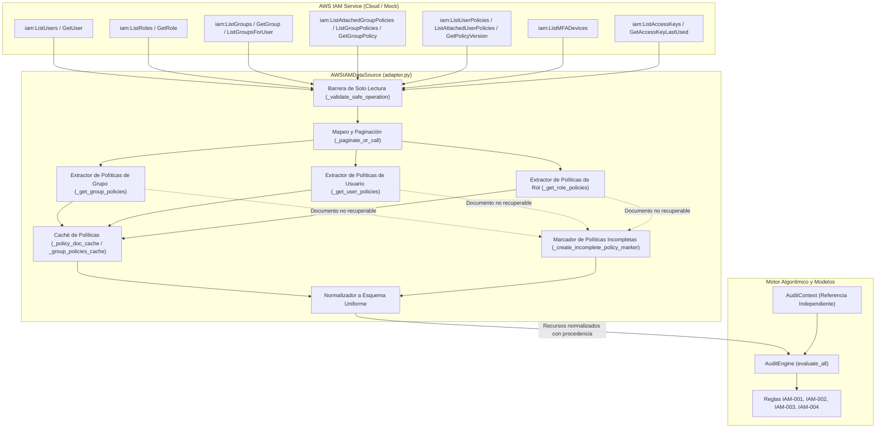

# DOCUMENTACIÓN TÉCNICA — FASE 4, ENTREGA 2
## Integración de la Fuente AWS IAM mediante Boto3 y Políticas de Grupos

---

## 1. Portada Técnica y Metadatos

| Atributo | Detalle |
| :--- | :--- |
| **Proyecto** | Modelo automatizado para la auditoría de gestión de identidades y accesos en entornos de nube basado en el estándar ISO 27001 para UPHARVEN C.A. |
| **Fase** | Fase 4: Integración de Fuentes de Datos y Escenarios de Simulación |
| **Entrega** | Entrega 2: Integración de la Fuente AWS IAM mediante Boto3 (Revisión y Ajustes) |
| **Fecha de emisión** | Noviembre 2026 |
| **Versión** | 1.2.0 |
| **Estado** | Implementado y Validado (146/146 pruebas superadas, 0 fallos) |
| **Entorno de ejecución** | Python 3.13 / Windows 11 / pytest 9.2.0 / Boto3 1.43+ |
| **Módulo central** | `src/auditoria_iam/data_sources/aws/adapter.py` |

---

## 2. Resumen Ejecutivo y Objetivo

El objetivo fundamental de la **Fase 4 — Entrega 2** es construir y validar el adaptador técnico para la ingestión y normalización de configuraciones de seguridad desde el servicio **AWS Identity and Access Management (IAM)** utilizando la biblioteca oficial **Boto3**.

Tras las revisiones técnicas, se perfeccionaron los siguientes aspectos esenciales:
1. **Políticas Asociadas a Grupos IAM**: Ingestión integral de políticas administradas e integradas (*inline*) asignadas a grupos IAM, asociándolas a los usuarios miembros para que la regla **IAM-003** (ISO 27001 Control 5.18) evalúe la totalidad de permisos efectivos heredados sin perder la trazabilidad de procedencia.
2. **Contexto de Auditoría Independiente**: Desvinculación absoluta del simulador en las pruebas de integración del motor, demostrando que `AuditEngine` procesa recursos normalizados de AWS frente a contextos de referencia (`AuditContext`) corporativos independientes sin inventar perfiles ni asignaciones.
3. **Prevención de Omisiones Silenciosas de Políticas**: Implementación del marcador de política incompleta (`_create_incomplete_policy_marker`) en grupos, usuarios y roles. Si una política asignada no puede recuperarse o normalizarse, no se descarta silenciosamente; se preserva su procedencia y se induce de forma controlada el resultado **No evaluable** en C18-01, impidiendo categóricamente falsos resultados «Conforme».

### Principios Rectores:
1. **Estricta Operación en Modo Solo Lectura**: Ninguna operación de modificación, creación, actualización, eliminación o remediación es invocada ni permitida. El adaptador implementa barreras activas que rechazan cualquier método que no sea de consulta.
2. **Desacoplamiento y Transparencia**: El motor algorítmico evalúa los recursos de AWS sin requerir adaptaciones en su lógica interna ni distinguir si provienen de la simulación o de la nube.
3. **Seguridad y Confidencialidad**: Toda gestión de credenciales respeta la cadena estándar de AWS (variables de entorno, perfiles IAM o roles de instancia) sin almacenar secretos en el código fuente ni emitirlos en logs o mensajes de error.
4. **Validación sin Infraestructura Real**: Las pruebas automatizadas operan íntegramente mediante clientes simulados y mocks unitarios, garantizando reproducibilidad sin requerir conectividad activa ni credenciales productivas durante el desarrollo.

---

## 3. Arquitectura del Adaptador AWS IAM

El adaptador se encuentra ubicado en el paquete `src/auditoria_iam/data_sources/aws/`, separado físicamente del módulo simulador (`data_sources/simulator/`):

```
src/auditoria_iam/data_sources/
├── __init__.py
├── aws/
│   ├── __init__.py
│   ├── adapter.py
│   └── exceptions.py
└── simulator/
    ├── __init__.py
    └── simulator.py
```

### Diagrama de Flujo e Integración



---

## 4. Archivos Creados y Modificados

| Archivo | Tipo de Acción | Propósito Técnico |
| :--- | :---: | :--- |
| `src/auditoria_iam/data_sources/aws/exceptions.py` | Creado | Jerarquía de excepciones controladas (`AWSIAMDataSourceError`, `AWSIAMAuthenticationError`, `AWSIAMPermissionError`, `AWSIAMConnectionError`). |
| `src/auditoria_iam/data_sources/aws/adapter.py` | Modificado | Ingestión de políticas de grupos, relación con usuarios, trazabilidad de procedencia, deduplicación y manejo de marcadores incompletos en grupos, usuarios y roles. |
| `src/auditoria_iam/data_sources/aws/__init__.py` | Modificado | Exportación pública del adaptador, excepciones y constantes de operación. |
| `requirements.txt` | Modificado | Declaración controlada de la dependencia `boto3>=1.34.0`. |
| `tests/test_aws_data_source.py` | Modificado | 28 pruebas unitarias completas que validan consultas de grupos, políticas, contexto independiente, marcadores incompletos y solo lectura. |
| `DOCUMENTACION_FASE_4_ENTREGA_2_AWS.md` | Actualizado | Documentación técnica exhaustiva de la entrega con las correcciones implementadas (v1.2.0). |

---

## 5. Operaciones Boto3 Utilizadas y su Finalidad

Todas las llamadas invocadas pertenecen estrictamente a la familia de operaciones de consulta (`get_` y `list_`):

| Operación Boto3 | Parámetros Clave | Finalidad Técnica en el Sistema |
| :--- | :--- | :--- |
| `list_users` | `MaxItems`, `Marker` | Obtiene el inventario de identidades de usuario IAM existentes en la cuenta. |
| `list_groups_for_user` | `UserName` | Determina la pertenencia del usuario a grupos para evaluar el control 5.15 (C15-01). |
| `list_attached_group_policies` | `GroupName` | Obtiene políticas administradas adjuntas a los grupos del usuario para el control 5.18. |
| `list_group_policies` | `GroupName` | Lista nombres de políticas integradas (*inline*) asignadas al grupo IAM. |
| `get_group_policy` | `GroupName`, `PolicyName` | Obtiene el documento JSON de una política integrada de grupo. |
| `list_mfa_devices` | `UserName` | Comprueba si el usuario tiene dispositivos MFA registrados para el control 8.5 (C85-01). |
| `list_access_keys` | `UserName` | Obtiene identificadores de credenciales de acceso programático del usuario. |
| `get_access_key_last_used` | `AccessKeyId` | Extrae la fecha de último uso (`LastUsedDate`) de las claves para evaluar inactividad en el control 5.16 (C16-02). |
| `list_user_policies` | `UserName` | Lista nombres de políticas integradas (*inline*) adjuntas directamente al usuario. |
| `get_user_policy` | `UserName`, `PolicyName` | Obtiene el documento JSON de una política integrada de usuario para el control 5.18 (C18-01). |
| `list_attached_user_policies`| `UserName` | Lista políticas administradas adjuntas directamente al usuario. |
| `list_roles` | `MaxItems`, `Marker` | Obtiene el inventario de roles IAM y sus documentos de confianza (*AssumeRolePolicyDocument* para C15-02). |
| `list_role_policies` | `RoleName` | Lista nombres de políticas integradas asociadas al rol. |
| `get_role_policy` | `RoleName`, `PolicyName` | Obtiene el documento JSON de una política integrada del rol. |
| `list_attached_role_policies`| `RoleName` | Lista políticas administradas adjuntas al rol. |
| `list_groups` | `MaxItems`, `Marker` | Obtiene el catálogo de grupos IAM de la cuenta. |
| `get_group` | `GroupName` | Obtiene detalles de un grupo y la lista de usuarios miembros asignados. |
| `get_policy` | `PolicyArn` | Obtiene los metadatos de una política administrada y su versión por defecto (`DefaultVersionId`). |
| `get_policy_version` | `PolicyArn`, `VersionId` | Obtiene el documento JSON de la versión predeterminada de una política administrada. |

---

## 6. Evidencia de Operación Estricta de Solo Lectura

El sistema implementa una **triple barrera de protección** para garantizar que no existan operaciones de escritura, remediación o alteración:

1. **Lista Blanca de Operaciones (`READ_ONLY_OPERATIONS`)**:
   Solo se permiten las 21 operaciones explicitadas en la sección anterior, todas con prefijos `get_` o `list_`.
2. **Rechazo Activo de Prefijos Prohibidos**:
   Cualquier invocación interna que inicie con `create`, `update`, `delete`, `put`, `attach`, `detach`, `enable`, `disable`, `deactivate`, `generate`, `remove`, `add`, `tag` o `untag` es interceptada antes de llamar al SDK y detona de inmediato una excepción `AWSIAMDataSourceError`.
3. **Auditoría de Métodos del Adaptador (`test_aws_strictly_read_only_no_write_operations`)**:
   La suite de pruebas inspecciona mediante introspección (`inspect.getmembers`) todos los métodos de la clase `AWSIAMDataSource` asegurando que no exista ningún método que modifique recursos.

---

## 7. Políticas de Grupos IAM, Trazabilidad y Prevención de Omisiones

### 7.1 Relación de Políticas con Usuarios y Trazabilidad

Un usuario IAM en AWS puede poseer permisos a través de cuatro mecanismos distintos:
1. **Políticas integradas directas**: Marcadas con `_source_type: "user_inline"` y `_source_name`.
2. **Políticas administradas directas**: Marcadas con `_source_type: "user_managed"`, `_source_name` y `_source_arn`.
3. **Políticas administradas de grupo**: Marcadas con `_source_type: "group_managed"`, `_group_name` y `_source_arn`.
4. **Políticas integradas de grupo**: Marcadas con `_source_type: "group_inline"`, `_group_name` y `_source_name`.

```python
# Ejemplo de documento de política de grupo normalizado en attributes["policies"]
{
    "Version": "2012-10-17",
    "Statement": [
        {
            "Effect": "Allow",
            "Action": ["s3:GetObject", "s3:ListBucket"],
            "Resource": "arn:aws:s3:::corp-data/*"
        }
    ],
    "_source_type": "group_managed",
    "_source_name": "CorpS3ReadPolicy",
    "_source_arn": "arn:aws:iam::123456789012:policy/CorpS3ReadPolicy",
    "_group_name": "OperacionesNube"
}
```

### 7.2 Deduplicación Inteligente
Si una misma política administrada está asignada directamente al usuario y también a uno o más de sus grupos, el adaptador la incluye una única vez en `attributes["policies"]`, evitando redundancias de evaluación y preservando la trazabilidad de su primera asociación.

### 7.3 Prevención de Omisiones Silenciosas y Marcador Incompleto
Cuando una política figura como asignada a un usuario, grupo o rol pero su documento técnico no puede recuperarse o normalizarse (por ejemplo, debido a errores de sintaxis JSON en la nube, permisos insuficientes `AccessDenied` o fallas de resolución en `get_policy_version`):

El método `_create_incomplete_policy_marker()` genera una estructura controlada:
```python
{
    "_source_type": "group_managed" | "user_managed" | "group_inline" | "user_inline" | "role_managed" | "role_inline",
    "_source_name": policy_name,
    "_source_arn": policy_arn,
    "_group_name": group_name,
    "_incomplete_policy": True,
    "_error": "Motivo controlado sin exponer credenciales",
    "Statement": None
}
```

**Efecto en el Motor Algorítmico (IAM-003):**
- Compatible con `_extract_policies()`: al ser un diccionario, se incorpora a la lista de políticas técnicas.
- Al evaluar C18-01, la presencia de `Statement: None` detona inmediatamente el estado **No evaluable** («Documento de política técnica sin campo 'Statement' definido.»).
- **Garantía analítica**: Se previene categóricamente emitir un falso *Conforme* para una identidad cuya superficie de privilegios no pudo ser inspeccionada en su totalidad, sin generar un *Hallazgo* indebido.

---

## 8. Integración del Contexto de Auditoría AWS

### 8.1 Separación entre Datos de Nube y Línea Base de Autorización
AWS IAM contiene la realidad operativa de la nube (qué identidades existen, qué grupos tienen y qué políticas tienen adjuntas), pero **no almacena la línea base de autorización corporativa** (qué grupos *debería* tener un cargo o qué roles tienen autorización de asumir servicios).

En la arquitectura del sistema:
- `AWSIAMDataSource` **no inventa perfiles ni grupos esperados**.
- La línea base se modela mediante el objeto formal `AuditContext`, suministrado de forma externa e independiente (a través de la base de datos o de especificaciones de auditoría).
- Si un recurso AWS no cuenta con perfil asignado en `resource_profiles`, los criterios dependientes (C15-01, C15-03 y C18-02) emiten estrictamente **No evaluable** («No es posible evaluar la correspondencia de asignaciones de acceso debido a la ausencia de un perfil de referencia activo»).

### 8.2 Validación con Contexto Independiente
En las pruebas automatizadas se demostró la evaluación de recursos AWS utilizando un `AuditContext` corporativo definido *ad-hoc* (p. ej., perfil `PRF-CORP-DEVOPS` con grupos esperados `["DevOpsTeam"]`), sin invocar `get_simulated_audit_context()`, acreditando la total independencia entre la fuente de datos real y los datos simulados.

---

## 9. Pruebas Automatizadas y Cobertura

La suite de pruebas para la fuente AWS en [`tests/test_aws_data_source.py`](file:///C:/Users/andre/Desktop/TESIS/sistema/tests/test_aws_data_source.py) cuenta con **28 pruebas unitarias exhaustivas**:

1. `test_aws_query_users`: Consulta y normalización de usuarios IAM.
2. `test_aws_query_groups_and_membership`: Consulta de grupos y miembros asociados.
3. `test_aws_query_roles_and_trust_policies`: Consulta de roles y política de confianza.
4. `test_aws_query_managed_policies`: Resolución de versión predeterminada y caché.
5. `test_aws_query_inline_policies`: Consulta y decodificación de políticas integradas.
6. `test_aws_query_mfa_devices`: Detección de dispositivos MFA activos y ausentes.
7. `test_aws_activity_metadata_calculation`: Cálculo preciso de días de inactividad.
8. `test_aws_pagination_handling`: Paginación mediante marcadores.
9. `test_aws_credentials_error_handling`: Excepciones controladas por credenciales ausentes.
10. `test_aws_permission_error_handling`: Excepciones controladas por `AccessDenied`.
11. `test_aws_incomplete_responses_defensive`: Resiliencia ante respuestas con claves faltantes.
12. `test_aws_normalization_format`: Comprobación del esquema de atributos requeridos.
13. `test_aws_engine_compatibility_with_independent_context`: Evaluación directa en `AuditEngine` con contexto independiente.
14. `test_aws_strictly_read_only_no_write_operations`: Verificación exhaustiva de 100% solo lectura.
15. `test_aws_group_managed_policies_query`: Consulta de políticas administradas de grupos.
16. `test_aws_group_inline_policies_query`: Consulta de políticas integradas de grupos.
17. `test_aws_group_managed_policy_default_version`: Resolución de `DefaultVersionId` en grupos.
18. `test_aws_group_policy_json_normalization`: Normalización de JSON y URL-encoding en grupos.
19. `test_aws_user_group_policy_association_and_provenance`: Relación usuario-grupo con trazabilidad y deduplicación.
20. `test_aws_group_policy_wildcard_detection_in_iam_003`: Detección de comodines globales (`*/*`) heredados de un grupo.
21. `test_aws_group_policy_error_and_permission_handling`: Manejo de `AccessDenied` en grupos y prevención de falsos conformes.
22. `test_aws_engine_integration_with_independent_reference_context`: Evaluación integral con perfiles corporativos propios.
23. `test_aws_engine_no_evaluable_when_missing_reference_profiles`: Generación de `No evaluable` ante recursos no mapeados.
24. `test_aws_group_managed_policy_unretrievable_marker_no_evaluable`: Generación de marcador incompleto y `No evaluable` ante política administrada de grupo no recuperable.
25. `test_aws_group_inline_policy_invalid_doc_marker_no_evaluable`: Generación de marcador incompleto y `No evaluable` ante JSON malformado en política de grupo.
26. `test_aws_user_direct_policy_unretrievable_marker_no_evaluable`: Marcador incompleto en políticas directas de usuario que no pueden recuperarse.
27. `test_aws_role_policy_unretrievable_marker_no_evaluable`: Marcador incompleto en políticas de roles que no pueden recuperarse.
28. `test_aws_valid_policies_still_detect_wildcard_patterns`: Confirmación de que las políticas válidas continúan detectando comodines globales con `Hallazgo`.

### Resultado Global de la Suite de Pruebas

```
============================= test session starts =============================
platform win32 -- Python 3.13.5, pytest-9.2.0, pluggy-1.7.0
rootdir: C:\Users\andre\Desktop\TESIS\sistema
collected 146 items

tests/test_audit_engine.py .................................. [  5%]
tests/test_audit_models.py .................................. [  9%]
tests/test_aws_data_source.py ............................... [ 28%]
tests/test_connection.py .................................... [ 32%]
tests/test_repository.py .................................... [ 45%]
tests/test_rule_iam_001.py .................................. [ 58%]
tests/test_rule_iam_002.py .................................. [ 65%]
tests/test_rule_iam_003.py .................................. [ 80%]
tests/test_rule_iam_004.py .................................. [ 84%]
tests/test_settings.py ...................................... [ 93%]
tests/test_simulator.py ..................................... [100%]

============================= 146 passed in 1.40s =============================
```

- **Pruebas preexistentes preservadas:** 118 / 118 aprobadas.
- **Pruebas de la fuente AWS:** 28 / 28 aprobadas.
- **Total:** **146 pruebas unitarias aprobadas (0 fallos)**.

---

## 10. Declaraciones Expresas de Integridad

- **Reglas y Motor Algorítmico Intactos**: No se modificaron `src/auditoria_iam/audit/engine.py`, `models.py` ni ninguna de las reglas `iam_001_access_control.py`, `iam_002_identity_management.py`, `iam_003_access_rights.py` e `iam_004_secure_authentication.py`.
- **Simulador Preservado**: La fuente simulada (`src/auditoria_iam/data_sources/simulator/`) permanece intacta, con su matriz exacta de referencia de 67 evaluaciones conservada al 100%.
- **Sin Operaciones Reales**: No se efectuaron llamadas de red contra cuentas reales de AWS ni se interactuó con bases de datos MySQL productivas o de prueba. Toda la validación fue ejecutada mediante mocks y simulación de SDK.
