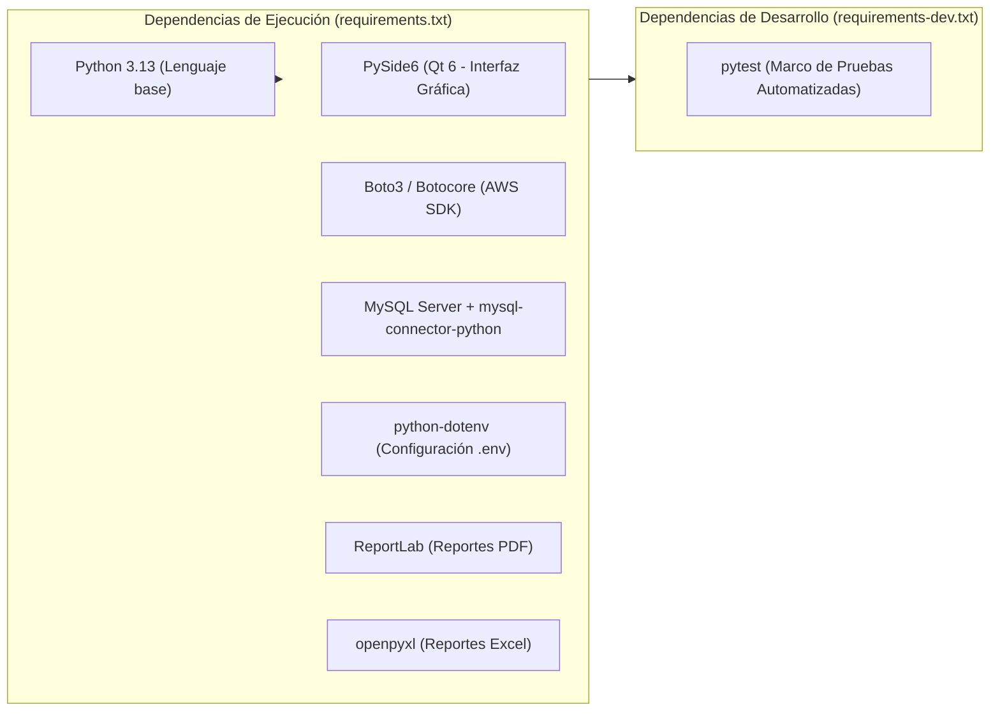
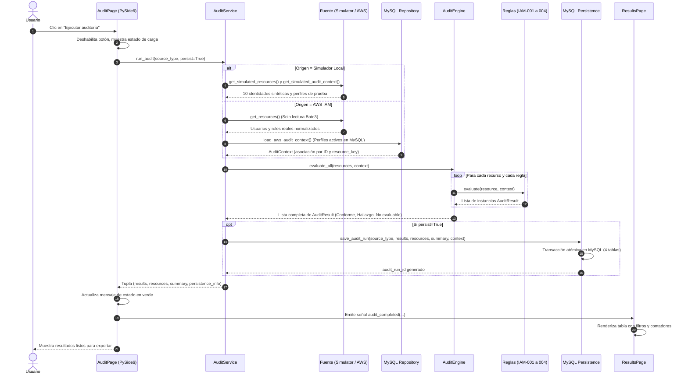
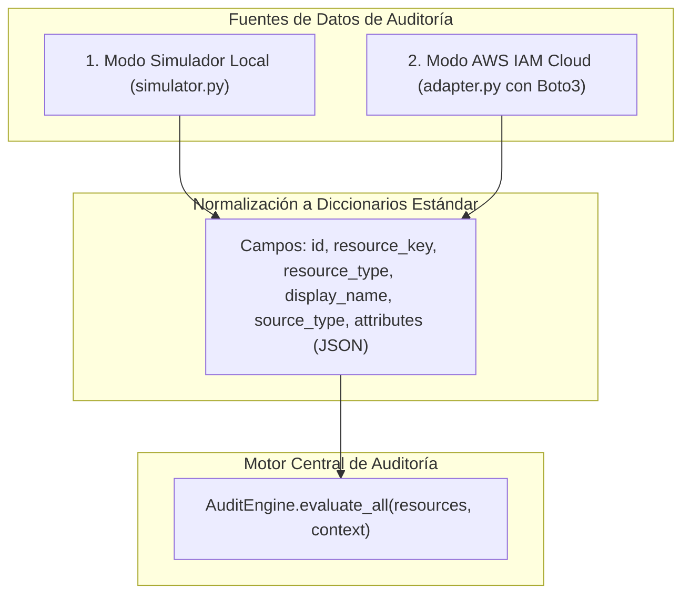
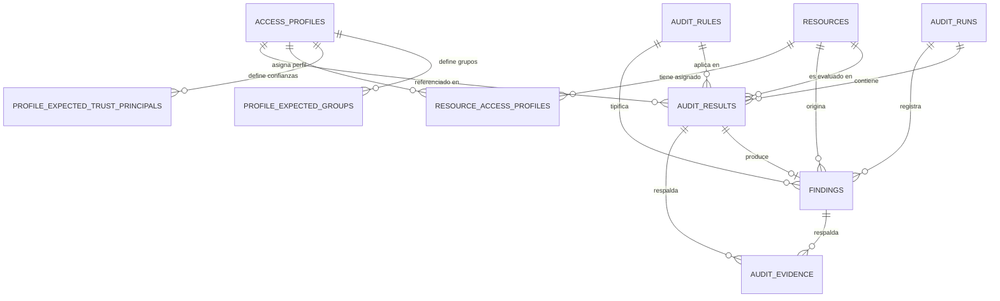

# DOCUMENTACIÓN TÉCNICA INTEGRAL DEL SISTEMA DE AUDITORÍA IAM
## Modelo Automatizado para la Auditoría de Gestión de Identidades y Accesos en Entornos de Nube Basado en el Estándar ISO/IEC 27001 para UPHARVEN C.A.

**Documento:** Manual Técnico Integral de Arquitectura, Dominio e Implementación de Software  
**Fecha:** Noviembre 2026  
**Versión del Prototipo:** 1.0.0  
**Autoría Técnica:** Unidad de Investigación y Desarrollo de Software para UPHARVEN C.A.  
**Propósito:** Guía de estudio, defensa técnica de grado y referencia de ingeniería de software  

---

## ÍNDICE GENERAL

1. [CAPÍTULO 1: Introducción Técnica](#capítulo-1-introducción-técnica)
2. [CAPÍTULO 2: Tecnologías Utilizadas y Dependencias](#capítulo-2-tecnologías-utilizadas-y-dependencias)
3. [CAPÍTULO 3: Arquitectura del Sistema y Flujo de Datos](#capítulo-3-arquitectura-del-sistema-y-flujo-de-datos)
4. [CAPÍTULO 4: Punto de Entrada e Interfaz Gráfica de Usuario (PySide6)](#capítulo-4-punto-de-entrada-e-interfaz-gráfica-de-usuario-pyside6)
5. [CAPÍTULO 5: Motor Central de Auditoría Algorítmica y Modelos de Dominio](#capítulo-5-motor-central-de-auditoría-algorítmica-y-modelos-de-dominio)
6. [CAPÍTULO 6: Catálogo de Reglas Técnicas de Auditoría ISO/IEC 27001](#capítulo-6-catálogo-de-reglas-técnicas-de-auditoría-isoiec-27001)
7. [CAPÍTULO 7: Fuentes de Información: Simulador Local y Adaptador AWS IAM](#capítulo-7-fuentes-de-información-simulador-local-y-adaptador-aws-iam)
8. [CAPÍTULO 8: Modelo Relacional de Base de Datos y Persistencia Transaccional](#capítulo-8-modelo-relacional-de-base-de-datos-y-persistencia-transaccional)
9. [CAPÍTULO 9: Panel de Control (Dashboard), Historial y Módulos de Reportes](#capítulo-9-panel-de-control-dashboard-historial-y-módulos-de-reportes)
10. [CAPÍTULO 10: Seguridad del Sistema y Restricciones de Alcance](#capítulo-10-seguridad-del-sistema-y-restricciones-de-alcance)
11. [CAPÍTULO 11: Estrategia de Pruebas Automatizadas y Validación](#capítulo-11-estrategia-de-pruebas-automatizadas-y-validación)
12. [CAPÍTULO 12: Guía de Instalación, Configuración y Despliegue](#capítulo-12-guía-de-instalación-configuración-y-despliegue)
13. [CAPÍTULO 13: Limitaciones Técnicas y Líneas de Trabajo Futuro](#capítulo-13-limitaciones-técnicas-y-líneas-de-trabajo-futuro)
14. [CAPÍTULO 14: Glosario Técnico de Términos](#capítulo-14-glosario-técnico-de-términos)

---

## CAPÍTULO 1. INTRODUCCIÓN TÉCNICA

### 1.1. Propósito del Sistema
El **Sistema de Auditoría IAM** es una solución de software de escritorio concebida para automatizar la revisión técnica, sistemática y determinista de las configuraciones de Gestión de Identidades y Accesos (IAM, por sus siglas en inglés: *Identity and Access Management*) en infraestructuras de computación en la nube alojadas sobre Amazon Web Services (AWS), tomando como marco normativo de referencia el estándar internacional **ISO/IEC 27001:2022**.

El sistema recopila metadatos de identidades (usuarios humanos y roles de servicio), inspecciona las políticas de privilegios en formato JSON, evalúa la activación de mecanismos de autenticación robusta y verifica la actividad temporal de credenciales, emitiendo veredictos estructurados de conformidad técnica.

### 1.2. Problema Técnico que Aborda
En las organizaciones modernas que adoptan modelos de nube pública, la gestión de identidades y privilegios se vuelve altamente dinámica y compleja. Con frecuencia se observan desviaciones de seguridad como:
1. **Acumulación de privilegios excesivos (*privilege creep*):** Usuarios que reciben políticas administrativas globales con comodines (`"Action": "*"` y `"Resource": "*"`) por facilidad operativa, vulnerando el principio de menor privilegio.
2. **Cuentas inactivas o huérfanas:** Credenciales que no registran actividad durante meses o años y que, al no ser deshabilitadas oportunamente, se convierten en vectores potenciales de acceso no autorizado.
3. **Ausencia de Autenticación Multifactor (MFA):** Identidades de acceso directo por consola sin segundo factor de autenticación habilitado.
4. **Relaciones de confianza desalineadas en roles:** Roles de servicio con políticas de asunción (*Trust Policies*) que permiten a entidades no aprobadas asumir privilegios elevados.
5. **Errores humanos y lentitud en revisiones manuales:** Las auditorías tradicionales basadas en inspección manual sobre la consola web de AWS son lentas, propensas al error humano y difíciles de contrastar contra matrices formales de acceso.

El sistema resuelve esta problemática proporcionando un motor algorítmico independiente que ejecuta evaluaciones en cuestión de segundos, garantiza la reproducibilidad de los resultados y genera evidencias técnicas inmutables.

### 1.3. Objetivo General de la Solución
Desarrollar un modelo automatizado y su correspondiente prototipo de software para la auditoría técnica de identidades y accesos en AWS IAM, alineado con cuatro controles clave del Anexo A de la norma ISO/IEC 27001:2022, que permita diagnosticar el nivel de cumplimiento de UPHARVEN C.A., registrar hallazgos de forma transaccional y exportar informes ejecutivos y técnicos para la toma de decisiones.

### 1.4. Alcance y Limitaciones Generales
- **Alcance Operativo:** El sistema audita exclusivamente el **plano de gestión de identidades** (AWS IAM). Inspecciona usuarios, grupos, roles, políticas administradas, políticas inline, dispositivos MFA y fechas de uso de claves de acceso.
- **Fuentes Soportadas:** Admite dos fuentes de datos: un **Simulador Local sintético** (para demostraciones autónomas y pruebas de laboratorio) y un **Adaptador AWS IAM en la nube** (que realiza consultas de solo lectura mediante el SDK Boto3).
- **Delimitación de Red y Plataforma:** No audita sistemas operativos de máquinas virtuales (EC2), contenedores (Docker/ECS), almacenamiento de datos (S3) ni redes virtuales (VPC, Security Groups).

### 1.5. Diferencia Fundamental entre Auditoría Técnica y Certificación ISO/IEC 27001
Es de vital importancia que la autora y los evaluadores comprendan con precisión la distinción epistemológica y normativa entre una **auditoría técnica automatizada** y una **certificación formal de conformidad**:

| Dimensión | Auditoría Técnica Automatizada (Este Sistema) | Certificación ISO/IEC 27001 Formal |
| :--- | :--- | :--- |
| **Naturaleza** | Herramienta tecnológica de diagnóstico y verificación algorítmica de parámetros de software. | Proceso formal de evaluación de la conformidad conducido por un Organismo de Certificación Acreditado. |
| **Objeto de Evaluación** | Configuraciones técnicas concretas en AWS IAM (JSON, booleanos, marcas temporales, pertenencias). | El Sistema de Gestión de Seguridad de la Información (SGSI) completo de la organización. |
| **Alcance Normativo** | Cuatro controles técnicos específicos del Anexo A (5.15, 5.16, 5.18 y 8.5). | Cláusulas obligatorias 4 a 10 (Contexto, Liderazgo, Planificación, Soporte, Operación, Desempeño, Mejora) más los 93 controles del Anexo A. |
| **Resultado Emitido** | Informe técnico con estados: `Conforme`, `Hallazgo` o `No evaluable`, respaldados por volcados de datos. | Certificado oficial emitido por auditores líderes acreditados tras auditorías de Fase 1 y Fase 2. |
| **Efecto Jurídico** | Insumo interno de control, diagnóstico preliminar y evidencia técnica de cumplimiento. | Acreditación internacional con validez comercial y legal ante terceros. |

> **Declaración explícita para la defensa:** El sistema **no certifica** a UPHARVEN C.A. ante la norma ISO/IEC 27001. Constituye un instrumento técnico automatizado que asiste al auditor interno o externo en la recolección de evidencias y el cálculo determinista del cumplimiento técnico de los controles de identidad seleccionados.

---

## CAPÍTULO 2. TECNOLOGÍAS UTILIZADAS Y DEPENDENCIAS

El proyecto fue diseñado utilizando tecnologías maduras del ecosistema de software libre y empresarial de Python, asegurando portabilidad, estabilidad y facilidad de replicación.



### 2.1. Python (Versión 3.13)
- **Qué es:** Lenguaje de programación interpretado, multiparadigma, de alto nivel y tipado dinámico fuerte.
- **Por qué se utiliza:** Es el estándar de facto para la automatización de infraestructura en la nube, ciberseguridad e integración con APIs de AWS. Ofrece soporte nativo para manipulación de estructuras JSON, tipos inmutables (`dataclasses`, `frozenset`), manejo robusto de excepciones y amplia compatibilidad multiplataforma.
- **Función en el proyecto:** Ejecuta la totalidad del sistema: el motor algorítmico, la interfaz de usuario, los adaptadores de red y la capa de persistencia.

### 2.2. PySide6 (Qt 6 para Python)
- **Qué es:** Conjunto oficial de *bindings* de Python para la biblioteca gráfica **Qt 6**, mantenido por The Qt Company.
- **Por qué se utiliza:** Permite construir aplicaciones de escritorio nativas con aceleración gráfica, arquitectura orientada a eventos mediante el mecanismo de **Señales y Slots (*Signals and Slots*)**, diseño desacoplado y soporte para hojas de estilo avanzadas (QSS).
- **Función en el proyecto:** Implementa la ventana principal (`MainWindow`), la navegación lateral dinámica (`QStackedWidget`), el panel de control con gráficos interactivos (`QtCharts`), las tablas de resultados con ordenamiento y los diálogos modales de información.

### 2.3. Boto3 y Botocore
- **Qué son:** **Boto3** es el kit de desarrollo de software (SDK) oficial de Amazon Web Services para Python. **Botocore** es la biblioteca subyacente que gestiona las firmas criptográficas de solicitudes HTTP (Signature Version 4), la serialización/deserialización de mensajes y la resolución de endpoints.
- **Por qué se utilizan:** Es la vía estándar, homologada y segura para interactuar programáticamente con los servicios de AWS. Provee mecanismos de paginación automática (`Paginator`) y una herramienta de simulación de protocolos en memoria denominada `botocore.stub.Stubber`.
- **Función en el proyecto:** El módulo [`adapter.py`](file:///c:/Users/andre/Desktop/TESIS/sistema/src/auditoria_iam/data_sources/aws/adapter.py) utiliza Boto3 para consultar usuarios, roles, grupos, políticas y credenciales desde AWS IAM.

### 2.4. AWS IAM (Identity and Access Management)
- **Qué es:** El servicio web de AWS que controla de forma centralizada la autenticación y autorización de identidades para acceder a los recursos en la nube de Amazon.
- **Función en el proyecto:** Es el objeto de auditoría de la solución. El sistema analiza las configuraciones de este servicio para contrastarlas contra la norma ISO 27001.

### 2.5. MySQL Server y MySQL Connector/Python
- **Qué son:** **MySQL Server** es un sistema de gestión de bases de datos relacionales (RDBMS) de código abierto ampliamente utilizado en entornos corporativos. **MySQL Connector/Python** es el controlador oficial de Oracle escrito en Python puro para comunicarse con el servidor mediante el protocolo de red nativo de MySQL.
- **Por qué se utilizan:** Garantizan el cumplimiento de las propiedades **ACID** (Atomicidad, Consistencia, Aislamiento y Durabilidad) requeridas para la persistencia de auditorías legales y de seguridad.
- **Función en el proyecto:** Almacena el historial inmutable de ejecuciones, los resultados granulares por criterio, los hallazgos con sus severidades, las evidencias técnicas y los perfiles de acceso autorizados de referencia.

### 2.6. python-dotenv
- **Qué es:** Biblioteca que analiza sintácticamente archivos en formato `.env` y carga sus pares clave-valor como variables de entorno del sistema operativo (`os.environ`).
- **Por qué se utiliza:** Aplica el principio de diseño de aplicaciones modernas (*The Twelve-Factor App*), separando estrictamente la configuración y credenciales del código fuente.
- **Función en el proyecto:** Permite que [`settings.py`](file:///c:/Users/andre/Desktop/TESIS/sistema/src/auditoria_iam/config/settings.py) lea los parámetros de conexión a MySQL (`DB_HOST`, `DB_PORT`, etc.) sin hardcodear datos sensibles.

### 2.7. ReportLab
- **Qué es:** Motor de composición y generación programática de documentos PDF vectoriales de alta calidad en Python.
- **Por qué se utiliza:** Permite construir informes imprimibles con diseño profesional, paginación dinámica en dos pasadas, control exacto de márgenes, tablas con ajuste de celdas y gráficos circulares generados por código.
- **Función en el proyecto:** Construye el informe ejecutivo en PDF emitido por [`pdf_report.py`](file:///c:/Users/andre/Desktop/TESIS/sistema/src/auditoria_iam/reports/pdf_report.py).

### 2.8. openpyxl
- **Qué es:** Biblioteca de Python especializada en la lectura, edición y escritura de libros de cálculo en formato Office Open XML (`.xlsx`).
- **Por qué se utiliza:** Genera hojas de cálculo nativas con soporte para múltiples pestañas, encabezados con formato, autofiltros y celdas estilizadas.
- **Función en el proyecto:** Genera el archivo Excel de auditoría estructurado en cuatro hojas (`Resumen`, `Evaluaciones`, `Hallazgos`, `Evidencias`) mediante [`excel_report.py`](file:///c:/Users/andre/Desktop/TESIS/sistema/src/auditoria_iam/reports/excel_report.py).

### 2.9. pytest
- **Qué es:** Marco maduro de pruebas automatizadas para Python que admite aserciones nativas (`assert`), fixtures parametrizadas y reporte detallado de cobertura.
- **Por qué se utiliza:** Permite validar regresión cero, ejecutar suites de pruebas unitarias y de integración complejas y aislar componentes mediante mocks y stubs.
- **Función en el proyecto:** Ejecuta la batería de **309 casos de prueba** que validan la correctitud del motor, las reglas, la interfaz y el adaptador AWS.

### 2.10. Clasificación de Dependencias (Ejecución vs. Desarrollo)
- **Dependencias de Ejecución (`requirements.txt`):** Indispensables para que el usuario final inicie y utilice la aplicación: `boto3`, `PySide6`, `mysql-connector-python`, `python-dotenv`, `reportlab`, `openpyxl`.
- **Dependencias de Desarrollo (`requirements-dev.txt`):** Requeridas exclusivamente por desarrolladores y evaluadores para ejecutar la suite de pruebas automatizadas: `pytest>=8.0.0` (incluye por referencia a `requirements.txt`).

---

## CAPÍTULO 3. ARQUITECTURA DEL SISTEMA Y FLUJO DE DATOS

### 3.1. Arquitectura en Capas Desacoplada (Clean Architecture)
El sistema está estructurado en seis capas horizontales estrictamente desacopladas. Una regla fundamental del diseño es que **las dependencias apuntan hacia adentro**: las capas externas (UI, persistencia, Boto3) conocen a las capas internas, pero el motor de auditoría y los modelos de dominio no tienen ninguna dependencia de la interfaz gráfica ni de la base de datos MySQL.

```mermaid
flowchart TD
    subgraph CapaPresentacion["1. Capa de Presentación (PySide6)"]
        UI_MAIN["MainWindow (Ventana Principal)"]
        P_HOME["HomePage (Dashboard)"]
        P_AUDIT["AuditPage (Ejecución)"]
        P_RES["ResultsPage (Detalle)"]
        P_HIST["HistoryPage (Historial)"]
        P_SETT["SettingsPage (Configuración)"]
        UI_CAT["ControlsCatalog / IsoControlDetailDialog"]
    end

    subgraph CapaAplicacion["2. Capa de Aplicación"]
        SVC["AuditService (Orquestador de Casos de Uso)"]
    end

    subgraph CapaDominio["3. Capa de Dominio y Motor (Agnóstica)"]
        AE["AuditEngine (Coordinador Algorítmico)"]
        AC["AuditContext (Perfiles Autorizados de Referencia)"]
        AR["AuditResult (Modelo Uniforme de Evaluación)"]
        R1["RuleIAM001 (Control 5.15 - Acceso)"]
        R2["RuleIAM002 (Control 5.16 - Identidades)"]
        R3["RuleIAM003 (Control 5.18 - Derechos)"]
        R4["RuleIAM004 (Control 8.5 - Autenticación)"]
    end

    subgraph CapaFuentes["4. Capa de Fuentes de Datos"]
        SIM["IAMSimulatorDataSource (Dataset Sintético)"]
        AWS["AWSIAMDataSource (Boto3 - Solo Lectura)"]
    end

    subgraph CapaPersistencia["5. Capa de Persistencia e Infraestructura (MySQL)"]
        PERS["persistence.py (save_audit_run - Transaccional)"]
        REPO["repository.py (Consultas de Lectura)"]
        CONN["connection.py (Gestores de Conexión y Contexto)"]
        CONF["settings.py (Carga Defensiva de .env)"]
    end

    subgraph CapaReportes["6. Capa de Reportería"]
        RD["report_data.py (Normalizador Agnóstico)"]
        PDF["pdf_report.py (ReportLab)"]
        XLS["excel_report.py (openpyxl)"]
        CSV["csv_report.py (CSV UTF-8 BOM)"]
    end

    %% Relaciones
    UI_MAIN --> P_HOME & P_AUDIT & P_RES & P_HIST & P_SETT
    P_HOME --> UI_CAT
    P_HOME & P_AUDIT & P_RES & P_HIST --> SVC

    SVC --> AE
    SVC --> SIM
    SVC --> AWS
    SVC --> PERS
    SVC --> REPO
    SVC --> RD
    SVC --> PDF & XLS & CSV

    AE --> R1 & R2 & R3 & R4
    AE --> AR & AC
    R1 & R2 & R3 & R4 --> AR & AC

    PERS --> CONN
    REPO --> CONN
    CONN --> CONF
```



### 3.2. Mecanismos de Comunicación y Patrones de Diseño
1. **Patrón Fachada (*Facade Pattern*):** La clase [`AuditService`](file:///c:/Users/andre/Desktop/TESIS/sistema/src/auditoria_iam/application/audit_service.py) actúa como fachada unificada. La interfaz gráfica no necesita saber cómo se conecta Boto3, cómo evalúa el motor ni cómo se insertan los registros en MySQL; simplemente llama a métodos de alto nivel como `run_simulated_audit()` o `run_aws_audit()`.
2. **Patrón Estrategia / Polimorfismo (*Strategy Pattern*):** Todas las reglas técnicas heredan de la clase base abstracta [`BaseAuditRule`](file:///c:/Users/andre/Desktop/TESIS/sistema/src/auditoria_iam/audit/rules/base.py) e implementan el método `evaluate(resource, context)`. El motor puede evaluar cualquier regla registrada sin conocer los detalles internos de cada control ISO.
3. **Mecanismo de Señales y Slots (*Signals & Slots*):** La comunicación entre páginas de la interfaz gráfica es puramente reactiva. Cuando `AuditPage` termina una auditoría, emite la señal `audit_completed(results, resources, summary)`. `MainWindow` captura la señal y delega la actualización a `ResultsPage` y `HomePage` sin acoplamiento directo entre vistas.
4. **Gestores de Contexto (*Context Managers*):** Para la base de datos se implementan generadores decorados con `@contextmanager` en [`connection.py`](file:///c:/Users/andre/Desktop/TESIS/sistema/src/auditoria_iam/database/connection.py): `get_db_cursor()` (para lecturas seguras) y `get_db_transaction()` (para transacciones de escritura con `commit()` o `rollback()` obligatorio y cierre garantizado en bloque `finally`).

### 3.3. Diagrama Mermaid del Flujo General de una Auditoría



---

## CAPÍTULO 4. PUNTO DE ENTRADA E INTERFAZ GRÁFICA DE USUARIO (PYSIDE6)

### 4.1. Punto de Entrada Oficial (`main.py`)
La ejecución del aplicativo inicia en el archivo [`main.py`](file:///c:/Users/andre/Desktop/TESIS/sistema/main.py) ubicado en la raíz del proyecto. El flujo secuencial es el siguiente:
1. Se importa `sys` y la clase `QApplication` de `PySide6.QtWidgets`.
2. Se define la función `main()`, que instancia el objeto central de la aplicación:
   ```python
   app = QApplication(sys.argv)
   app.setApplicationName("Sistema de Auditoría IAM")
   app.setOrganizationName("UPHARVEN C.A.")
   ```
3. Se instancia la ventana principal: `window = MainWindow()`.
4. Se invoca `window.show()`, lo que hace visible la ventana en el escritorio del sistema operativo.
5. Se inicia el bucle de eventos mediante `sys.exit(app.exec())`, el cual captura eventos del ratón, teclado y señales del sistema operativo hasta que el usuario cierra la ventana.

### 4.2. Estructura de la Ventana Principal (`MainWindow`)
La clase [`MainWindow`](file:///c:/Users/andre/Desktop/TESIS/sistema/src/auditoria_iam/ui/main_window.py) hereda de `QMainWindow`. Aplica una hoja de estilo global denominada `CYBER_SECURITY_STYLE` (definida en [`styles.py`](file:///c:/Users/andre/Desktop/TESIS/sistema/src/auditoria_iam/ui/styles.py)) que establece un tema visual oscuro profesional con tonos azul marino (*slate/navy*), tipografías claras y bordes redondeados.

La interfaz se divide en dos áreas principales mediante un diseño horizontal (`QHBoxLayout`):
1. **Panel Lateral Izquierdo (*Sidebar*):** Marco fijo de 240 píxeles de ancho con el logotipo institucional y un grupo exclusivo de botones de navegación (`QButtonGroup`).
2. **Área Central Dinámica (`QStackedWidget`):** Contenedor de páginas apiladas donde solo una vista es visible a la vez, garantizando una transición inmediata y fluida sin recargar ventanas independientes.

### 4.3. Las Cinco Vistas Funcionales del Sistema

| Índice | Vista | Clase PySide6 | Archivo | Responsabilidad Principal |
| :---: | :--- | :--- | :--- | :--- |
| **0** | **Inicio (Dashboard)** | `HomePage` | `pages/home_page.py` | Métricas ejecutivas (KPIs), gráfico circular interactivo, tarjeta de última auditoría, resumen por control ISO y acceso al catálogo de controles. |
| **1** | **Ejecutar auditoría** | `AuditPage` | `pages/audit_page.py` | Selector de fuentes (Simulador / AWS IAM), botón reactivo de ejecución y panel de estado operativo. |
| **2** | **Resultados** | `ResultsPage` | `pages/results_page.py` | Tabla detallada con los veredictos algorítmicos, barra de filtros reactivos por regla y estado, y botones de exportación a PDF, Excel y CSV. |
| **3** | **Historial** | `HistoryPage` | `pages/history_page.py` | Registro cronológico de auditorías guardadas en MySQL, selección de ejecuciones pasadas y exportación directa. |
| **4** | **Configuración** | `SettingsPage` | `pages/settings_page.py` | Vista demostrativa de parámetros de conexión y umbrales operativos (diseño estricto que no muta credenciales ni altera el `.env`). |

### 4.4. Diálogo Modal de Detalle de Controles (`IsoControlDetailDialog`)
Al hacer clic en cualquier control del catálogo en el Dashboard, se abre una ventana modal emergente implementada por la clase [`IsoControlDetailDialog`](file:///c:/Users/andre/Desktop/TESIS/sistema/src/auditoria_iam/ui/dialogs/control_detail_dialog.py). Este diálogo presenta:
- El objetivo formal de seguridad según ISO/IEC 27001:2022.
- El aspecto técnico específico auditado en AWS IAM.
- Los criterios de evaluación (`C15-01`, `C18-01`, etc.).
- El significado normativo de los estados `Conforme`, `Hallazgo` y `No evaluable`.
- La nota de delimitación de alcance que aclara el carácter diagnóstico del prototipo.

---

## CAPÍTULO 5. MOTOR DE AUDITORÍA Y MODELOS DE DOMINIO

### 5.1. Responsabilidad del Motor (`AuditEngine`)
La clase [`AuditEngine`](file:///c:/Users/andre/Desktop/TESIS/sistema/src/auditoria_iam/audit/engine.py) es el núcleo algorítmico del proyecto. Su función es recibir colecciones de recursos normalizados y coordinar la ejecución de las reglas técnicas registradas de forma puramente determinista.

**Características de diseño:**
- **Independencia absoluta:** No realiza operaciones de entrada/salida (I/O), no se conecta a bases de datos ni emite peticiones de red.
- **Registro dinámico de reglas:** Al instanciarse, registra por defecto las cuatro reglas técnicas mediante `register_rule()`.
- **Evaluación granular:** Permite evaluar un único recurso (`evaluate_resource()`) o una lista completa (`evaluate_all()`), con la posibilidad de filtrar un subconjunto de reglas mediante códigos específicos (ej. `rule_codes=['IAM-001', 'IAM-004']`).

### 5.2. Captura Defensiva de Excepciones en el Motor
Si una regla técnica falla internamente debido a un error de programación imprevisto o un formato de datos totalmente anómalo, el motor aplica una política de **captura defensiva** en `evaluate_resource()`:
```python
except Exception as exc:
    logger.error(f"Error imprevisto ejecutando {rule.rule_code} en recurso {resource_id}: {exc}")
    results.append(
        AuditResult(
            rule_code=rule.rule_code,
            criterion_code=f"ERR-{rule.iso_control}",
            resource_id=resource_id,
            result_status="No evaluable",
            justification=f"Error durante la ejecución técnica de la regla {rule.rule_code}: {type(exc).__name__}.",
            profile_id=None,
            details={"error_type": type(exc).__name__, "rule_code": rule.rule_code},
            evidence={"error_type": type(exc).__name__}
        )
    )
```
Esto garantiza que **una falla en una regla jamás interrumpe la auditoría general** y, fundamentalmente, **nunca convierte una falla en un resultado Conforme**.

### 5.3. Significado Normativo de los Tres Estados de Evaluación
El motor opera exclusivamente con el conjunto de estados inmutables `VALID_STATUSES = {"Conforme", "Hallazgo", "No evaluable"}`:
- **`Conforme`:** La configuración analizada satisface estrictamente la condición de seguridad estipulada en el control ISO/IEC 27001 y coincide con la línea base autorizada.
- **`Hallazgo`:** Se identifica una vulnerabilidad, desviación técnica, configuración insegura o exceso de privilegios que contraviene el control. Genera un registro en la tabla `findings` con severidad formal y recomendación técnica de remediación.
- **`No evaluable`:** **Principio de prevención de falsos conformes.** Se emite cuando faltan datos requeridos para emitir un juicio riguroso (por ejemplo: la política JSON no pudo descargarse por falta de permisos en AWS, la identidad no tiene perfil de acceso asignado en MySQL o los metadatos están malformados). Impedir falsos conformes es un principio de seguridad crítico: ante la duda, no se asume seguridad.

### 5.4. Modelos de Dominio (`models.py`)

#### La clase `AuditResult`
Es un objeto de datos (`@dataclass`) inmutable que encapsula el resultado de evaluar un criterio de auditoría sobre un recurso específico.
- **Campos obligatorios:** `rule_code` (str), `criterion_code` (str), `resource_id` (int o str), `result_status` (str, validado contra `VALID_STATUSES`), `justification` (str, no vacío).
- **Campos opcionales:** `profile_id` (int o str), `details` (dict), `evidence` (dict).
- **Validación interna:** En su método `__post_init__()` valida la presencia obligatoria de los campos clave y lanza `ValueError` si el estado no pertenece a los tres permitidos.

#### La clase `AuditContext`
Es el contenedor de la **línea base de referencia autorizada** contra la cual se contrastan las identidades reales:
- `profiles`: Diccionario de perfiles activos (`id -> dict`).
- `expected_groups`: Mapeo de grupos IAM autorizados para perfiles de usuario (`profile_id -> List[str]`).
- `expected_trust_principals`: Mapeo de entidades de confianza autorizadas para perfiles de rol (`profile_id -> List[dict]`).
- `resource_profiles`: Asociación directa por clave primaria numérica (`resource_id -> profile_id`).
- `resource_key_profiles`: Asociación unívoca por clave textual natural (`resource_key -> profile_id`), indispensable para recursos de AWS cuyo identificador interno difiere de la base de datos local.
- `get_profile_for_resource(resource_id, resource_key)`: Resuelve el perfil activo del recurso primero por ID numérico y luego por clave textual exacta, sin admitir aproximaciones heurísticas.

---

## CAPÍTULO 6. REGLAS DE AUDITORÍA IAM (ISO/IEC 27001:2022)

Cada regla técnica está implementada en un módulo independiente dentro del paquete [`src/auditoria_iam/audit/rules/`](file:///c:/Users/andre/Desktop/TESIS/sistema/src/auditoria_iam/audit/rules/) y hereda de `BaseAuditRule`.

---

### 6.1. Regla IAM-001: Control de Acceso (ISO 27001:2022 Control 5.15)
- **Archivo:** [`iam_001_access_control.py`](file:///c:/Users/andre/Desktop/TESIS/sistema/src/auditoria_iam/audit/rules/iam_001_access_control.py)
- **Control ISO asociado:** **5.15** (*Control de acceso*).
- **Severidad por defecto:** `ALTA`.
- **Objetivo:** Verificar que las identidades posean asignaciones lógicas de acceso estrictamente alineadas con los perfiles de referencia formalmente aprobados por la organización.
- **Información que necesita:** Pertenencias a grupos IAM (para usuarios), documento de política de asunción `AssumeRolePolicyDocument` (para roles), y el perfil de referencia activo en `AuditContext`.
- **Criterios evaluados:**
  - `C15-01` (Usuarios): Compara el conjunto de grupos reales del usuario frente a los grupos esperados del perfil.
    - *Conforme:* Los grupos reales coinciden de forma exacta con los grupos esperados.
    - *Hallazgo:* Se detectan grupos adicionales no autorizados o faltan grupos requeridos por el perfil.
  - `C15-02` (Roles): Inspecciona las cláusulas `Principal` y `Action` dentro de las declaraciones `Allow` de la política de asunción del rol.
    - *Conforme:* Todas las entidades principales que pueden asumir el rol pertenecen a la lista blanca de confianza del perfil.
    - *Hallazgo:* Se detectan entidades no autorizadas (ej. comodín `"AWS": "*"` o servicios ajenos).
  - `C15-03` (Disponibilidad del perfil): Se emite cuando la identidad carece de un perfil asignado o el perfil se encuentra inactivo. Dictamina `No evaluable` de forma fundamentada.
- **Ejemplo didáctico:** El usuario simulado `ana.operaciones` tiene asignados los grupos `['Operaciones', 'LecturaContratos']`. Su perfil `PRF-USR-OPERACIONES` autoriza exactamente esos dos grupos $\rightarrow$ Resultado: `C15-01: Conforme`. Si se le agrega manualmente el grupo `Administradores` $\rightarrow$ Resultado: `C15-01: Hallazgo` por grupos excedentes.

---

### 6.2. Regla IAM-002: Gestión de Identidades (ISO 27001:2022 Control 5.16)
- **Archivo:** [`iam_002_identity_management.py`](file:///c:/Users/andre/Desktop/TESIS/sistema/src/auditoria_iam/audit/rules/iam_002_identity_management.py)
- **Control ISO asociado:** **5.16** (*Gestión de identidades*).
- **Severidad por defecto:** `MEDIA`.
- **Objetivo:** Auditar el ciclo de vida de las identidades digitales, detectando cuentas inactivas o credenciales en desuso prolongado que deban suspenderse o revocarse.
- **Aclaración normativa fundamental:** El umbral de inactividad de **90 días** utilizado por defecto en el sistema es un **parámetro técnico configurable del prototipo** adaptado para UPHARVEN C.A. La norma ISO/IEC 27001:2022 no impone textualmente un plazo rígido de 90 días; exige a la organización definir y aplicar procedimientos para la gestión del ciclo de vida y revocación oportuna.
- **Criterios evaluados:**
  - `C16-01` (Estado de vigencia): Comprueba el atributo `resource_status` de la identidad.
    - *Conforme:* La cuenta se encuentra en estado `'activo'`.
    - *Hallazgo:* La cuenta está marcada como `'inactivo'`, `'deshabilitado'` o `'suspendido'`, evidenciando identidades no desprovisionadas.
  - `C16-02` (Actividad reciente): Evalúa los días transcurridos desde el último acceso registrado (`last_access_days`, obtenido de la contraseña de consola o de las claves de acceso de Boto3).
    - *Conforme:* El recurso registra actividad reciente dentro del umbral (días $\le 90$).
    - *Hallazgo:* Los días de inactividad superan el umbral (días $> 90$).
    - *No evaluable:* El recurso no cuenta con registros históricos de actividad ni fecha de último uso.

---

### 6.3. Regla IAM-003: Derechos de Acceso (ISO 27001:2022 Control 5.18)
- **Archivo:** [`iam_003_access_rights.py`](file:///c:/Users/andre/Desktop/TESIS/sistema/src/auditoria_iam/audit/rules/iam_003_access_rights.py)
- **Control ISO asociado:** **5.18** (*Derechos de acceso*).
- **Severidad por defecto:** `CRITICA`.
- **Objetivo:** Analizar estáticamente el contenido de los documentos JSON de políticas de IAM (tanto administradas como inline) para detectar privilegios excesivos e irrestrictos globales.
- **Exclusión técnica de alcance:** El control **ISO 8.2** (*Derechos de acceso privilegiado*, que aborda cuentas de emergencia *break-glass* y bóvedas PAM) se encuentra **explícitamente excluido**. Esta regla no utiliza banderas auxiliares como `is_admin=True` ni clasificaciones subjetivas; analiza estrictamente la sintaxis de las políticas JSON.
- **Criterios evaluados:**
  - `C18-01` (Permisos irrestrictos globales): Recorre cada `Statement` del JSON con `Effect: Allow`.
    - *Hallazgo (CRÍTICO):* Se detecta la combinación de comodines globales absolutos: `"Action": "*"` (o `"iam:*"`) junto con `"Resource": "*"`.
    - *Conforme:* Todas las políticas analizadas tienen acciones y recursos acotados a servicios o identificadores específicos sin comodines de superusuario.
    - *No evaluable:* Si el JSON es sintácticamente inválido, o si el adaptador marcó la política con `_incomplete_policy: True` (debido a falta de permisos en AWS para leer el documento), la regla emite `No evaluable`.
  - `C18-02` (Principio de menor privilegio granular): Evalúa la granularidad de las acciones frente a un catálogo formal de permisos autorizados por perfil.
    - *Comportamiento actual:* Al no haberse configurado un catálogo exhaustivo de permisos atómicos esperados en la base de datos, la regla dictamina `No evaluable` de forma controlada y justificada.

---

### 6.4. Regla IAM-004: Autenticación Segura (ISO 27001:2022 Control 8.5)
- **Archivo:** [`iam_004_secure_authentication.py`](file:///c:/Users/andre/Desktop/TESIS/sistema/src/auditoria_iam/audit/rules/iam_004_secure_authentication.py)
- **Control ISO asociado:** **8.5** (*Autenticación segura*).
- **Severidad por defecto:** `ALTA`.
- **Objetivo:** Garantizar que los usuarios con acceso al entorno de nube tengan activada la autenticación multifactor (MFA) para mitigar el riesgo de robo o compromiso de credenciales.
- **Exclusión técnica justificada de roles:** Los recursos de tipo `IAM_ROLE` quedan **explícitamente excluidos** de la evaluación de este control y no generan registros artificiales. Los roles de AWS son asumidos temporalmente mediante llamadas al servicio de token de seguridad (*AWS STS AssumeRole*), no poseen contraseñas ni inicios de sesión interactivos por consola.
- **Criterio evaluado:**
  - `C85-01` (Estado de MFA en usuarios): Evalúa el atributo `mfa_enabled` del usuario (obtenido mediante `list_mfa_devices` en AWS o del atributo simulado).
    - *Conforme:* `mfa_enabled == True`.
    - *Hallazgo:* `mfa_enabled == False`.
    - *No evaluable:* El atributo `mfa_enabled` es nulo, ausente o posee un tipo no booleano.

---

## CAPÍTULO 7. FUENTES DE INFORMACIÓN



### 7.1. Modo Simulación (`simulator.py`)
- **Propósito:** Brindar un entorno de prueba y demostración 100% determinista, autocontenido y desacoplado de la nube y de MySQL.
- **Conjunto de Datos Sintético:** Genera **10 identidades** (6 usuarios IAM y 4 roles IAM):
  - *Usuarios:* `ana.operaciones` (conforme en todo), `carlos.soporte` (con hallazgo de privilegios), `usuario.inactivo` (inactivo $>90$ días), `cuenta.sin_mfa` (sin MFA), `usuario.dev` (conforme), `invitado.temporal` (inactivo y sin perfil).
  - *Roles:* `rol.ec2.operaciones`, `rol.lambda.basico`, `rol.administrador.global`, `rol.no.evaluable`.
- **Volumetría cuantitativa comprobada:** Al ser procesado por las cuatro reglas del motor algorítmico, el dataset genera exactamente **67 evaluaciones**: **40 Conformes**, **15 Hallazgos** y **12 No evaluables**.

### 7.2. Modo AWS IAM Cloud (`adapter.py`)
- **Propósito:** Extraer datos reales de configuración desde una cuenta de AWS utilizando el SDK oficial Boto3.
- **Catálogo Estricto de Operaciones Seguras (`READ_ONLY_OPERATIONS`):**
  El adaptador define una lista blanca inmutable de **21 operaciones permitidas**:
  1. `get_access_key_last_used`
  2. `get_group`
  3. `get_group_policy`
  4. `get_policy`
  5. `get_policy_version`
  6. `get_role`
  7. `get_role_policy`
  8. `get_user`
  9. `get_user_policy`
  10. `list_access_keys`
  11. `list_attached_group_policies`
  12. `list_attached_role_policies`
  13. `list_attached_user_policies`
  14. `list_group_policies`
  15. `list_groups`
  16. `list_groups_for_user`
  17. `list_mfa_devices`
  18. `list_role_policies`
  19. `list_roles`
  20. `list_user_policies`
  21. `list_users`
- **Operaciones Efectivamente Utilizadas en el Código:** El código utiliza activamente **19 operaciones**. Las 2 restantes (`get_user` y `get_role`) forman parte del catálogo seguro pero no se llaman en bucle porque `list_users` y `list_roles` devuelven en lote todos los metadatos necesarios, evitando sobrecostos de latencia y cuotas de API (*throttling*).
- **Mecanismos de Bloqueo Preventivo:**
  Antes de ejecutar cualquier llamada, el método `_validate_safe_operation()` comprueba que la operación pertenezca a la lista blanca y no contenga ninguno de los 15 prefijos prohibidos (`create`, `update`, `delete`, `put`, `attach`, `detach`, etc.).
- **Mapeo Tipificado de Excepciones:**
  Los errores de Boto3 se capturan y traducen a excepciones de dominio en [`exceptions.py`](file:///c:/Users/andre/Desktop/TESIS/sistema/src/auditoria_iam/data_sources/aws/exceptions.py): `AWSIAMAuthenticationError`, `AWSIAMPermissionError` y `AWSIAMConnectionError`, ocultando credenciales sensibles.

---

## CAPÍTULO 8. BASE DE DATOS Y PERSISTENCIA TRANSACCIONAL

### 8.1. Modelo Relacional en MySQL Server (10 Tablas)
El sistema utiliza una base de datos relacional sobre **MySQL Server 8.0/9.6** bajo el motor transaccional **InnoDB** y codificación **`utf8mb4`** con colación `utf8mb4_unicode_ci`.



### 8.2. Descripción Estructural de las Diez Tablas
1. **`audit_runs`:** Maestro de ejecuciones. Almacena `id`, `execution_date`, `source_type` (`simulacion`/`aws`), `status` (`completada`), `total_findings` y el resumen textual.
2. **`resources`:** Inventario de identidades. Clave única `uq_resource_key_source (resource_key, source_type)`. Almacena tipo (`IAM_USER`, `IAM_ROLE`), nombre visible y metadatos técnicos en columna `attributes` de tipo `JSON`.
3. **`audit_rules`:** Catálogo de reglas. Clave única `rule_code` (`IAM-001` a `IAM-004`). Almacena nombre descriptivo, control ISO asociado y severidad por defecto.
4. **`access_profiles`:** Perfiles de acceso autorizados. Restricciones CHECK para `identity_type IN ('user', 'role')` y `status IN ('active', 'inactive', 'deprecated')`.
5. **`profile_expected_groups`:** Grupos IAM permitidos para perfiles de usuario. Clave foránea `fk_peg_profile` hacia `access_profiles(id)`.
6. **`profile_expected_trust_principals`:** Entidades de confianza autorizadas para asumir roles. Clave foránea `fk_petp_profile` hacia `access_profiles(id)`.
7. **`resource_access_profiles`:** Asignación de perfiles a recursos. Utiliza una columna virtual generada `is_active_flag` y una clave única compuesta `uk_resource_single_active_profile (resource_id, is_active_flag)` que **impide físicamente que una identidad tenga dos perfiles activos concurrentes**.
8. **`audit_results`:** Tabla exhaustiva de resultados. Registra cada evaluación individual con restricción CHECK en `result_status IN ('Conforme', 'Hallazgo', 'No evaluable')` y restricción UNIQUE `(audit_run_id, resource_id, audit_rule_id, criterion_code)` para evitar duplicidades en una misma auditoría.
9. **`findings`:** Registra exclusivamente las desviaciones (`result_status = 'Hallazgo'`). Vinculada al resultado mediante `audit_result_id`.
10. **`audit_evidence`:** Almacena volcados técnicos y trazas de auditoría. Implementa la restricción `chk_evidence_target` de **exclusión mutua estricta**: cada evidencia debe apuntar a un hallazgo (`finding_id IS NOT NULL AND audit_result_id IS NULL`) o a una evaluación (`finding_id IS NULL AND audit_result_id IS NOT NULL`), impidiendo registros huérfanos o ambiguos.

### 8.3. Lógica de Persistencia Atómica (`save_audit_run`)
La persistencia es orquestada en [`persistence.py`](file:///c:/Users/andre/Desktop/TESIS/sistema/src/auditoria_iam/database/persistence.py) dentro del gestor `get_db_transaction()`:
1. **Resolución de reglas:** Consulta `audit_rules` por `rule_code`. Si alguna regla requerida no existe en la base de datos, aborta la transacción inmediatamente.
2. **Resolución de recursos por clave natural:** Consulta `resources` por `resource_key` y `source_type`. Resuelve los IDs reales de MySQL sin inventar identificadores de respaldo.
3. **Inserción transaccional:** Inserta en `audit_runs`, luego en `audit_results`, luego en `findings` y finalmente en `audit_evidence`.
4. **Manejo de fallos:** Si ocurre cualquier error de red o base de datos, se ejecuta `connection.rollback()` total y `AuditService` retiene los resultados íntegramente en memoria para que el usuario no pierda su auditoría.

---

## CAPÍTULO 9. PANEL, HISTORIAL E INFORMES

### 9.1. Dashboard Ejecutivo (`HomePage`)
El Dashboard centraliza la visualización de alto nivel del estado de seguridad:
- **Tarjetas de KPIs:** Cuatro tarjetas con contadores numéricos y porcentuales (Total, Conforme, Hallazgo, No evaluable).
- **Gráfico Circular Interactivo:** Muestra la distribución proporcional de resultados con paleta corporativa (Verde para Conforme, Rojo para Hallazgo, Gris para No evaluable).
- **Resumen por Regla ISO:** Barras de estado que indican el porcentaje de conformidad para los controles 5.15, 5.16, 5.18 y 8.5.
- **Acceso a la Norma:** Incluye un enlace web directo para abrir en el navegador la norma ISO/IEC 27001:2022 de acceso público alojada en Internet Archive.

### 9.2. Historial de Auditorías (`HistoryPage`)
Permite la auditoría retrospectiva consultando la tabla `audit_runs` en MySQL. El usuario puede seleccionar cualquier fila histórica y pulsar **“Ver resultados de auditoría”**; el sistema carga los resultados detallados correspondientes en `ResultsPage` sin necesidad de volver a ejecutar la auditoría.

### 9.3. Exportación de Informes Técnicos
La capa [`reports`](file:///c:/Users/andre/Desktop/TESIS/sistema/src/auditoria_iam/reports/) utiliza una función agnóstica de preparación de datos denominada `build_report_data()` que normaliza tanto datos provenientes de MySQL como datos activos en memoria:
- **Informe PDF (`pdf_report.py`):** Utiliza ReportLab con una clase personalizada `NumberedCanvas` que realiza dos pasadas para calcular la numeración total de páginas (*"Página X de Y"*). Incluye portada corporativa, resumen ejecutivo con gráfico vectorial, tablas por control ISO, detalle de hallazgos, evidencias técnicas y descargo formal de responsabilidad técnica.
- **Libro Excel (`excel_report.py`):** Utiliza `openpyxl` para generar un archivo `.xlsx` organizado en 4 hojas de cálculo con autofiltros y formato visual condicional.
- **Archivo CSV (`csv_report.py`):** Exporta una tabla plana delimitada por comas, codificada en `UTF-8 con BOM` (`utf-8-sig`), lo que garantiza que Microsoft Excel en sistemas Windows reconozca tildes y caracteres especiales en español sin requerir conversiones de codificación.

---

## CAPÍTULO 10. SEGURIDAD DEL SISTEMA Y RESTRICCIONES DE ALCANCE

El diseño técnico del proyecto respeta estrictamente **nueve restricciones de alcance** acordadas para la investigación:

1. **Operaciones Boto3 estrictamente de solo lectura:**
   El adaptador AWS únicamente ejecuta operaciones de consulta (`get_*` y `list_*`). La tupla `FORBIDDEN_OPERATION_PREFIXES` bloquea preventivamente 15 prefijos de mutación (`create`, `delete`, `update`, `put`, `attach`, `detach`, etc.). El sistema **no puede modificar ni eliminar recursos en AWS**.
2. **Exclusión de administración especializada y control ISO 8.2:**
   El sistema no audita esquemas de acceso de emergencia (*break-glass*), rotación de cuentas maestras de superusuario ni herramientas de gestión de acceso privilegiado (PAM). La regla IAM-003 audita el control 5.18 mediante análisis estático de políticas JSON.
3. **Exclusión de ciclo de vida de secretos y rotación de credenciales:**
   No se audita la periodicidad de rotación de claves criptográficas en AWS KMS ni la caducidad de certificados SSL/TLS.
4. **Exclusión del plano de datos:**
   El sistema no inspecciona los datos almacenados en buckets de Amazon S3, tablas de Amazon DynamoDB ni registros en bases de datos relacionales RDS. Audita únicamente los permisos lógicos de acceso.
5. **Exclusión del plano de cómputo y sistemas operativos:**
   No se auditan sistemas operativos, parches de seguridad, imágenes de máquinas virtuales (AMI) ni contenedores Docker/Kubernetes.
6. **Exclusión de monitoreo continuo y análisis en tiempo real (SIEM):**
   El sistema opera bajo demanda o en revisiones periódicas discretas. No es un agente de monitoreo continuo ni procesa flujos de eventos en tiempo real de AWS CloudTrail o Amazon GuardDuty.
7. **Análisis exclusivo de políticas IAM en formato JSON:**
   El análisis de permisos se basa en la inspección sintáctica y semántica de las cláusulas JSON de las políticas de IAM. No simula la evaluación en tiempo de ejecución del motor de decisiones de autorización de AWS (*PDP/PEP*).
8. **Exclusión de cláusulas de gestión 4 a 10 de ISO 27001:**
   El prototipo se circunscribe a cuatro controles del Anexo A. No evalúa los procesos organizacionales de liderazgo, planificación, soporte, auditoría interna ni revisión por la dirección del SGSI.
9. **Exclusión de redes y perímetro:**
   No se evalúan topologías de red en la nube, subredes, tablas de enrutamiento, Security Groups, Access Control Lists (NACLs), firewalls ni redes privadas virtuales (VPC).

### 10.1. Protección de Credenciales y Manejo de `.env`
- El archivo de configuración `.env` se encuentra explícitamente excluido del repositorio mediante `.gitignore` y jamás se incluye en paquetes ZIP de entrega.
- Se provee el archivo de plantilla [`.env.example`](file:///c:/Users/andre/Desktop/TESIS/sistema/.env.example) con valores vacíos o ficticios.
- Si las variables de base de datos son inválidas o están vacías, `settings.py` lanza excepciones con mensajes genéricos que **nunca revelan contraseñas ni cadenas de conexión en consola ni en logs**.

---

## CAPÍTULO 11. ESTRATEGIA DE PRUEBAS AUTOMATIZADAS Y VALIDACIÓN

### 11.1. Resultados Oficiales de la Suite de Pruebas
La calidad del software se valida mediante una suite completa ejecutada con `pytest`:
- **Pruebas recopiladas:** **309**
- **Pruebas aprobadas:** **309 (100%)**
- **Pruebas fallidas:** **0**
- **Pruebas omitidas:** **0**
- **Tiempo de ejecución total:** **~9.6 segundos**
- **Código de salida:** **`0`**

### 11.2. Desglose de Pruebas por Módulo

| Archivo de Prueba | Casos | Aspecto Técnico Validado |
| :--- | :---: | :--- |
| `test_audit_engine.py` | 8 | Inicialización del motor, registro de reglas, evaluación individual/múltiple y captura defensiva de excepciones. |
| `test_audit_models.py` | 6 | Validación de estados en `AuditResult`, serialización y resolución de perfiles en `AuditContext`. |
| `test_aws_adapter_stubber.py` | 44 | Interceptación con Boto3 Stubber: 17 operaciones API, paginación, credenciales faltantes, políticas inaccesibles y bloqueo preventivo de 15 operaciones de escritura. |
| `test_aws_data_source.py` | 28 | Normalización de usuarios, grupos, roles, políticas JSON, cálculo de inactividad y dispositivos MFA. |
| `test_aws_end_to_end.py` | 23 | Flujo integral AWS: extracción, evaluación con 4 reglas, persistencia en MySQL, dashboard, reportes y retención en memoria. |
| `test_aws_ui_integration.py` | 23 | Integración de `AuditPage` con AWS, señales Qt, credenciales ausentes y asociación de perfiles activos en BD. |
| `test_connection.py` | 6 | Fábrica de conexiones MySQL, context managers `get_db_cursor` y `get_db_transaction`, y ocultamiento de contraseñas. |
| `test_dashboard.py` | 13 | Métricas ejecutivas en `HomePage`, renderizado del gráfico circular y diálogo modal de controles ISO. |
| `test_dashboard_integration.py` | 12 | Consistencia de indicadores entre el historial de MySQL y el Dashboard sin mezcla entre auditorías. |
| `test_persistence.py` | 16 | Inserción atómica en 4 tablas, resolución por claves naturales, restricciones CHECK y rollback automático. |
| `test_reports.py` | 14 | Generación y estructura de archivos PDF (ReportLab), Excel (openpyxl) y CSV con codificación UTF-8 BOM. |
| `test_repository.py` | 19 | Consultas SELECT parametrizadas de recursos, perfiles activos, grupos esperados, historial y hallazgos. |
| `test_rule_iam_001.py` | 16 | Regla IAM-001 (ISO 5.15): Usuarios con grupos conformes/excedentes/faltantes, roles con confianzas y perfiles ausentes. |
| `test_rule_iam_002.py` | 13 | Regla IAM-002 (ISO 5.16): Cuentas inactivas por estatus, inactividad $>90$ días y manejo de atributos nulos. |
| `test_rule_iam_003.py` | 22 | Regla IAM-003 (ISO 5.18): Comodines globales `*`, políticas restringidas, JSON corrupto y principio de menor privilegio. |
| `test_rule_iam_004.py` | 6 | Regla IAM-004 (ISO 8.5): Usuarios con/sin MFA y exclusión técnica explícita de roles IAM. |
| `test_settings.py` | 13 | Validación estricta de variables en `.env`, rangos de puertos (1-65535) y timeouts positivos. |
| `test_simulator.py` | 9 | Integridad del dataset sintético determinista de 10 recursos y matriz de 67 evaluaciones. |
| `test_ui.py` | 18 | Ciclo de vida de la aplicación PySide6, navegación entre 5 páginas, botones y manejo de errores. |
| **TOTAL** | **309** | **Suite integral de pruebas unitarias, de integración y de interfaz gráfica.** |

### 11.3. Qué Demuestra y Qué NO Demuestra esta Validación
- **Qué demuestra:** Que el código fuente es sintáctica y lógicamente correcto, que las 4 reglas aplican con precisión matemática los criterios de auditoría, que el motor es inmune a fallos imprevistos, que la persistencia relacional es atómica y consistente, que los reportes se generan válidamente y que el adaptador AWS respeta las firmas oficiales del SDK Boto3 y bloquea escrituras.
- **Qué NO demuestra:** No demuestra la ejecución contra una cuenta real de producción de UPHARVEN C.A., dado que la empresa no suministró credenciales activas. Esta distinción debe ser expuesta con total transparencia técnica ante el jurado calificador.

---

## CAPÍTULO 12. INSTALACIÓN Y EJECUCIÓN DEL SISTEMA

### 12.1. Requisitos Previos del Sistema
- **Sistema Operativo:** Windows 10/11 (64-bit), Linux o macOS.
- **Python:** Versión 3.11, 3.12 o 3.13 instalada y agregada al PATH del sistema.
- **Base de Datos:** MySQL Server versión 8.0 o 9.6 ejecutándose localmente o en red.
- **Herramientas recomendadas:** Windows PowerShell y MySQL Workbench.

### 12.2. Procedimiento de Instalación en Windows PowerShell

```powershell
# 1. Acceder al directorio raíz del proyecto
cd c:\Users\andre\Desktop\TESIS\sistema

# 2. Crear el entorno virtual de Python
python -m venv .venv

# 3. Activar el entorno virtual
.\.venv\Scripts\Activate.ps1

# 4. Instalar las dependencias de ejecución y desarrollo
pip install --upgrade pip
pip install -r requirements.txt
pip install -r requirements-dev.txt

# 5. Crear el archivo de configuración a partir de la plantilla
Copy-Item .env.example .env
```

### 12.3. Configuración de Variables de Entorno (`.env`)
Edite el archivo `.env` recién creado asignando los valores correspondientes a su servidor MySQL:
```ini
DB_HOST=localhost
DB_PORT=3306
DB_NAME=auditoria_iam_upharven
DB_USER=root
DB_PASSWORD=su_contraseña_local_aqui
DB_CONNECT_TIMEOUT=10
```

### 12.4. Despliegue de la Base de Datos
Desde MySQL Workbench o la línea de comandos de MySQL, ejecute el script consolidado [`init_database_upharven.sql`](file:///c:/Users/andre/Desktop/TESIS/sistema/init_database_upharven.sql):
```sql
SOURCE init_database_upharven.sql;
```

### 12.5. Inicio de la Aplicación y Ejecución de Pruebas
```powershell
# Ejecutar la aplicación de escritorio
python main.py

# Ejecutar la suite completa de pruebas automatizadas
.\.venv\Scripts\pytest.exe -v
```

---

## CAPÍTULO 13. LIMITACIONES TÉCNICAS Y LÍNEAS DE TRABAJO FUTURO

### 13.1. Estado de las Funcionalidades

| Componente | Estado Actual | Comentarios |
| :--- | :---: | :--- |
| **Simulador de Datos** | **Implementado y Verificado** | Funciona 100% en memoria con dataset determinista de 10 recursos. |
| **Motor de Auditoría** | **Implementado y Verificado** | Coordina las 4 reglas y captura defensivamente errores. |
| **Reglas IAM-001 a 004** | **Implementadas y Verificadas** | Cubren los controles 5.15, 5.16, 5.18 y 8.5 de ISO/IEC 27001. |
| **Persistencia MySQL** | **Implementada y Verificada** | Transaccional sobre 10 tablas relacionales con resolución por clave natural. |
| **Interfaz Gráfica PySide6** | **Implementada y Verificada** | 5 vistas dinámicas, diseño oscuro ergonómico y gráficos QtCharts. |
| **Generación de Reportes** | **Implementada y Verificada** | Genera reportes en PDF (ReportLab), Excel (openpyxl) y CSV UTF-8 BOM. |
| **Adaptador AWS Boto3** | **Verificado en Laboratorio** | 19 operaciones utilizadas, 21 autorizadas; probado con Stubber y mocks. |
| **Conexión en Vivo con AWS** | **No Probada en Vivo** | Pendiente de credenciales de producción de UPHARVEN C.A. |
| **Remediación Automática** | **No Implementada** | Excluida por diseño para evitar mutaciones accidentales en la nube. |

### 13.2. Propuestas de Trabajo Futuro
1. **Módulo de Remediación Asistida:** Permitir que el sistema sugiera comandos de AWS CLI o plantillas Terraform para corregir los hallazgos identificados, requiriendo siempre aprobación humana manual.
2. **Soporte Multi-Cuenta con AWS Organizations:** Integrar el adaptador con el servicio de organizaciones de AWS para recorrer automáticamente múltiples cuentas subordinadas mediante asunción de roles delegados (*AssumeRole*).
3. **Integración con AWS CloudTrail:** Permitir el análisis histórico de llamadas a la API para enriquecer la regla IAM-002 con eventos de autenticación federada (SSO/SAML).

---

## CAPÍTULO 14. GLOSARIO TÉCNICO DE TÉRMINOS

- **ACID:** Acrónimo de *Atomicity, Consistency, Isolation, Durability* (Atomicidad, Consistencia, Aislamiento y Durabilidad), conjunto de propiedades que garantizan la confiabilidad de las transacciones en una base de datos relacional.
- **API (Application Programming Interface):** Interfaz de programación de aplicaciones; conjunto de definiciones y protocolos que permiten que dos componentes de software se comuniquen.
- **AuditContext:** Estructura de datos de dominio que encapsula la línea base de perfiles de acceso y grupos autorizados contra la cual se evalúan las identidades.
- **AuditEngine:** Clase central del sistema responsable de coordinar la ejecución algorítmica desacoplada de las reglas de auditoría.
- **AuditResult:** Estructura de datos inmutable que representa el veredicto técnico emitido tras evaluar un criterio de auditoría sobre un recurso.
- **AWS IAM (Identity and Access Management):** Servicio web de Amazon que permite administrar el acceso seguro a los servicios y recursos de AWS mediante identidades y políticas de permisos.
- **Boto3:** SDK oficial de Amazon Web Services para el lenguaje de programación Python.
- **Botocore:** Biblioteca de bajo nivel en la que se basa Boto3, encargada de la serialización, autenticación HTTP y manejo de protocolos de red con AWS.
- **Evidencia Técnica:** Registro estructurado, traza de configuración o volcado JSON que sustenta objetivamente un hallazgo o veredicto de auditoría.
- **Hallazgo (*Finding*):** Constatación formal de una desviación o incumplimiento técnico frente a un criterio establecido en la norma ISO/IEC 27001.
- **Idempotencia:** Propiedad de una operación que garantiza que el resultado de ejecutarla múltiples veces es idéntico al de ejecutarla una sola vez, sin efectos colaterales imprevistos.
- **InnoDB:** Motor de almacenamiento predeterminado de MySQL que proporciona soporte para transacciones ACID, integridad referencial mediante claves foráneas y bloqueo a nivel de fila.
- **ISO/IEC 27001:2022:** Estándar internacional para Sistemas de Gestión de Seguridad de la Información (SGSI), cuyo Anexo A define controles de seguridad de la información.
- **MFA (Multi-Factor Authentication):** Mecanismo de autenticación que exige al usuario proporcionar dos o más factores de verificación independientes para obtener acceso a un sistema.
- **No Evaluable:** Estado de resultado que indica que la evaluación no pudo completarse de forma concluyente debido a datos incompletos, inaccesibles o ausentes, evitando emitir falsos conformes.
- **Perfil de Acceso:** Conjunto documentado y autorizado de grupos, privilegios y relaciones de confianza asignados a una función laboral o rol técnico específico.
- **Política de IAM (Policy):** Documento formal en formato JSON que define de manera explícita qué acciones están permitidas (*Allow*) o denegadas (*Deny*) sobre determinados recursos en AWS.
- **PySide6:** Módulo oficial de Python que provee los enlaces y la interfaz de programación para el marco gráfico Qt 6.
- **QStackedWidget:** Componente visual de Qt que organiza múltiples páginas en una pila dinámica, mostrando una sola vista activa a la vez.
- **Repositorio (*Repository Pattern*):** Patrón de diseño que media entre la capa de dominio y la capa de mapeo de datos, encapsulando las consultas de lectura y escritura en la base de datos.
- **Rol de IAM (IAM Role):** Identidad de AWS con permisos específicos asignados, diseñada para ser asumida temporalmente por usuarios, aplicaciones o servicios de AWS sin requerir credenciales estáticas permanentes.
- **Simulador de Datos:** Componente de software que genera identidades sintéticas y configuraciones deterministas en memoria para validar la lógica del motor sin dependencias externas.
- **Stubber (`botocore.stub.Stubber`):** Herramienta de pruebas de AWS que intercepta las llamadas de red del cliente Boto3 y devuelve respuestas y excepciones simuladas preconfiguradas sin emitir tráfico HTTP real.
- **Trust Policy (Política de Confianza):** Documento JSON adjunto a un rol de IAM que define qué entidades principales (*Principals*) están autorizadas para asumir dicho rol mediante la acción `sts:AssumeRole`.
- **Usuario de IAM (IAM User):** Identidad de AWS asociada a una persona o servicio específico que posee credenciales de seguridad a largo plazo (contraseña de consola o claves de acceso).

