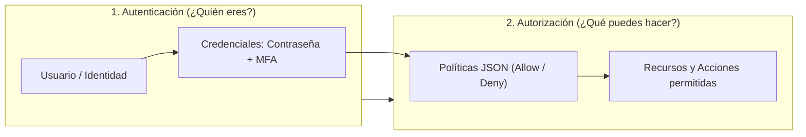
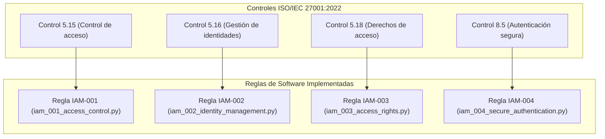
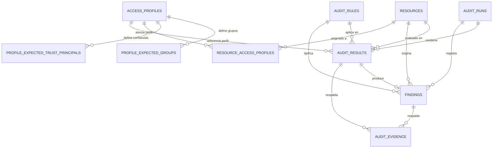
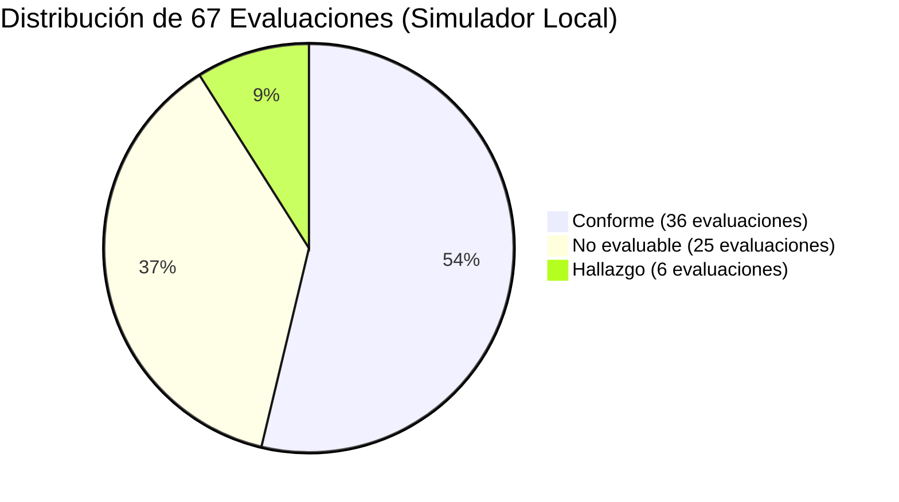

# GUÍA DE ESTUDIO Y PREPARACIÓN PARA LA PREDEFENSA DE TESIS
## Modelo Automatizado para la Auditoría de Gestión de Identidades y Accesos en Entornos de Nube Basado en el Estándar ISO/IEC 27001 para UPHARVEN C.A.

**Documento:** Guía Maestra de Estudio, Fundamentos Teóricos y Defensa Oral  
**Destinataria:** Autora del Trabajo Especial de Grado  
**Objetivo:** Proporcionar una comprensión profunda, integral y pedagógica del proyecto para dominar la arquitectura, defender las decisiones técnicas y responder con solvencia ante el jurado calificador  
**Fecha:** Noviembre 2026  
**Versión del Prototipo:** 1.0.0  

---

## ÍNDICE GENERAL

1. [CAPÍTULO 1: Comprensión General del Proyecto](#capítulo-1-comprensión-general-del-proyecto)
2. [CAPÍTULO 2: Fundamentos Teóricos de IAM y Ciberseguridad](#capítulo-2-fundamentos-teóricos-de-iam-y-ciberseguridad)
3. [CAPÍTULO 3: Análisis Detallado de los Cuatro Controles Evaluados](#capítulo-3-análisis-detallado-de-los-cuatro-controles-evaluados)
4. [CAPÍTULO 4: Arquitectura del Sistema y Funcionamiento Técnico Paso a Paso](#capítulo-4-arquitectura-del-sistema-y-funcionamiento-técnico-paso-a-paso)
5. [CAPÍTULO 5: Base de Datos Relacional y Modelo de Persistencia](#capítulo-5-base-de-datos-relacional-y-modelo-de-persistencia)
6. [CAPÍTULO 6: Justificación Tecnológica para la Defensa Oral](#capítulo-6-justificación-tecnológica-para-la-defensa-oral)
7. [CAPÍTULO 7: Metodología de Desarrollo: El Modelo por Prototipos](#capítulo-7-metodología-de-desarrollo-el-modelo-por-prototipos)
8. [CAPÍTULO 8: Estrategia de Pruebas y Validación Rigurosa](#capítulo-8-estrategia-de-pruebas-y-validación-rigurosa)
9. [CAPÍTULO 9: Análisis e Interpretación de los Resultados del Prototipo](#capítulo-9-análisis-e-interpretación-de-los-resultados-del-prototipo)
10. [CAPÍTULO 10: Seguridad del Sistema y las Nueve Restricciones de Alcance](#capítulo-10-seguridad-del-sistema-y-las-nueve-restricciones-de-alcance)
11. [CAPÍTULO 11: Limitaciones Actuales y Líneas de Trabajo Futuro](#capítulo-11-limitaciones-actuales-y-líneas-de-trabajo-futuro)
12. [CAPÍTULO 12: Estrategia de Comunicación Oral: Guiones para la Defensa](#capítulo-12-estrategia-de-comunicación-oral-guiones-para-la-defensa)

---

## CAPÍTULO 1. COMPRENSIÓN GENERAL DEL PROYECTO

### 1.1. ¿Qué problema busca resolver este proyecto?
En las organizaciones modernas que utilizan la nube pública, como **UPHARVEN C.A.**, la administración de usuarios, credenciales y permisos se convierte rápidamente en un entorno complejo y difícil de controlar. Los problemas más frecuentes son:
- **Asignación excesiva de permisos:** Con frecuencia se asignan políticas con permisos amplios (comodines `*`) por comodidad o urgencia operativa, vulnerando el principio de menor privilegio.
- **Cuentas inactivas no gestionadas:** Empleados que cambian de rol o abandonan la empresa conservan cuentas activas o claves de acceso sin utilizar durante meses.
- **Falta de autenticación robusta:** Usuarios con acceso directo a la consola sin autenticación multifactor (MFA).
- **Procesos manuales de auditoría:** Las revisiones tradicionales consisten en inspeccionar manualmente la consola web de AWS. Este método es lento, subjetivo, propenso al error humano y no deja un registro estructurado e inmutable de evidencias.

### 1.2. ¿Por qué es crucial la Gestión de Identidades y Accesos (IAM)?
En la computación en la nube, el perímetro de red tradicional (firewalls físicos, oficinas cerradas) ha desaparecido. **La identidad es el nuevo perímetro de seguridad**. Si un atacante compromete una clave de acceso con permisos administrativos en AWS, tiene control absoluto sobre la infraestructura, bases de datos y servidores, sin necesidad de vulnerar la red física de la empresa.

### 1.3. ¿Qué es exactamente una auditoría IAM?
Es un proceso sistemático, independiente y documentado para examinar si las identidades (usuarios y roles), sus credenciales (contraseñas, claves de API, MFA) y sus autorizaciones (políticas JSON) cumplen con las políticas de seguridad internas y con los estándares internacionales de la industria.

### 1.4. ¿Por qué se eligió Amazon Web Services (AWS) como entorno de referencia?
- **Liderazgo de mercado:** AWS es el proveedor de nube pública más utilizado a nivel mundial y la plataforma tecnológica estratégica evaluada para la modernización de UPHARVEN C.A.
- **Madurez de AWS IAM:** Su servicio de gestión de identidades es altamente granular, basado en políticas JSON bien estructuradas y formalmente documentadas.
- **Soporte de desarrollo (SDK Boto3):** Provee una biblioteca oficial y robusta en Python (`boto3`) que permite extraer configuraciones de forma segura y automatizada.

### 1.5. ¿Qué aporta la solución desarrollada frente a una revisión manual?
1. **Velocidad y determinismo:** Evalúa decenas de recursos y políticas en cuestión de segundos, aplicando exactamente las mismas reglas matemáticas en cada corrida.
2. **Alineación normativa formal:** Mapea directamente las configuraciones técnicas contra cuatro controles del estándar **ISO/IEC 27001:2022**.
3. **Prevención de falsos conformes:** Incorpora el estado `No evaluable` para advertir cuando faltan datos, evitando asumir erróneamente que una configuración desconocida es segura.
4. **Trazabilidad y persistencia:** Registra cada evaluación, hallazgo y evidencia en una base de datos MySQL relacional con soporte transaccional.
5. **Informes profesionales inmediatos:** Genera informes ejecutivos en PDF y libros de cálculo estructurados en Excel con un solo clic.

### 1.6. Alcance y limitaciones formales
- **Lo que sí hace:** Audita el plano de gestión de identidades (usuarios, grupos, roles, políticas JSON, MFA y fechas de uso de claves) y compara contra una línea base de perfiles autorizados.
- **Lo que no hace:** No audita el tráfico de red, no inspecciona el contenido de bases de datos o archivos S3, no audita sistemas operativos de máquinas virtuales, no realiza remediación automática (no borra ni modifica recursos en la nube) y **no emite un certificado oficial ISO 27001**.

---

## CAPÍTULO 2. FUNDAMENTOS TEÓRICOS DE IAM Y CIBERSEGURIDAD

Para defender el proyecto con propiedad, debes dominar y diferenciar los siguientes conceptos clave:



### 2.1. Autenticación vs. Autorización
- **Autenticación (*Authentication* - AuthN):** Es el proceso de **verificar la identidad** de un usuario o sistema. Responde a la pregunta: *¿Quién eres?* (Ejemplo: ingresar usuario, contraseña y código MFA).
- **Autorización (*Authorization* - AuthZ):** Es el proceso de **determinar qué permisos y acciones** tiene permitido realizar una identidad ya autenticada. Responde a la pregunta: *¿Qué tienes permitido hacer?* (Ejemplo: ¿este usuario puede leer un bucket S3 o puede borrar una base de datos?).

### 2.2. Entidades de AWS IAM
- **Usuario de IAM (*IAM User*):** Identidad digital con credenciales a largo plazo (contraseña de consola o claves de acceso `Access Key ID` / `Secret Access Key`), asociada generalmente a una persona física o a una aplicación legacy.
- **Grupo de IAM (*IAM Group*):** Colección de usuarios. No es una identidad en sí misma (no puede iniciar sesión), sino un mecanismo administrativo para asignar permisos homogéneos a múltiples usuarios a la vez.
- **Rol de IAM (*IAM Role*):** Identidad que no tiene credenciales permanentes. Está diseñada para ser **asumida temporalmente** por usuarios autorizados, aplicaciones o servicios de AWS (como una instancia EC2 o una función Lambda) mediante la generación de tokens criptográficos efímeros a través de *AWS STS (Security Token Service)*.
- **Política de IAM (*IAM Policy*):** Documento formal en formato JSON que define permisos. Contiene declaraciones (*Statements*) con cuatro elementos fundamentales:
  - `Effect`: Determina si la declaración permite (`Allow`) o deniega (`Deny`).
  - `Action`: Lista de operaciones de API afectadas (ej. `s3:GetObject`, `ec2:DescribeInstances`).
  - `Resource`: El identificador único (ARN) del recurso sobre el que aplica la acción (ej. `arn:aws:s3:::mi-bucket/*`).
  - `Condition` (Opcional): Circunstancias bajo las cuales aplica la regla (ej. exigir MFA o restringir por dirección IP).

### 2.3. Principio de Menor Privilegio (*Least Privilege*)
Principio cardinal de la seguridad de la información que establece que a cualquier identidad (usuario, proceso o servicio) se le deben conceder **únicamente los privilegios mínimos estrictamente indispensables** para cumplir su función laboral asignada, durante el tiempo necesario y nada más. Asignar comodines globales (`"Action": "*"`, `"Resource": "*"`) es la antítesis de este principio.

### 2.4. Autenticación Multifactor (MFA)
Mecanismo de seguridad que requiere al menos dos de los tres factores de autenticación clásicos:
1. Algo que sabes (contraseña o PIN).
2. Algo que tienes (teléfono móvil con app TOTP, llave física FIDO2/YubiKey).
3. Algo que eres (biometría: huella dactilar, reconocimiento facial).
En entornos de nube, el MFA mitiga el 99% de los ataques basados en robo o filtración de contraseñas.

### 2.5. La Norma ISO/IEC 27001:2022
Es el estándar internacional por excelencia para los **Sistemas de Gestión de Seguridad de la Información (SGSI)**. La versión 2022 actualizó su estructura agrupando los 93 controles del Anexo A en cuatro temáticas: Organizacionales (Cláusula 5), Personas (Cláusula 6), Físicos (Cláusula 7) y Tecnológicos (Cláusula 8). El presente proyecto aborda cuatro controles clave directamente vinculados a IAM.

---

## CAPÍTULO 3. ANÁLISIS DETALLADO DE LOS CUATRO CONTROLES EVALUADOS

En este capítulo se analiza la correspondencia entre la norma internacional y la regla de software programada:



---

### 3.1. Control 5.15: Control de Acceso $\rightarrow$ Regla `IAM-001`
- **Qué busca la norma:** Que las reglas para el control de acceso a la información y a los activos asociados se establezcan, documenten y apliquen en función de los requisitos del negocio.
- **Qué evalúa el prototipo:** Verifica que los usuarios humanos pertenezcan **exactamente a los grupos autorizados** en su perfil de referencia, y que los roles de IAM solo permitan ser asumidos por **entidades de confianza aprobadas**.
- **Información que consulta:** La lista de grupos reales del usuario (`list_groups_for_user`), la política de asunción del rol (`AssumeRolePolicyDocument`) y el perfil de acceso activo en la base de datos MySQL (`AuditContext`).
- **Criterios técnicos evaluados:**
  - `C15-01` (Usuarios): Compara grupos observados vs. grupos esperados.
  - `C15-02` (Roles): Compara entidades principales del `Principal` vs. entidades esperadas.
  - `C15-03` (Disponibilidad de perfil): Evalúa si la identidad tiene un perfil activo válido.
- **Veredictos:**
  - *Conforme:* Correspondencia exacta entre lo observado y lo autorizado.
  - *Hallazgo:* Presencia de grupos no autorizados, ausencia de grupos requeridos o entidades de confianza externas no permitidas.
  - *No evaluable:* La identidad carece de perfil de acceso registrado en MySQL.
- **Fuera de alcance:** No evalúa procesos de solicitud de acceso fuera de banda (tickets de Jira o firmas manuales).

---

### 3.2. Control 5.16: Gestión de Identidades $\rightarrow$ Regla `IAM-002`
- **Qué busca la norma:** Gestionar el ciclo de vida completo de las identidades (asignación, modificación y revocación oportuna cuando dejan de operar).
- **Qué evalúa el prototipo:** Detecta cuentas formalmente deshabilitadas que aún no han sido eliminadas, y credenciales de acceso que superan el umbral operativo de inactividad establecido para el prototipo (**90 días**).
- **Aclaración crucial para la defensa:** Los 90 días son un **parámetro técnico propio del prototipo de UPHARVEN C.A.**; la norma ISO 27001 exige establecer plazos de revisión y revocación, pero no fija un número de días en su redacción textual.
- **Información que consulta:** El estado del recurso (`resource_status`) y los días de inactividad (`last_access_days`, obtenidos del último inicio de sesión de consola `PasswordLastUsed` o del uso de claves `get_access_key_last_used`).
- **Criterios técnicos evaluados:**
  - `C16-01`: Estado de vigencia de la cuenta digital.
  - `C16-02`: Actividad reciente de credenciales frente al umbral de 90 días.
- **Veredictos:**
  - *Conforme:* Cuenta activa y con actividad reciente dentro de los 90 días.
  - *Hallazgo:* Cuenta marcada como inactiva/suspendida, o con inactividad superior a 90 días.
  - *No evaluable:* Ausencia de registros o marcas temporales de acceso en la identidad.

---

### 3.3. Control 5.18: Derechos de Acceso $\rightarrow$ Regla `IAM-003`
- **Qué busca la norma:** Asegurar que los derechos de acceso a la información se asignen, modifiquen y restrinjan de acuerdo con las políticas de control de acceso y el principio de menor privilegio.
- **Qué evalúa el prototipo:** Realiza un análisis sintáctico y semántico sobre los documentos JSON de políticas (inline y administradas) para detectar comodines globales que otorguen control irrestricto de administración.
- **Aclaración crucial para la defensa:** El control **ISO 8.2** (*Derechos de acceso privilegiado*, enfocado en cuentas de emergencia *break-glass* y bóvedas PAM) está **formalmente excluido del alcance**. Esta regla evalúa el control 5.18 analizando el contenido de las políticas JSON, sin usar clasificaciones artificiales de superusuario.
- **Criterios técnicos evaluados:**
  - `C18-01`: Detección de comodines globales absolutos (`"Action": "*"` o `"iam:*"` con `"Resource": "*"` en declaraciones `Allow`).
  - `C18-02`: Principio de menor privilegio granular frente a catálogo esperado.
- **Veredictos:**
  - *Hallazgo (CRÍTICO):* Detección de comodines irrestrictos globales (`full_wildcard`).
  - *Conforme:* Políticas con alcance específico y acotado a servicios o recursos concretos.
  - *No evaluable:* Políticas inaccesibles (`_incomplete_policy`), documentos JSON corruptos o evaluación de granularidad sin matriz formal de permisos.

---

### 3.4. Control 8.5: Autenticación Segura $\rightarrow$ Regla `IAM-004`
- **Qué busca la norma:** Establecer mecanismos de autenticación segura que aseguren la identificación inequívoca del usuario antes de otorgar acceso a los sistemas.
- **Qué evalúa el prototipo:** Verifica que las identidades de usuario tengan activado obligatoriamente un dispositivo MFA físico o virtual.
- **Aclaración crucial para la defensa:** Los roles de IAM (`IAM_ROLE`) quedan **explícitamente excluidos** de esta evaluación y no generan registros artificiales. Los roles no tienen contraseñas ni inicios de sesión interactivos; son asumidos mediante sesiones temporales autenticadas criptográficamente a través de STS.
- **Criterio técnico evaluado:**
  - `C85-01`: Estado del dispositivo MFA en usuarios IAM (`mfa_enabled`).
- **Veredictos:**
  - *Conforme:* Usuario con MFA activo (`mfa_enabled = True`).
  - *Hallazgo:* Usuario con acceso sin MFA (`mfa_enabled = False`).
  - *No evaluable:* Atributo MFA nulo, ausente o malformado.

---

## CAPÍTULO 4. ARQUITECTURA Y FUNCIONAMIENTO TÉCNICO PASO A PASO

### 4.1. Recorrido de los Datos de Principio a Fin
Para explicarle al jurado cómo funciona el sistema, debes narrar el recorrido de los datos a través de las capas:

```
[Usuario presiona botón] 
       ↓
1. Interfaz Gráfica (AuditPage en PySide6)
       ↓ invoca run_audit()
2. Capa de Aplicación (AuditService)
       ↓ extrae identidades
3. Capa de Fuentes (Simulator / AWSIAMDataSource)
       ↓ normaliza a diccionarios estándar
4. Capa de Dominio (AuditEngine)
       ↓ evalúa mediante evaluate_all()
5. Reglas Técnicas (IAM-001 a IAM-004)
       ↓ emite lista de AuditResult
6. Persistencia (persistence.py transaccional en MySQL)
       ↓ retorna resultados a UI
7. Visualización y Reportes (ResultsPage, Dashboard, PDF, Excel)
```

1. **Paso 1 (Disparo):** El usuario selecciona la fuente (*Simulador* o *AWS*) y pulsa **“Ejecutar auditoría”** en `AuditPage`. La interfaz desactiva el botón y procesa eventos Qt en tiempo real.
2. **Paso 2 (Orquestación):** `AuditPage` llama a `AuditService.run_simulated_audit()` o `run_aws_audit()`.
3. **Paso 3 (Extracción y Normalización):**
   - Si es el simulador: `simulator.py` entrega 10 recursos sintéticos y el `AuditContext` en memoria.
   - Si es AWS: `AWSIAMDataSource` ejecuta llamadas Boto3 de solo lectura (`list_users`, `list_roles`, etc.), procesa paginaciones y extrae políticas JSON. Simultáneamente, `AuditService._load_aws_audit_context()` consulta en MySQL los perfiles activos asociándolos por `resource_key`.
4. **Paso 4 (Evaluación Algorítmica):** `AuditService` entrega los recursos y el contexto al motor: `AuditEngine.evaluate_all(resources, context)`.
5. **Paso 5 (Ejecución de Reglas):** El motor itera sobre cada recurso y ejecuta polimórficamente las cuatro reglas (`RuleIAM001AccessControl`, `RuleIAM002IdentityManagement`, etc.). Cada regla retorna objetos `AuditResult` tipificados. Si ocurre algún error imprevisto, el motor lo atrapa y emite `No evaluable`.
6. **Paso 6 (Persistencia Atómica):** Si la persistencia está habilitada, `AuditService` llama a `save_audit_run()`. Esta función abre una transacción en MySQL (`get_db_transaction()`), resuelve los IDs reales de reglas y recursos por sus claves naturales, e inserta de forma atómica en `audit_runs`, `audit_results`, `findings` y `audit_evidence`. Si MySQL falla, se efectúa rollback y los resultados se conservan en memoria.
7. **Paso 7 (Presentación):** `AuditPage` recibe los resultados y emite la señal Qt `audit_completed`. `ResultsPage` carga la tabla interactiva y `HomePage` actualiza sus KPIs y gráfico circular.

---

## CAPÍTULO 5. BASE DE DATOS RELACIONAL Y MODELO DE PERSISTENCIA

### 5.1. ¿Por qué se eligió MySQL?
- **Soporte Transaccional ACID:** El motor **InnoDB** garantiza que una auditoría se guarda completamente o no se guarda nada (*Atomicidad*), evitando que la base de datos quede en estados corruptos o con corridas a medias.
- **Integridad Referencial Estricta:** Permite definir restricciones `FOREIGN KEY`, `UNIQUE` y `CHECK` que impiden incoherencias en los datos.
- **Estándar Empresarial:** MySQL es el motor de base de datos relacional de referencia en la infraestructura tecnológica de UPHARVEN C.A.

### 5.2. Las Diez Tablas del Sistema y sus Relaciones



1. **`audit_runs` (Maestro de Corridas):** Guarda el registro global de cada auditoría (`id`, `execution_date`, `source_type`, `status`, `total_findings`, `summary`).
2. **`resources` (Catálogo de Identidades):** Almacena las identidades (`resource_key`, `resource_type`, `display_name`, `source_type`, `attributes` en formato JSON). Clave única compuesta: `(resource_key, source_type)`.
3. **`audit_rules` (Catálogo de Reglas):** Almacena las reglas técnicas (`rule_code`, `rule_name`, `iso_control`, `default_severity`).
4. **`access_profiles` (Perfiles de Acceso):** Catálogo de perfiles autorizados (`profile_code`, `identity_type` CHECK `'user'` o `'role'`).
5. **`profile_expected_groups` (Grupos Esperados):** Lista de grupos IAM que autoriza un perfil de usuario. Clave foránea a `access_profiles`.
6. **`profile_expected_trust_principals` (Entidades de Confianza):** Lista de entidades autorizadas para asumir un perfil de rol. Clave foránea a `access_profiles`.
7. **`resource_access_profiles` (Asignación de Perfiles):** Asocia un recurso con su perfil activo. Utiliza una columna generada virtual `is_active_flag` y una clave única `(resource_id, is_active_flag)` que **impide matemáticamente que un recurso tenga más de un perfil activo simultáneamente**.
8. **`audit_results` (Evaluaciones Exhaustivas):** Almacena cada evaluación individual con clave única `(audit_run_id, resource_id, audit_rule_id, criterion_code)` y restricción CHECK en `result_status IN ('Conforme', 'Hallazgo', 'No evaluable')`.
9. **`findings` (Hallazgos de Seguridad):** Almacena exclusivamente los incumplimientos detectados (`Hallazgo`), vinculados a su resultado mediante `audit_result_id`.
10. **`audit_evidence` (Evidencias Técnicas):** Guarda trazas y volcados JSON de soporte. Implementa la restricción CHECK `chk_evidence_target` de **exclusión mutua estricta**: exige que la evidencia apunte a un hallazgo o a un resultado, nunca a ambos ni quede huérfana.

---

## CAPÍTULO 6. JUSTIFICACIÓN TECNOLÓGICA PARA LA DEFENSA ORAL

Cuando el jurado te pregunte: *“¿Por qué seleccionó estas tecnologías y no otras?”*, debes argumentar con esta justificación técnica:

- **¿Por qué Python?**  
  *Defensa:* "Seleccioné Python 3.13 porque es el estándar consolidado en la industria para ingeniería de nube, automatización de seguridad y análisis de datos. Posee soporte nativo para manipulación de estructuras JSON complejas y cuenta con el SDK oficial y más maduro de Amazon Web Services (`boto3`)."
- **¿Por qué PySide6 (Qt 6) y no una aplicación web?**  
  *Defensa:* "Opté por PySide6 porque una aplicación de escritorio nativa ofrece un aislamiento de seguridad superior: no expone puertos de red locales, no requiere levantar servidores web intermedios que aumenten la superficie de ataque y permite la renderización gráfica acelerada y la exportación de documentos binarios de forma autónoma y segura en la máquina del auditor."
- **¿Por qué Boto3 y no herramientas de terceros como ScoutSuite o Prowler?**  
  *Defensa:* "Boto3 es el SDK de bajo nivel oficial desarrollado por AWS. Utilizarlo directamente garantizó que el motor de auditoría y las reglas algorítmicas fueran 100% de autoría propia, controlando exactamente qué llamadas a la API se emiten, validando la política estricta de solo lectura y evitando dependencias externas opacas."
- **¿Por qué ReportLab y openpyxl?**  
  *Defensa:* "Porque permiten generar informes formales sin depender de que el usuario tenga instalado Microsoft Office o Adobe Acrobat. ReportLab genera PDFs vectoriales de dos pasadas con gráficos nativos, y openpyxl construye libros XLSX estructurados con estilos condicionales y autofiltros para auditorías operativas."

---

## CAPÍTULO 7. METODOLOGÍA DE DESARROLLO: EL MODELO POR PROTOTIPOS

### 7.1. ¿Qué es el Modelo por Prototipos Evolutivos?
Es un paradigma de ciclo de vida del desarrollo de software orientado a proyectos donde los requisitos técnicos y normativos deben refinarse de forma iterativa. En lugar de intentar construir todo el sistema en una sola entrega monolítica, se desarrollan versiones operativas incrementales (*prototipos*) que se prueban, validan y amplían progresivamente.

### 7.2. ¿Cómo evolucionó el prototipo a lo largo de las fases de la tesis?
El proyecto avanzó a través de siete fases metodológicas claramente documentadas:
1. **Fase 1 (Diagnóstico inicial):** Estudio del estado de UPHARVEN C.A., análisis de la norma ISO/IEC 27001:2022 y selección de los cuatro controles técnicos de identidad.
2. **Fase 2 (Modelo de datos relacional):** Diseño de la base de datos MySQL, definición de las tablas maestras y creación de scripts DDL con restricciones de integridad.
3. **Fase 3 (Motor algorítmico agnóstico):** Implementación de `AuditEngine`, modelos de dominio (`AuditResult`, `AuditContext`) y lógica preliminar de las cuatro reglas.
4. **Fase 4 (Fuentes de información):** Creación del dataset sintético determinista en `simulator.py` y desarrollo del adaptador AWS IAM con Boto3 de solo lectura.
5. **Fase 5 (Interfaz y Persistencia):** Construcción de la aplicación de escritorio en PySide6 (`MainWindow`, navegación) y orquestación de la persistencia transaccional atómica en MySQL.
6. **Fase 6 (Dashboard y Reportería):** Incorporación del Dashboard interactivo con `QtCharts`, diálogo modal de controles ISO y motores de exportación a PDF, Excel y CSV.
7. **Fase 7 (Integración de Nube y Replicabilidad):** Validación exhaustiva del adaptador AWS con `botocore.stub.Stubber` (44 pruebas), flujo end-to-end, script SQL consolidado y documentación técnica integral.

---

## CAPÍTULO 8. ESTRATEGIA DE PRUEBAS Y VALIDACIÓN RIGUROSA

### 8.1. ¿Qué es pytest y cómo se aplicó?
`pytest` es el marco de pruebas automatizadas líder en Python. En este proyecto se utilizó para verificar sistemáticamente cada función, método, regla y flujo de integración mediante aserciones estrictas.

### 8.2. ¿Qué significan las 309 pruebas aprobadas al 100%?
- **Métrica comprobada:** 309 casos ejecutados en 9.6 segundos con **0 fallos** y **0 pruebas omitidas** (`exit code 0`).
- **Qué demuestra:** Demuestra la **estabilidad interna del software**: que no existen errores de sintaxis, que el motor algorítmico evalúa exactamente lo que debe evaluar, que la persistencia relacional es atómica, que los reportes se generan válidamente y que la interfaz de usuario responde sin abortos.
- **Qué NO demuestra:** No demuestra la ejecución en vivo contra la infraestructura real de producción de UPHARVEN C.A., dado que la empresa no suministró credenciales reales.

### 8.3. ¿Cómo se probaron las operaciones de AWS sin una cuenta real?
Mediante **`botocore.stub.Stubber`**:
- `Stubber` es una herramienta oficial provista en el núcleo del SDK de AWS (`botocore`) diseñada específicamente para pruebas de infraestructura.
- **Cómo opera:** Intercepta las llamadas HTTP que Boto3 emitiría hacia los servidores de AWS y devuelve respuestas simuladas en formato JSON idénticas a las que entrega la API real de AWS IAM.
- **Qué permitió validar:** Se validaron 17 operaciones API, procesamiento de respuestas paginadas multi-página, respuestas vacías, errores de autenticación (`InvalidClientTokenId`), permisos insuficientes (`AccessDenied`), timeouts de red y, fundamentalmente, **se comprobó que el adaptador bloquea cualquier operación de escritura prohibida** (`create_user`, `delete_role`, etc.).

---

## CAPÍTULO 9. ANÁLISIS E INTERPRETACIÓN DE LOS RESULTADOS DEL PROTOTIPO

Al ejecutar el motor sobre el dataset sintético del Simulador Local, se produce de manera invariable la siguiente matriz de referencia:



### 9.1. Métricas Cuantitativas
- **Total de evaluaciones generadas:** **67**.
- **Conforme:** **36 evaluaciones (53.73%)**.
- **Hallazgo:** **6 evaluaciones (8.96%)**.
- **No evaluable:** **25 evaluaciones (37.31%)**.

### 9.2. Análisis Detallado de los Seis Hallazgos Identificados
Cada hallazgo fue deliberadamente sembrado en el dataset para validar que el motor detecta con precisión matemática cada tipo de desviación:

1. **Hallazgo 1 (Recurso 2: `carlos.soporte` / Regla IAM-001 / Criterio C15-01):**
   - *Desviación:* Discrepancia en membresías de grupos IAM.
   - *Detalle:* El usuario tiene asignado el grupo adicional `SeguridadTI`, no contemplado en su perfil de referencia autorizado `PRF-USR-SOPORTE` (que solo autoriza `SoporteTI`).
2. **Hallazgo 2 (Recurso 2: `carlos.soporte` / Regla IAM-003 / Criterio C18-01):**
   - *Desviación:* Permisos irrestrictos globales en política JSON (`full_wildcard`).
   - *Detalle:* Tiene adjunta la política `AdministratorAccessSimulated` que contiene `"Action": "*"` y `"Resource": "*"` bajo `Effect: Allow`.
3. **Hallazgo 3 (Recurso 3: `usuario.inactivo` / Regla IAM-002 / Criterio C16-02):**
   - *Desviación:* Inactividad prolongada de credenciales.
   - *Detalle:* Registra 120 días continuos sin actividad, superando el umbral operativo de 90 días establecido para el prototipo.
4. **Hallazgo 4 (Recurso 4: `cuenta.sin_mfa` / Regla IAM-004 / Criterio C85-01):**
   - *Desviación:* Ausencia de Autenticación Multifactor.
   - *Detalle:* El usuario tiene `mfa_enabled = False`, incumpliendo el mandato de autenticación segura.
5. **Hallazgo 5 (Recurso 6: `usuario.grupos_discrepantes` / Regla IAM-001 / Criterio C15-01):**
   - *Desviación:* Discrepancia bidireccional severa de grupos IAM.
   - *Detalle:* Presenta dos grupos no autorizados (`AuditoriaInterna` y `Finanzas`) y carece de dos grupos que sí exige su perfil (`LecturaContratos` y `Operaciones`).
6. **Hallazgo 6 (Recurso 8: `rol.discrepante` / Regla IAM-001 / Criterio C15-02):**
   - *Desviación:* Política de confianza del rol desalineada.
   - *Detalle:* Permite ser asumido por el servicio no autorizado `lambda.amazonaws.com` en lugar del servicio esperado `ec2.amazonaws.com`.

### 9.3. ¿Por qué hay 25 evaluaciones en estado "No Evaluable"?
Porque el dataset incluye intencionalmente recursos sin perfil de acceso asignado, roles excluidos de MFA (que no generan falsos conformes) y evaluaciones de granularidad de permisos (C18-02) que, al no contar con una matriz exhaustiva de permisos esperados por perfil, emiten justificadamente `No evaluable`. Esto demuestra la solidez del motor frente a falsos positivos.

---

## CAPÍTULO 10. SEGURIDAD DEL SISTEMA Y LAS NUEVE RESTRICCIONES DE ALCANCE

Para defender las decisiones de diseño, debes explicar por qué el sistema respeta estrictamente estas nueve restricciones de alcance:

1. **Operaciones Boto3 estrictamente de solo lectura:** El sistema audita la nube sin alterar la infraestructura. La tupla `FORBIDDEN_OPERATION_PREFIXES` bloquea 15 prefijos de mutación.
2. **Exclusión de administración especializada y control ISO 8.2:** Se enfoca en la auditoría lógica de políticas JSON bajo el control 5.18, sin abordar sistemas PAM ni cuentas *break-glass*.
3. **Exclusión de ciclo de vida de secretos:** No audita rotación de claves KMS ni certificados SSL.
4. **Exclusión del plano de datos:** No inspecciona archivos en S3 ni datos en bases de datos RDS.
5. **Exclusión del plano de cómputo y sistemas operativos:** No audita sistemas operativos de instancias EC2 ni parches de seguridad.
6. **Exclusión de monitoreo continuo (SIEM):** El sistema opera bajo demanda o en revisiones periódicas discretas, no en tiempo real.
7. **Análisis exclusivo de políticas IAM en formato JSON:** Análisis estático de declaraciones, sin simular el motor de autorización dinámico de AWS.
8. **Exclusión de cláusulas de gestión 4 a 10:** Se limita a cuatro controles del Anexo A; no evalúa los procesos organizacionales de gestión del SGSI.
9. **Exclusión de redes y perímetro:** No audita VPC, subredes, tablas de enrutamiento ni Security Groups.

---

## CAPÍTULO 11. LIMITACIONES ACTUALES Y LÍNEAS DE TRABAJO FUTURO

### 11.1. Limitaciones que debes declarar con honestidad intelectual
1. **Falta de conexión con credenciales reales de UPHARVEN C.A.:** La empresa no facilitó claves de producción por políticas de confidencialidad; la compatibilidad técnica se validó al 100% mediante laboratorio automatizado con `botocore.stub.Stubber`.
2. **Herramienta diagnóstica:** El sistema no sustituye el criterio de un auditor líder ni otorga certificación formal ISO.
3. **Ausencia de remediación automática:** Por razones de seguridad, el sistema no revoca permisos automáticamente en AWS; solo emite recomendaciones técnicas para intervención humana.

### 11.2. Líneas de Trabajo Futuro
- **Remediación Asistida:** Generación de scripts de AWS CLI o código Terraform sugeridos para corregir hallazgos con confirmación manual del usuario.
- **Soporte Multi-Cuenta:** Auditoría automática de múltiples cuentas mediante integración con *AWS Organizations*.
- **Integración con AWS CloudTrail:** Análisis de registros de eventos para enriquecer el análisis de identidades inactivas con inicios de sesión federados (SSO/SAML).

---

## CAPÍTULO 12. ESTRATEGIA DE COMUNICACIÓN ORAL: GUIONES PARA LA DEFENSA

Utiliza estos cuatro guiones calibrados según el tiempo que el jurado te conceda para responder:

---

### 12.1. Explicación de 30 Segundos (*Elevator Pitch*)
> *"Mi proyecto es un sistema de software de escritorio que automatiza la auditoría de identidades y accesos en AWS IAM tomando como base la norma ISO/IEC 27001:2022. En lugar de revisar manualmente la consola de AWS, el sistema evalúa cuatro controles de seguridad clave en usuarios y roles, detecta permisos excesivos, cuentas inactivas y falta de MFA, guarda los hallazgos en una base de datos MySQL y genera informes ejecutivos en PDF y Excel con un solo clic."*

---

### 12.2. Explicación de 1 Minuto
> *"El problema que abordé en UPHARVEN C.A. es que la gestión de identidades en la nube suele volverse caótica y propensa a privilegios excesivos o cuentas huérfanas, mientras que las revisiones manuales son lentas y propensas al error humano.  
> Para resolverlo, desarrollé un aplicativo de escritorio en Python y PySide6 con un motor algorítmico independiente que evalúa cuatro controles de ISO/IEC 27001:2022: control de acceso, gestión de identidades, derechos de acceso y autenticación multifactor.  
> El sistema admite dos fuentes: un simulador local determinista para demostraciones y un adaptador de AWS con Boto3 que opera estrictamente en modo de solo lectura. Los resultados se clasifican rigurosamente en Conforme, Hallazgo o No evaluable para evitar falsos conformes, se persisten de forma transaccional en MySQL y se exportan en informes ejecutivos."*

---

### 12.3. Explicación de 3 Minutos
> *"Buenos días, estimados miembros del jurado. Mi trabajo de grado aborda la seguridad en la nube para UPHARVEN C.A., partiendo de la premisa de que en la nube la identidad es el nuevo perímetro de seguridad.  
> El objetivo fue construir una herramienta automatizada que contrastara las configuraciones técnicas de AWS IAM frente a cuatro controles esenciales del Anexo A de ISO/IEC 27001:2022: el control 5.15 sobre control de acceso, el 5.16 sobre gestión del ciclo de vida de identidades, el 5.18 sobre prevención de privilegios excesivos y el 8.5 sobre obligatoriedad de MFA.  
> Arquitectónicamente, diseñé el sistema bajo una arquitectura en capas desacoplada. La interfaz gráfica en PySide6 delega en un servicio de aplicación, el cual coordina un motor de auditoría puramente algorítmico. Este motor recibe identidades desde dos fuentes posibles: un simulador local sintético para pruebas controladas y un adaptador oficial con el SDK Boto3 para consultar AWS en la nube.  
> Un aspecto fundamental del diseño es la seguridad: el adaptador AWS utiliza una lista blanca inmutable de 21 operaciones de solo lectura y bloquea preventivamente cualquier operación de escritura, garantizando que el sistema jamás altere o elimine recursos en la nube. Asimismo, el motor implementa el estado 'No evaluable' para evitar emitir falsos conformes cuando los datos son incompletos.  
> Los resultados se registran de forma atómica en una base de datos MySQL de 10 tablas en InnoDB, y el usuario puede visualizarlos en un dashboard ejecutivo, filtrarlos interactivamente y exportar reportes en PDF, Excel y CSV. La calidad del software está respaldada por una batería de 309 pruebas automatizadas con 100% de aprobación."*

---

### 12.4. Explicación Técnica de 5 Minutos (Para Interrogatorio Técnico Profundo)
> *"Para explicar la arquitectura técnica en profundidad, el proyecto se estructura en seis capas estrictamente desacopladas siguiendo los principios de Clean Architecture:  
> 
> En primer lugar, la **Capa de Presentación** está construida con PySide6 y Qt 6. Utiliza un contenedor dinámico `QStackedWidget` con cinco vistas operativas y se comunica mediante el mecanismo de señales y slots de Qt, manteniendo la interfaz reactiva mediante procesamiento de eventos en tiempo real.  
> 
> En segundo lugar, la **Capa de Aplicación** está encapsulada en la clase `AuditService`, la cual aplica el patrón Fachada. Este servicio orquesta el caso de uso completo: solicita recursos a las fuentes, invoca la resolución de perfiles autorizados en MySQL, ejecuta el motor y gestiona la persistencia.  
> 
> En tercer lugar, el **Motor de Auditoría (`AuditEngine`)** es agnóstico e independiente de MySQL y de la nube. Coordina polimórficamente las cuatro reglas técnicas que heredan del contrato abstracto `BaseAuditRule`. El motor aplica una política de captura defensiva de excepciones: si ocurre cualquier anomalía imprevista en una regla, jamás aborta la auditoría general ni asume conformidad; emite un `AuditResult` en estado 'No evaluable' con código de error tipificado.  
> 
> En cuarto lugar, la **Capa de Fuentes de Datos** implementa el desacoplamiento entre el `IAMSimulatorDataSource`, que produce una matriz determinista de 67 evaluaciones de referencia sobre 10 identidades sintéticas, y el `AWSIAMDataSource`, que utiliza el SDK Boto3. Este último implementa seguridad de solo lectura verificada en dos capas: un conjunto cerrado `READ_ONLY_OPERATIONS` y la validación preventiva `_validate_safe_operation()`, la cual bloquea 15 prefijos de mutación antes de enviar peticiones a la red.  
> 
> En quinto lugar, la **Capa de Persistencia** sobre MySQL Server 8.0/9.6 utiliza el motor transaccional InnoDB. La función `save_audit_run()` opera bajo un gestor de contexto `get_db_transaction()` que garantiza atomicidad: resuelve reglas y recursos mediante sus claves naturales sin inventar IDs artificiales, e inserta en cascada en las tablas `audit_runs`, `audit_results`, `findings` y `audit_evidence`. Si ocurre un fallo en la base de datos, se ejecuta rollback total y los resultados se preservan en memoria para no perjudicar al usuario.  
> 
> Finalmente, la solución fue validada mediante **309 pruebas automatizadas con pytest**, abarcando pruebas unitarias de reglas, pruebas de integración con `botocore.stub.Stubber` simulando llamadas y códigos de error oficiales de AWS, pruebas de transaccionalidad con rollback simulado y pruebas de interfaz gráfica. Esta arquitectura garantiza que el sistema sea modular, determinista, seguro y plenamente auditable."*

