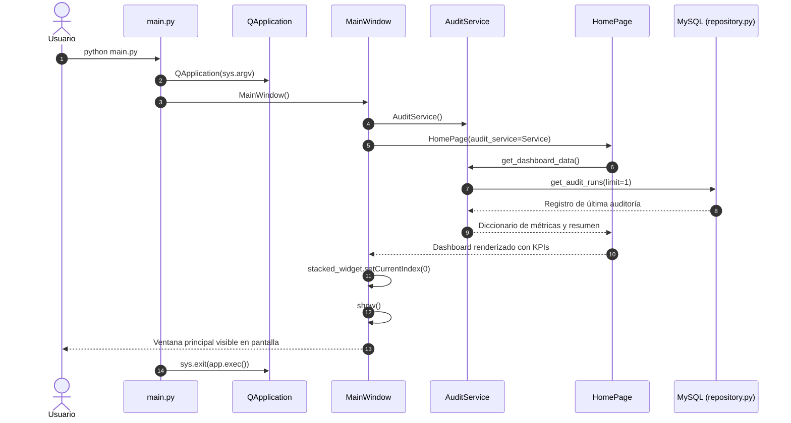
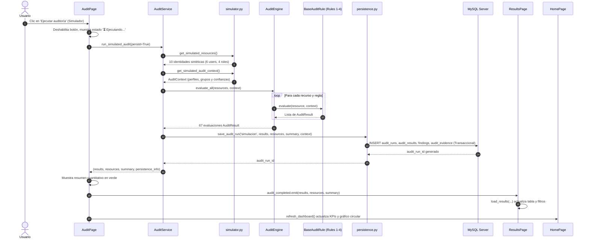
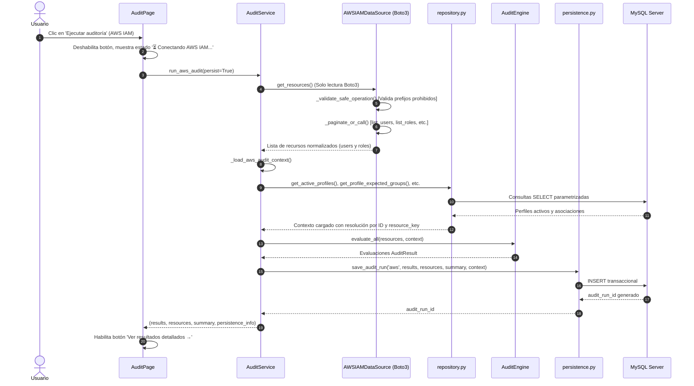
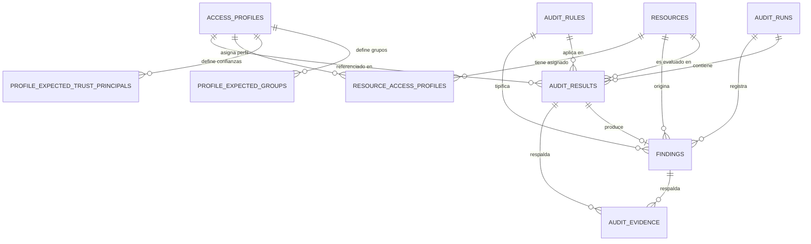
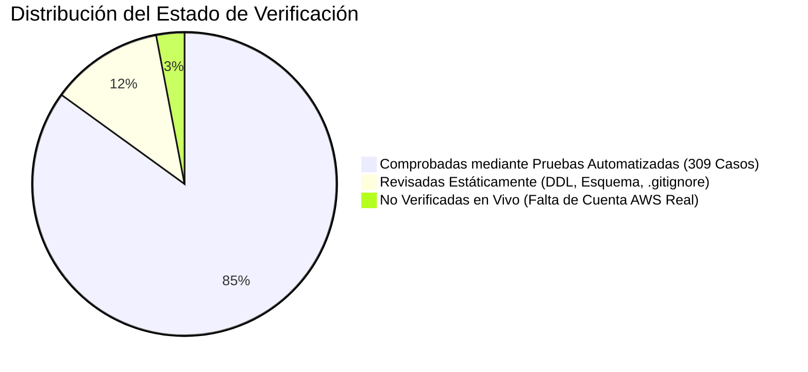

# INVENTARIO TÉCNICO INTEGRAL DEL SISTEMA DE AUDITORÍA IAM

**Proyecto:** Modelo automatizado para la auditoría de gestión de identidades y accesos en entornos de nube basado en el estándar ISO 27001 para UPHARVEN C.A.  
**Fecha de elaboración:** Noviembre 2026  
**Documento:** Inventario Técnico Integral de Software y Arquitectura  
**Versión del Prototipo:** 1.0.0  
**Tecnologías:** Python 3.13, PySide6 (Qt 6), Boto3, MySQL Server 8.0/9.6, ReportLab, openpyxl, pytest  

---

## 1. INFORMACIÓN GENERAL Y PROPÓSITO

El presente documento constituye el inventario técnico exhaustivo del sistema de auditoría automatizada de identidades y accesos en entornos de nube (AWS IAM) desarrollado para la empresa UPHARVEN C.A. Su objetivo es proporcionar una referencia formal, fidedigna e inmutable de la estructura del proyecto, las capas de software, la totalidad de módulos implementados, el esquema relacional de base de datos, las reglas técnicas basadas en la norma ISO/IEC 27001:2022, los flujos reales de ejecución y el marco de pruebas automatizadas.

El sistema fue concebido bajo una arquitectura desacoplada por capas que separa estrictamente la interfaz gráfica de usuario, los servicios de orquestación de aplicación, el motor de auditoría algorítmico, las fuentes de extracción de datos (simulada y AWS en la nube) y la capa de almacenamiento relacional transaccional.

---

## 2. ESTRUCTURA DEL PROYECTO

### 2.1. Árbol Completo de Carpetas y Archivos Relevantes

```
sistema/
├── .env                                       # Variables de entorno locales (DB_HOST, DB_USER, etc.) - Excluido de VCS
├── .gitignore                                 # Reglas de exclusión de Git (.env, venv, caches, zips)
├── db_pruebas.sql                             # Volcado SQL inicial de la base de datos (5 tablas históricas)
├── db_pruebas_sin_gtid.sql                    # Volcado SQL sin identificadores GTID
├── FASE2_MIGRACION_PRELIMINAR.sql             # Procedimiento almacenado DDL de migración a Fase 2 (10 tablas)
├── PRUEBAS_FASE2_MIGRACION_PRELIMINAR.sql     # Script de validación de integridad para Fase 2
├── main.py                                    # Punto de entrada principal de la aplicación de escritorio
├── pytest.ini                                 # Configuración global del marco de pruebas pytest
├── README.md                                  # Documento general de bienvenida del repositorio
├── requirements.txt                           # Archivo de dependencias del entorno de ejecución Python
├── test_connection.py                         # Script auxiliar CLI de verificación de conexión a MySQL
├── test_resources.py                          # Script auxiliar CLI de inspección de identidades
├── DOCUMENTACION_FASE_*.md                    # 16 documentos técnicos de entregas y fases de la tesis
│
├── src/
│   └── auditoria_iam/                         # Paquete raíz del código fuente del sistema
│       ├── __init__.py                        # Inicializador del paquete raíz (define __version__ = "1.0.0")
│       │
│       ├── application/                       # CAPA DE APLICACIÓN Y ORQUESTACIÓN
│       │   ├── __init__.py                    # Exporta AuditService
│       │   └── audit_service.py               # Servicio de aplicación y orquestador desacoplado
│       │
│       ├── audit/                             # CAPA DEL MOTOR ALGORÍTMICO CENTRAL
│       │   ├── __init__.py                    # Exporta AuditEngine, AuditResult, AuditContext
│       │   ├── engine.py                      # Coordinador algorítmico y ejecutor de reglas
│       │   ├── models.py                      # Modelos de datos de dominio (AuditResult, AuditContext)
│       │   └── rules/                         # Subpaquete de reglas de auditoría ISO/IEC 27001:2022
│       │       ├── __init__.py                # Exporta las cuatro reglas implementadas
│       │       ├── base.py                    # Clase abstracta BaseAuditRule
│       │       ├── iam_001_access_control.py  # Regla IAM-001 (Control 5.15 - Control de acceso)
│       │       ├── iam_002_identity_management.py # Regla IAM-002 (Control 5.16 - Gestión de identidades)
│       │       ├── iam_003_access_rights.py   # Regla IAM-003 (Control 5.18 - Derechos de acceso)
│       │       └── iam_004_secure_authentication.py # Regla IAM-004 (Control 8.5 - Autenticación segura)
│       │
│       ├── config/                            # CAPA DE CONFIGURACIÓN Y ENTORNO
│       │   ├── __init__.py                    # Exporta get_database_settings, DatabaseSettings
│       │   └── settings.py                    # Carga y validación segura de variables de entorno (.env)
│       │
│       ├── database/                          # CAPA DE PERSISTENCIA Y REPOSITORIO RELACIONAL
│       │   ├── __init__.py                    # Exporta funciones de conexión, repositorio y persistencia
│       │   ├── connection.py                  # Fábrica de conexiones y gestores de contexto (cursor/tx)
│       │   ├── repository.py                  # Consultas de lectura parametrizadas (SELECT)
│       │   └── persistence.py                 # Persistencia atómica transaccional (INSERT)
│       │
│       ├── data_sources/                      # CAPA DE ADAPTADORES Y EXTRACCIÓN DE IDENTIDADES
│       │   ├── __init__.py                    # Inicializador del módulo de fuentes
│       │   ├── simulator/                     # Fuente sintética local determinista
│       │   │   ├── __init__.py                # Exporta IAMSimulatorDataSource y funciones sintéticas
│       │   │   └── simulator.py               # Dataset sintético determinista (10 recursos, 67 evaluaciones)
│       │   └── aws/                           # Adaptador de nube para AWS IAM
│       │       ├── __init__.py                # Exporta AWSIAMDataSource y excepciones de dominio
│       │       ├── adapter.py                 # Extractor Boto3 de solo lectura con validación estricta
│       │       └── exceptions.py              # Jerarquía de excepciones de dominio de AWS IAM
│       │
│       ├── reports/                           # CAPA DE EXPORTACIÓN Y GENERACIÓN DE INFORMES
│       │   ├── __init__.py                    # Exporta funciones generadoras de PDF, Excel, CSV y datos
│       │   ├── report_data.py                 # Normalizador y enriquecedor agnóstico de datos de informe
│       │   ├── pdf_report.py                  # Generador de informes ejecutivos en formato PDF (ReportLab)
│       │   ├── excel_report.py                # Generador de libros de cálculo estructurados (openpyxl)
│       │   └── csv_report.py                  # Generador de tablas planas CSV delimitadas (utf-8-sig)
│       │
│       └── ui/                                # CAPA DE PRESENTACIÓN E INTERFAZ GRÁFICA (PySide6)
│           ├── __init__.py                    # Exporta MainWindow
│           ├── main_window.py                 # Ventana principal, barra lateral y enrutamiento en stack
│           ├── styles.py                      # Hoja de estilos centralizada QSS (tema ciberseguridad)
│           ├── controls_catalog.py            # Catálogo interactivo de controles ISO 27001 y metadatos
│           ├── dialogs/                       # Diálogos modales auxiliares
│           │   ├── __init__.py                # Exporta IsoControlDetailDialog
│           │   └── control_detail_dialog.py   # Modal de desglose técnico de control ISO 27001
│           └── pages/                         # Vistas de contenido de la aplicación
│               ├── __init__.py                # Exporta las 5 páginas principales
│               ├── home_page.py               # Vista 0: Dashboard ejecutivo, KPIs y catálogo ISO
│               ├── audit_page.py              # Vista 1: Configuración y ejecución de auditorías
│               ├── results_page.py            # Vista 2: Tabla detallada de resultados y exportación
│               ├── history_page.py            # Vista 3: Registro cronológico de corridas en MySQL
│               └── settings_page.py           # Vista 4: Parámetros del sistema y credenciales
│
└── tests/                                     # SUITE DE PRUEBAS AUTOMATIZADAS (PYTEST)
    ├── __init__.py                            # Inicializador del paquete de pruebas
    ├── conftest.py                            # Configuración global y fixtures compartidas de pytest
    ├── test_audit_engine.py                   # Pruebas del motor algorítmico (8 casos)
    ├── test_audit_models.py                   # Pruebas de modelos de dominio y validaciones (6 casos)
    ├── test_aws_adapter_stubber.py            # Pruebas de Boto3 Stubber y operaciones seguras (44 casos)
    ├── test_aws_data_source.py                # Pruebas de normalización del adaptador AWS (28 casos)
    ├── test_aws_end_to_end.py                 # Pruebas de integración de extremo a extremo AWS (23 casos)
    ├── test_aws_ui_integration.py             # Pruebas de integración UI con AWS y MySQL (23 casos)
    ├── test_connection.py                     # Pruebas de fábrica de conexión y transacciones (6 casos)
    ├── test_dashboard.py                      # Pruebas unitarias de HomePage y gráficos (13 casos)
    ├── test_dashboard_integration.py          # Pruebas de integración Dashboard con BD (12 casos)
    ├── test_persistence.py                    # Pruebas de transaccionalidad atómica y rollback (16 casos)
    ├── test_reports.py                        # Pruebas de exportación PDF, Excel y CSV (14 casos)
    ├── test_repository.py                     # Pruebas de consultas de lectura y repositorio (19 casos)
    ├── test_rule_iam_001.py                   # Pruebas de regla IAM-001 / Control 5.15 (16 casos)
    ├── test_rule_iam_002.py                   # Pruebas de regla IAM-002 / Control 5.16 (13 casos)
    ├── test_rule_iam_003.py                   # Pruebas de regla IAM-003 / Control 5.18 (22 casos)
    ├── test_rule_iam_004.py                   # Pruebas de regla IAM-004 / Control 8.5 (6 casos)
    ├── test_settings.py                       # Pruebas de validación de variables de entorno (13 casos)
    ├── test_simulator.py                      # Pruebas de integridad del simulador determinista (9 casos)
    └── test_ui.py                             # Pruebas de ciclo de vida e interfaz PySide6 (18 casos)
```

### 2.2. Punto de Entrada de la Aplicación
El punto de entrada oficial es el archivo [`main.py`](file:///c:/Users/andre/Desktop/TESIS/sistema/main.py), ubicado en la raíz del repositorio. Se encarga de instanciar la aplicación Qt (`QApplication`), establecer el nombre institucional del aplicativo y desplegar la ventana principal `MainWindow`.

### 2.3. Paquetes, Módulos y Submódulos
- **`src.auditoria_iam`**: Paquete principal que alberga la lógica de negocio y presentación.
  - **`application`**: Casos de uso de alto nivel y orquestación entre componentes.
  - **`audit`**: Motor algorítmico agnóstico, modelos formales de dominio y catálogo de reglas ISO.
    - **`audit.rules`**: Implementación de las cuatro reglas de auditoría.
  - **`config`**: Lectura y validación defensiva de variables de entorno sin mutaciones.
  - **`database`**: Infraestructura de persistencia relacional en MySQL Server.
  - **`data_sources`**: Adaptadores para extracción y normalización de identidades.
    - **`data_sources.simulator`**: Generador de identidades sintéticas locales deterministas.
    - **`data_sources.aws`**: Adaptador Boto3 de solo lectura con manejo de excepciones y políticas.
  - **`reports`**: Servicios de procesamiento agnóstico de datos y generación de reportes en PDF, Excel y CSV.
  - **`ui`**: Capa de usuario gráfica desarrollada con PySide6.
    - **`ui.dialogs`**: Diálogos modales complementarios.
    - **`ui.pages`**: Vistas funcionales insertadas en el contenedor principal dinámico.
- **`tests`**: Conjunto de pruebas unitarias, de integración y funcionales ejecutadas con pytest.

### 2.4. Responsabilidad de Cada Directorio

| Directorio | Responsabilidad Técnica |
| :--- | :--- |
| `src/auditoria_iam/application/` | Orquestar el flujo integral de auditoría: invocar fuentes de datos, ejecutar el motor, solicitar persistencia transaccional y preparar estructuras para reportes y dashboard. |
| `src/auditoria_iam/audit/` | Alojar la lógica matemática y algorítmica de auditoría, garantizar la inmutabilidad de los estados de resultado y desacoplar las reglas de los orígenes de datos y almacenamiento. |
| `src/auditoria_iam/audit/rules/` | Contener la lógica de evaluación técnica individualizada correspondiente a cada control de seguridad ISO/IEC 27001:2022. |
| `src/auditoria_iam/config/` | Centralizar los parámetros del entorno de base de datos (`.env`), validar rangos numéricos y prevenir la divulgación de credenciales. |
| `src/auditoria_iam/database/` | Conectar con MySQL Server, proveer gestores de contexto transaccionales (commit/rollback atómico) y ejecutar consultas parametrizadas seguras. |
| `src/auditoria_iam/data_sources/` | Abstraer la adquisición de recursos IAM (usuarios, grupos, roles, políticas), transformándolos a estructuras de datos uniformes. |
| `src/auditoria_iam/reports/` | Formatear, estructurar y serializar los resultados de auditoría en artefactos descargables (PDF corporativo, Excel con autofiltros y CSV UTF-8 BOM). |
| `src/auditoria_iam/ui/` | Proveer la experiencia de usuario de escritorio mediante PySide6, controlando la interacción reactiva, renderizado de gráficos y tablas de resultados. |
| `tests/` | Verificar sistemáticamente la correctitud de cada módulo, asegurar regresión cero y simular escenarios de frontera (Stubber, mocks y fallas). |

---

## 3. ARQUITECTURA DEL SISTEMA

### 3.1. Capas Reales y sus Relaciones

El sistema aplica los principios de la Arquitectura en Capas y la Arquitectura Limpia (Hexagonal), asegurando que el núcleo de auditoría permanezca independiente de los detalles de infraestructura:

1. **Capa de Presentación (UI - PySide6):**
   - Interactúa exclusivamente con el usuario y emite señales de interfaz.
   - Delega la lógica de negocio y las consultas al servicio de aplicación `AuditService`.
   - No contiene sentencias SQL ni llamadas directas a Boto3.
2. **Capa de Aplicación (`AuditService`):**
   - Actúa como fachada y orquestador central del sistema.
   - Conoce al motor de auditoría (`AuditEngine`), a las fuentes de datos (`IAMSimulatorDataSource`, `AWSIAMDataSource`), a la persistencia (`persistence.py`), al repositorio (`repository.py`) y a los generadores de reportes (`reports`).
   - Controla el ciclo de vida de una ejecución y coordina el manejo defensivo de fallas de almacenamiento sin perder datos en memoria.
3. **Capa de Dominio y Motor (`AuditEngine` y `rules`):**
   - **Completamente independiente:** No depende de PySide6, no depende de MySQL ni de Boto3.
   - Recibe estructuras de datos estandarizadas (`dict`) y un contexto de referencia (`AuditContext`), y produce una lista uniforme de instancias de `AuditResult`.
   - Reglas puras que operan sobre JSON y atributos técnicos de identidades.
4. **Capa de Fuentes de Datos (`data_sources`):**
   - **Simulador:** Módulo puro en memoria, libre de dependencias externas.
   - **Adaptador AWS IAM:** Depende exclusivamente de `boto3` y `botocore`. Implementa un modo estricto de solo lectura (`READ_ONLY_OPERATIONS`), normaliza documentos JSON de políticas y mapea errores de la nube a excepciones de dominio.
5. **Capa de Persistencia e Infraestructura (`database` y `config`):**
   - `settings.py`: Carga defensiva basada en `python-dotenv`.
   - `connection.py`: Administra conexiones y transacciones con `mysql-connector-python`.
   - `repository.py`: Consultas `SELECT` parametrizadas que devuelven diccionarios estándar.
   - `persistence.py`: Orquesta escrituras atómicas en las tablas relacionales garantizando integridad referencial mediante claves naturales.
6. **Capa de Reportes (`reports`):**
   - Aislada de la base de datos y de la interfaz. Recibe diccionarios estructurados y genera documentos binarios utilizando `reportlab` y `openpyxl`.

### 3.2. Comunicación entre Componentes
- **Interfaz $\rightarrow$ Servicio:** La vista [`AuditPage`](file:///c:/Users/andre/Desktop/TESIS/sistema/src/auditoria_iam/ui/pages/audit_page.py) invoca `audit_service.run_simulated_audit()` o `audit_service.run_aws_audit()`.
- **Servicio $\rightarrow$ Fuente de Datos:** `AuditService` solicita los recursos a `IAMSimulatorDataSource` o a `AWSIAMDataSource.get_resources()`.
- **Servicio $\rightarrow$ Contexto de Referencia:** Si es simulada, extrae perfiles sintéticos; si es AWS, invoca `_load_aws_audit_context()` para cargar perfiles activos desde MySQL mediante `repository.py`.
- **Servicio $\rightarrow$ Motor:** Invoca `AuditEngine.evaluate_all(resources, context)`.
- **Servicio $\rightarrow$ Persistencia:** Envía resultados a `save_audit_run()`. Si MySQL falla, captura la excepción y retorna los resultados en memoria junto con un reporte de incidencia para la interfaz.
- **Servicio $\rightarrow$ Interfaz:** Retorna `(results, resources, summary, persistence_info)`. La interfaz emite señales Qt (`audit_completed`) para actualizar `ResultsPage` y el Dashboard en `HomePage`.

### 3.3. Componentes Totalmente Independientes
- **`AuditEngine` y sus cuatro reglas:** Pueden ejecutarse en scripts independientes, servidores web o pruebas sin necesidad de instalar PySide6 ni configurar MySQL.
- **`AuditResult` y `AuditContext`:** Modelos de datos dataclass con validación propia en `__post_init__`.
- **`IAMSimulatorDataSource`:** Conjunto cerrado de datos sintéticos con cálculo determinista de matrices.
- **Generadores de reportes (`pdf_report`, `excel_report`, `csv_report`):** Operan directamente a partir de la estructura de datos generada por `build_report_data`.

### 3.4. Diagrama Mermaid de Arquitectura Basado en Dependencias Verificadas

```mermaid
flowchart TD
    subgraph UI_Layer["Capa de Presentación (PySide6)"]
        MW["MainWindow"]
        HP["HomePage (Dashboard)"]
        AP["AuditPage (Ejecución)"]
        RP["ResultsPage (Detalle)"]
        HIST["HistoryPage (Historial)"]
        SETT["SettingsPage (Config)"]
        CAT["ControlsCatalog / Dialog"]
    end

    subgraph App_Layer["Capa de Aplicación"]
        AS["AuditService"]
    end

    subgraph Core_Layer["Capa de Dominio y Motor de Auditoría"]
        AE["AuditEngine"]
        AC["AuditContext"]
        AR["AuditResult"]
        R1["RuleIAM001 (5.15)"]
        R2["RuleIAM002 (5.16)"]
        R3["RuleIAM003 (5.18)"]
        R4["RuleIAM004 (8.5)"]
    end

    subgraph Sources_Layer["Capa de Fuentes de Datos"]
        SIM["IAMSimulatorDataSource"]
        AWS["AWSIAMDataSource (Boto3)"]
    end

    subgraph DB_Layer["Capa de Persistencia (MySQL Server)"]
        CONN["connection.py (get_db_cursor / get_db_transaction)"]
        REPO["repository.py (Lecturas parametrizadas)"]
        PERS["persistence.py (Escritura transaccional atómica)"]
        CONF["settings.py (.env / DatabaseSettings)"]
    end

    subgraph Report_Layer["Capa de Reportes"]
        RD["report_data.py"]
        PDF["pdf_report.py (ReportLab)"]
        XLS["excel_report.py (openpyxl)"]
        CSV["csv_report.py (CSV UTF-8 BOM)"]
    end

    %% Relaciones de dependencia verificadas
    MW --> HP & AP & RP & HIST & SETT
    HP --> CAT
    HP & AP & RP & HIST --> AS

    AS --> AE
    AS --> SIM
    AS --> AWS
    AS --> PERS
    AS --> REPO
    AS --> RD
    AS --> PDF & XLS & CSV

    AE --> R1 & R2 & R3 & R4
    AE --> AR
    AE --> AC
    R1 & R2 & R3 & R4 --> AR
    R1 & R2 & R3 & R4 --> AC

    PERS --> CONN
    REPO --> CONN
    CONN --> CONF
```



---

## 4. INVENTARIO DETALLADO DE MÓDULOS

A continuación se presenta la ficha técnica de cada uno de los módulos que componen el sistema.

### 4.1. Punto de Entrada
- **Ruta del archivo:** [`main.py`](file:///c:/Users/andre/Desktop/TESIS/sistema/main.py)
- **Responsabilidad:** Punto de entrada único para la ejecución del aplicativo de escritorio. Inicializa `QApplication`, aplica los metadatos corporativos e inicia la ventana principal.
- **Clases y funciones:**
  - `main() -> None`: Inicializa Qt, instancia `MainWindow`, ejecuta el ciclo de eventos `app.exec()` y gestiona el código de salida de terminación del proceso con `sys.exit()`.
- **Entradas y salidas:**
  - *Entradas:* Argumentos de línea de comandos (`sys.argv`).
  - *Salidas:* Código de salida del proceso del sistema operativo.
- **Dependencias internas:** `src.auditoria_iam.ui.main_window.MainWindow`.
- **Dependencias externas:** `sys`, `PySide6.QtWidgets.QApplication`.

---

### 4.2. Capa de Aplicación

#### Módulo `audit_service.py`
- **Ruta del archivo:** [`src/auditoria_iam/application/audit_service.py`](file:///c:/Users/andre/Desktop/TESIS/sistema/src/auditoria_iam/application/audit_service.py)
- **Responsabilidad:** Orquestar los procesos de auditoría (simulada y de AWS), coordinar la evaluación del motor algorítmico, invocar la persistencia transaccional en MySQL y proporcionar servicios de consulta histórica, agregación de métricas para el Dashboard y exportación de reportes.
- **Clases y funciones:**
  - `class AuditService`:
    - `__init__(engine: Optional[AuditEngine] = None, aws_data_source: Optional[AWSIAMDataSource] = None) -> None`: Inicializa el servicio inyectando opcionalmente el motor y el adaptador AWS.
    - `_load_aws_audit_context(db_name: Optional[str] = None) -> AuditContext`: Consulta en MySQL los perfiles activos, sus grupos y principales esperados, y asocia los perfiles tanto por `resource_id` como por `resource_key`.
    - `run_aws_audit(persist: bool = True, db_name: Optional[str] = None, region_name: Optional[str] = None, credentials: Optional[Dict[str, str]] = None) -> Tuple[List[AuditResult], List[Dict[str, Any]], Dict[str, int], Dict[str, Any]]`: Extrae recursos de AWS IAM mediante Boto3, construye el contexto desde MySQL, ejecuta las 4 reglas técnicas y persiste en MySQL. Retorna tupla de 4 elementos garantizando retención en memoria si la persistencia falla.
    - `run_audit(resources: List[Dict[str, Any]], context: Optional[AuditContext] = None, persist: bool = True, source_type: str = "simulacion", db_name: Optional[str] = None) -> Tuple[List[AuditResult], List[Dict[str, Any]], Dict[str, int], Dict[str, Any]]`: Método genérico de evaluación y persistencia.
    - `run_simulated_audit(persist: bool = True, db_name: Optional[str] = None) -> Tuple[List[AuditResult], List[Dict[str, Any]], Dict[str, int], Dict[str, Any]]`: Ejecuta la auditoría sobre el dataset sintético local.
    - `get_audit_history(limit: int = 50, db_name: Optional[str] = None) -> List[Dict[str, Any]]`: Recupera las ejecuciones históricas registradas en MySQL.
    - `get_historical_run_results(run_id: int, db_name: Optional[str] = None) -> Tuple[List[AuditResult], List[Dict[str, Any]], Dict[str, int]]`: Recupera y reconstruye los resultados y recursos de una corrida guardada previa.
    - `get_dashboard_data(db_name: Optional[str] = None) -> Dict[str, Any]`: Calcula KPIs ejecutivos, distribución por estados y porcentajes de cumplimiento de la última auditoría disponible.
    - `get_audit_report_data(...) -> Dict[str, Any]`: Construye la estructura normalizada de reporte ya sea desde la base de datos o desde la memoria.
    - `export_audit_report(format_type: str, output_path: str, ...) -> str`: Enruta la exportación a los generadores PDF, Excel o CSV.
- **Entradas y salidas:**
  - *Entradas:* Parámetros de ejecución, credenciales AWS opcionales, filtros y nombres de archivo de salida.
  - *Salidas:* Tuplas con listas de `AuditResult`, metadatos de recursos, diccionarios de resumen y rutas de archivos generados.
- **Dependencias internas:** `AuditEngine`, `AuditResult`, `AuditContext`, `AWSIAMDataSource`, `IAMSimulatorDataSource`, `save_audit_run`, `repository`, `reports`.
- **Dependencias externas:** `logging`, `typing`, `json`.

---

### 4.3. Capa del Motor Algorítmico y Modelos de Dominio

#### Módulo `models.py`
- **Ruta del archivo:** [`src/auditoria_iam/audit/models.py`](file:///c:/Users/andre/Desktop/TESIS/sistema/src/auditoria_iam/audit/models.py)
- **Responsabilidad:** Definir las entidades de datos inmutables y uniformes de la auditoría, asegurando que los resultados posean únicamente estados válidos y que el contexto de perfiles resuelva correspondencias exactas.
- **Constantes:**
  - `VALID_STATUSES: Set[str] = {"Conforme", "Hallazgo", "No evaluable"}`.
- **Clases y funciones:**
  - `class AuditResult`: Dataclass que representa el veredicto técnico de un criterio.
    - Atributos: `rule_code`, `criterion_code`, `resource_id`, `result_status`, `justification`, `profile_id`, `details`, `evidence`.
    - `__post_init__()`: Valida presencia de campos requeridos y que `result_status` pertenezca a `VALID_STATUSES`.
    - `to_dict() -> Dict[str, Any]`: Serializa la instancia a diccionario.
  - `class AuditContext`: Dataclass que alberga perfiles autorizados y asociaciones de recursos.
    - Atributos: `profiles`, `expected_groups`, `expected_trust_principals`, `resource_profiles`, `resource_key_profiles`.
    - `get_profile_for_resource(resource_id: Optional[int | str], resource_key: Optional[str]) -> Optional[Dict[str, Any]]`: Resuelve un perfil activo por ID numérico o por `resource_key` exacto sin aproximaciones.
    - `get_expected_groups(profile_id: int | str) -> List[str]`: Retorna la lista de grupos requeridos para usuarios.
    - `get_expected_trust_principals(profile_id: int | str) -> List[Dict[str, Any]]`: Retorna entidades autorizadas para asumir roles.
  - `extract_resource_attributes(resource: Dict[str, Any]) -> Dict[str, Any]`: Extrae y valida el campo `attributes` distinguiendo diccionarios nativos, strings JSON y atributos ausentes o corruptos.
- **Dependencias internas:** Ninguna.
- **Dependencias externas:** `dataclasses`, `json`, `typing`.

#### Módulo `engine.py`
- **Ruta del archivo:** [`src/auditoria_iam/audit/engine.py`](file:///c:/Users/andre/Desktop/TESIS/sistema/src/auditoria_iam/audit/engine.py)
- **Responsabilidad:** Coordinar la ejecución desacoplada de reglas técnicas sobre identidades IAM, aislar excepciones imprevistas mediante captura defensiva y retornar listas estandarizadas de resultados.
- **Clases y funciones:**
  - `class AuditEngine`:
    - `__init__(auto_register_default_rules: bool = True) -> None`: Inicializa el motor registrando por defecto las 4 reglas técnicas.
    - `register_rule(rule: BaseAuditRule) -> None`: Registra una nueva regla verificando herencia de `BaseAuditRule`.
    - `get_rule(rule_code: str) -> Optional[BaseAuditRule]`: Obtiene regla por código.
    - `list_rules() -> List[BaseAuditRule]`: Lista todas las reglas registradas.
    - `evaluate_resource(resource: Dict[str, Any], context: Optional[AuditContext] = None, rule_codes: Optional[Sequence[str]] = None) -> List[AuditResult]`: Evalúa un único recurso capturando cualquier fallo imprevisto como `No evaluable` (`criterion_code = f"ERR-{iso_control}"`).
    - `evaluate_all(resources: List[Dict[str, Any]], context: Optional[AuditContext] = None, rule_codes: Optional[Sequence[str]] = None) -> List[AuditResult]`: Itera y evalúa la totalidad de recursos.
    - `_get_selected_rules(rule_codes: Optional[Sequence[str]]) -> List[BaseAuditRule]`: Filtra y valida los códigos de regla solicitados.
- **Dependencias internas:** `AuditContext`, `AuditResult`, `BaseAuditRule`, `RuleIAM001AccessControl`, `RuleIAM002IdentityManagement`, `RuleIAM003AccessRights`, `RuleIAM004SecureAuthentication`.
- **Dependencias externas:** `logging`, `typing`.

---

### 4.4. Reglas de Auditoría ISO/IEC 27001:2022

#### Módulo `base.py`
- **Ruta del archivo:** [`src/auditoria_iam/audit/rules/base.py`](file:///c:/Users/andre/Desktop/TESIS/sistema/src/auditoria_iam/audit/rules/base.py)
- **Responsabilidad:** Definir el contrato abstracto unificado que toda regla técnica debe cumplir.
- **Clases:**
  - `class BaseAuditRule(ABC)`: Define las propiedades abstractas `rule_code`, `rule_name`, `iso_control`, `default_severity` y el método `evaluate(resource, context) -> List[AuditResult]`.
- **Dependencias internas:** `AuditContext`, `AuditResult`.
- **Dependencias externas:** `abc`, `typing`.

#### Módulo `iam_001_access_control.py`
- **Ruta del archivo:** [`src/auditoria_iam/audit/rules/iam_001_access_control.py`](file:///c:/Users/andre/Desktop/TESIS/sistema/src/auditoria_iam/audit/rules/iam_001_access_control.py)
- **Responsabilidad:** Auditar el control ISO/IEC 27001:2022 **5.15** (Control de acceso). Compara membresías de grupos reales frente a los autorizados en usuarios, y entidades de confianza en roles.
- **Clase:** `class RuleIAM001AccessControl(BaseAuditRule)`
- **Criterios implementados:**
  - `C15-01`: Pertenencia a grupos en usuarios IAM (detecta grupos adicionales no autorizados o grupos faltantes).
  - `C15-02`: Entidades y acciones autorizadas para asumir roles IAM (inspecciona `AssumeRolePolicyDocument`).
  - `C15-03`: Disponibilidad y validez del perfil de referencia asignado (emite `No evaluable` si no existe o está inactivo).
- **Severidad por defecto:** `ALTA`.

#### Módulo `iam_002_identity_management.py`
- **Ruta del archivo:** [`src/auditoria_iam/audit/rules/iam_002_identity_management.py`](file:///c:/Users/andre/Desktop/TESIS/sistema/src/auditoria_iam/audit/rules/iam_002_identity_management.py)
- **Responsabilidad:** Auditar el control ISO/IEC 27001:2022 **5.16** (Gestión de identidades). Evalúa vigencia de cuentas y días de inactividad de credenciales.
- **Clase:** `class RuleIAM002IdentityManagement(BaseAuditRule)`
- **Criterios implementados:**
  - `C16-01`: Estado de vigencia de la identidad (distingue cuentas deshabilitadas de cuentas desprovisionadas).
  - `C16-02`: Actividad reciente de credenciales frente al umbral configurable (umbral operativo por defecto: 90 días).
- **Severidad por defecto:** `MEDIA`.

#### Módulo `iam_003_access_rights.py`
- **Ruta del archivo:** [`src/auditoria_iam/audit/rules/iam_003_access_rights.py`](file:///c:/Users/andre/Desktop/TESIS/sistema/src/auditoria_iam/audit/rules/iam_003_access_rights.py)
- **Responsabilidad:** Auditar el control ISO/IEC 27001:2022 **5.18** (Derechos de acceso). Inspecciona el contenido sintáctico y semántico de documentos JSON de políticas de IAM en busca de privilegios excesivos o comodines globales.
- **Clase:** `class RuleIAM003AccessRights(BaseAuditRule)`
- **Criterios implementados:**
  - `C18-01`: Detección de permisos irrestrictos globales (Action: `*` o `iam:*` junto con Resource: `*` en efectos `Allow`). Emite `Hallazgo`. Si la política no es legible o está incompleta (`_incomplete_policy`), emite justificadamente `No evaluable`.
  - `C18-02`: Principio de mínimo privilegio granular. Emite `No evaluable` de forma fundamentada al no suministrarse un catálogo formal de permisos esperados por perfil.
- **Severidad por defecto:** `CRITICA`.

#### Módulo `iam_004_secure_authentication.py`
- **Ruta del archivo:** [`src/auditoria_iam/audit/rules/iam_004_secure_authentication.py`](file:///c:/Users/andre/Desktop/TESIS/sistema/src/auditoria_iam/audit/rules/iam_004_secure_authentication.py)
- **Responsabilidad:** Auditar el control ISO/IEC 27001:2022 **8.5** (Autenticación segura). Exige la activación mandatoria de autenticación multifactor (MFA) en identidades de usuario humano.
- **Clase:** `class RuleIAM004SecureAuthentication(BaseAuditRule)`
- **Criterios implementados:**
  - `C85-01`: Activación de dispositivo MFA virtual o físico en usuarios IAM. Emite `Conforme` si está activo, `Hallazgo` si está inactivo y `No evaluable` ante metadatos nulos o ausentes.
- **Exclusión técnica documentada:** Los roles IAM (`IAM_ROLE`) quedan excluidos de la evaluación de este control y no generan registros artificiales, pues asumen sesiones temporales mediante AWS STS sin credenciales estáticas de inicio de sesión.
- **Severidad por defecto:** `ALTA`.

---

### 4.5. Capa de Fuentes de Datos (Data Sources)

#### Módulo `simulator.py`
- **Ruta del archivo:** [`src/auditoria_iam/data_sources/simulator/simulator.py`](file:///c:/Users/andre/Desktop/TESIS/sistema/src/auditoria_iam/data_sources/simulator/simulator.py)
- **Responsabilidad:** Proveer un conjunto de datos sintéticos representativo y determinista para ejecutar auditorías sin conexión a AWS ni MySQL.
- **Clases y funciones:**
  - `get_simulated_audit_context() -> AuditContext`: Retorna el catálogo en memoria de perfiles de prueba, grupos esperados y entidades de confianza.
  - `get_simulated_resources() -> List[Dict[str, Any]]`: Genera 10 identidades sintéticas (6 usuarios y 4 roles) con combinaciones deterministas de conformidad, hallazgos y no evaluabilidad.
  - `get_simulated_users() -> List[Dict[str, Any]]`: Retorna los 6 usuarios de prueba.
  - `get_simulated_roles() -> List[Dict[str, Any]]`: Retorna los 4 roles de prueba.
  - `get_simulated_groups() -> List[Dict[str, Any]]`: Retorna el catálogo de 4 grupos de prueba.
  - `get_simulated_policies() -> List[Dict[str, Any]]`: Retorna el catálogo de 7 políticas simuladas (inline y administradas).
  - `validate_simulated_data_integrity() -> Dict[str, Any]`: Valida la coherencia de identificadores cruzados.
  - `class IAMSimulatorDataSource`: Envoltorio orientado a objetos que expone la interfaz de extracción de datos.
- **Dependencias internas:** `AuditContext`.
- **Dependencias externas:** `typing`.

#### Módulo `adapter.py` (Adaptador AWS IAM)
- **Ruta del archivo:** [`src/auditoria_iam/data_sources/aws/adapter.py`](file:///c:/Users/andre/Desktop/TESIS/sistema/src/auditoria_iam/data_sources/aws/adapter.py)
- **Responsabilidad:** Conectar con AWS IAM mediante Boto3 en modalidad estricta de solo lectura, procesar respuestas paginadas, normalizar documentos de políticas JSON y mapear usuarios, grupos, roles y credenciales a estructuras compatibles con el motor de auditoría.
- **Constantes de seguridad:**
  - `READ_ONLY_OPERATIONS: FrozenSet[str]`: Lista blanca inmutable de 17 operaciones permitidas (`list_users`, `list_roles`, `list_groups`, `list_mfa_devices`, `get_account_authorization_details`, etc.).
  - `FORBIDDEN_OPERATION_PREFIXES: Tuple[str, ...]`: 15 prefijos bloqueados preventivamente (`create_`, `delete_`, `update_`, `put_`, `attach_`, `detach_`, etc.).
- **Clases y funciones:**
  - `class AWSIAMDataSource`:
    - `__init__(region_name: Optional[str] = None, aws_access_key_id: Optional[str] = None, aws_secret_access_key: Optional[str] = None, aws_session_token: Optional[str] = None, client: Optional[Any] = None) -> None`: Inicializa cliente Boto3 o recibe un mock/stub.
    - `_validate_safe_operation(operation_name: str) -> None`: Bloquea cualquier operación no autorizada o perteneciente a prefijos prohibidos.
    - `_handle_exception(exc: Exception, context_action: str) -> None`: Mapea excepciones de Boto3 a `AWSIAMAuthenticationError`, `AWSIAMPermissionError` o `AWSIAMConnectionError` sin exponer credenciales.
    - `_call_iam_operation(operation_name: str, **kwargs) -> Any`: Ejecuta invocaciones directas seguras.
    - `_paginate_or_call(operation_name: str, result_key: str, **kwargs) -> List[Dict[str, Any]]`: Procesa exhaustivamente colecciones paginadas mediante `get_paginator` o llamadas simples.
    - `_normalize_policy_document(raw_document: Any) -> Optional[Dict[str, Any]]`: Decodifica documentos JSON URL-encoded o cadenas planas.
    - `_get_managed_policy_document(policy_arn: str) -> Optional[Dict[str, Any]]`: Obtiene la versión por defecto de políticas administradas.
    - `_create_incomplete_policy_marker(...) -> Dict[str, Any]`: Genera un marcador de política inaccesible que induce `No evaluable` en IAM-003.
    - `_get_group_policies(group_name: str) -> List[Dict[str, Any]]`: Recupera políticas de grupos para herencia en usuarios.
    - `_get_user_policies(username: str, user_groups: Optional[List[str]] = None) -> List[Dict[str, Any]]`: Extrae políticas directas y de grupo.
    - `_get_role_policies(role_name: str) -> List[Dict[str, Any]]`: Extrae políticas asociadas a roles.
    - `_get_user_last_access_days(user_dict: Dict[str, Any], username: str) -> Optional[int]`: Calcula días transcurridos desde el último acceso mediante claves de acceso o contraseñas.
    - `_check_user_mfa(username: str) -> bool`: Comprueba presencia de dispositivos MFA.
    - `get_users() -> List[Dict[str, Any]]`: Lista y normaliza usuarios de AWS.
    - `get_roles() -> List[Dict[str, Any]]`: Lista y normaliza roles de AWS y sus políticas de asunción.
    - `get_resources() -> List[Dict[str, Any]]`: Retorna la unión de usuarios y roles listos para evaluación.
    - `get_groups() -> List[Dict[str, Any]]`: Lista grupos de AWS.
    - `get_policies() -> List[Dict[str, Any]]`: Lista políticas administradas.
- **Dependencias internas:** `AWSIAMDataSourceError`, `AWSIAMAuthenticationError`, `AWSIAMPermissionError`, `AWSIAMConnectionError`.
- **Dependencias externas:** `boto3`, `botocore.exceptions`, `datetime`, `json`, `urllib.parse`.

#### Módulo `exceptions.py`
- **Ruta del archivo:** [`src/auditoria_iam/data_sources/aws/exceptions.py`](file:///c:/Users/andre/Desktop/TESIS/sistema/src/auditoria_iam/data_sources/aws/exceptions.py)
- **Responsabilidad:** Jerarquía de errores tipificados de la fuente de datos AWS IAM.
- **Clases:** `AWSIAMDataSourceError`, `AWSIAMAuthenticationError`, `AWSIAMPermissionError`, `AWSIAMConnectionError`.
- **Dependencias internas:** Ninguna.
- **Dependencias externas:** Ninguna.

---

### 4.6. Capa de Configuración y Base de Datos

#### Módulo `settings.py`
- **Ruta del archivo:** [`src/auditoria_iam/config/settings.py`](file:///c:/Users/andre/Desktop/TESIS/sistema/src/auditoria_iam/config/settings.py)
- **Responsabilidad:** Carga inmutable y validación estricta de variables de entorno para MySQL sin revelar secretos en excepciones.
- **Clases y funciones:**
  - `class DatabaseSettings`: Dataclass inmutable (`frozen=True`) con campos `host`, `port`, `name`, `user`, `password`, `timeout`.
  - `get_database_settings(db_name_override: Optional[str] = None, env_file_path: Optional[Path] = None) -> DatabaseSettings`: Lee `.env`, valida presencia obligatoria de claves, verifica que el puerto esté entre 1 y 65535 y que el timeout sea $> 0$.
- **Dependencias internas:** Ninguna.
- **Dependencias externas:** `os`, `pathlib.Path`, `dotenv.load_dotenv`, `dataclasses`.

#### Módulo `connection.py`
- **Ruta del archivo:** [`src/auditoria_iam/database/connection.py`](file:///c:/Users/andre/Desktop/TESIS/sistema/src/auditoria_iam/database/connection.py)
- **Responsabilidad:** Fábrica de conexiones y gestores de contexto seguros para MySQL Server.
- **Clases y funciones:**
  - `get_connection(user: Optional[str] = None, password: Optional[str] = None, settings: Optional[DatabaseSettings] = None, db_name: Optional[str] = None) -> MySQLConnection`: Abre una conexión con `autocommit=False`. Captura errores de conexión y lanza `RuntimeError` controlado que oculta la contraseña.
  - `get_db_cursor(dictionary: bool = True, db_name: Optional[str] = None, settings: Optional[DatabaseSettings] = None) -> Generator[MySQLCursor, None, None]`: Context manager para lecturas defensivas (`SELECT`). Asegura cierre de cursor y conexión.
  - `get_db_transaction(dictionary: bool = True, db_name: Optional[str] = None, settings: Optional[DatabaseSettings] = None) -> Generator[MySQLCursor, None, None]`: Context manager para escrituras (`INSERT`). Ejecuta `commit()` automático al salir del bloque con éxito y `rollback()` forzoso ante cualquier excepción.
- **Dependencias internas:** `DatabaseSettings`, `get_database_settings`.
- **Dependencias externas:** `mysql.connector`, `contextlib.contextmanager`.

#### Módulo `repository.py`
- **Ruta del archivo:** [`src/auditoria_iam/database/repository.py`](file:///c:/Users/andre/Desktop/TESIS/sistema/src/auditoria_iam/database/repository.py)
- **Responsabilidad:** Consultas de solo lectura parametrizadas sobre el esquema relacional de MySQL.
- **Funciones principales:**
  - `get_resources(user, password, source_type="simulacion", db_name=None) -> List[Dict[str, Any]]`: Consulta identidades registradas por tipo de fuente.
  - `get_resource_by_id(resource_id, db_name=None) -> Optional[Dict[str, Any]]`: Consulta recurso por ID.
  - `get_resource_by_key(resource_key, source_type="simulacion", db_name=None) -> Optional[Dict[str, Any]]`: Consulta recurso por clave natural y fuente.
  - `get_active_rules(db_name=None) -> List[Dict[str, Any]]`: Retorna reglas activas en `audit_rules`.
  - `get_rule_by_code(rule_code, db_name=None) -> Optional[Dict[str, Any]]`: Consulta regla por código (`IAM-001` a `IAM-004`).
  - `get_active_profiles(db_name=None) -> List[Dict[str, Any]]`: Retorna perfiles activos en `access_profiles`.
  - `get_profile_by_code(profile_code, db_name=None) -> Optional[Dict[str, Any]]`: Consulta perfil por código.
  - `get_resource_active_profile(resource_id, db_name=None) -> Optional[Dict[str, Any]]`: Obtiene el perfil vigente de un recurso desde `resource_access_profiles`.
  - `get_profile_expected_groups(profile_id, db_name=None) -> List[Dict[str, Any]]`: Obtiene grupos esperados desde `profile_expected_groups`.
  - `get_profile_expected_trust_principals(profile_id, db_name=None) -> List[Dict[str, Any]]`: Obtiene entidades de confianza esperadas desde `profile_expected_trust_principals`.
  - `get_audit_runs(limit=50, db_name=None) -> List[Dict[str, Any]]`: Lista ejecuciones de auditoría en orden cronológico descendente.
  - `get_audit_run_by_id(run_id, db_name=None) -> Optional[Dict[str, Any]]`: Consulta encabezado de corrida.
  - `get_audit_results_by_run(run_id, db_name=None) -> List[Dict[str, Any]]`: Obtiene resultados con unión a reglas y recursos.
  - `get_findings_by_run(run_id, db_name=None) -> List[Dict[str, Any]]`: Obtiene hallazgos de una ejecución.
  - `get_evidence_by_run(run_id, db_name=None) -> List[Dict[str, Any]]`: Obtiene evidencias técnicas de una ejecución.
- **Dependencias internas:** `get_connection`, `get_db_cursor`.
- **Dependencias externas:** `typing`.

#### Módulo `persistence.py`
- **Ruta del archivo:** [`src/auditoria_iam/database/persistence.py`](file:///c:/Users/andre/Desktop/TESIS/sistema/src/auditoria_iam/database/persistence.py)
- **Responsabilidad:** Registro atómico y transaccional de auditorías completas en MySQL.
- **Clases y funciones:**
  - `save_audit_run(source_type: str, results: List[AuditResult], resources: List[Dict[str, Any]], summary: Dict[str, int], context: Optional[AuditContext] = None, db_name: Optional[str] = None) -> int`:
    - Resuelve de forma estricta las claves naturales de `audit_rules`, `resources` y `access_profiles` contra la base de datos real.
    - Si falta alguna regla o recurso, aborta inmediatamente con excepción evitando asignar IDs de respaldo falsos.
    - Inserta secuencialmente:
      1. Maestro en `audit_runs`.
      2. Resultados individuales en `audit_results`.
      3. Hallazgos en `findings` vinculados al `audit_result_id`.
      4. Evidencias técnicas en `audit_evidence` cumpliendo estrictamente con la restricción `chk_evidence_target`.
    - Retorna el ID autonumérico generado en `audit_runs`.
- **Dependencias internas:** `AuditContext`, `AuditResult`, `get_db_transaction`.
- **Dependencias externas:** `datetime`, `json`, `logging`, `typing`.

---

### 4.7. Capa de Reportes y Exportación

#### Módulo `report_data.py`
- **Ruta del archivo:** [`src/auditoria_iam/reports/report_data.py`](file:///c:/Users/andre/Desktop/TESIS/sistema/src/auditoria_iam/reports/report_data.py)
- **Responsabilidad:** Construir una estructura de diccionario estandarizada y agnóstica para los generadores de reportes, ya sea a partir de datos consultados en MySQL o generados en memoria durante una sesión activa.
- **Funciones:**
  - `build_report_data(...) -> Dict[str, Any]`: Agrupa metadatos de la corrida, resumen ejecutivo, desglose por controles ISO/IEC 27001, lista detallada de evaluaciones, hallazgos ordenados por severidad y evidencias técnicas.
- **Dependencias internas:** `AuditResult`.
- **Dependencias externas:** `datetime`, `json`, `typing`.

#### Módulo `pdf_report.py`
- **Ruta del archivo:** [`src/auditoria_iam/reports/pdf_report.py`](file:///c:/Users/andre/Desktop/TESIS/sistema/src/auditoria_iam/reports/pdf_report.py)
- **Responsabilidad:** Generar el informe formal de auditoría en formato PDF con diseño institucional.
- **Clases y funciones:**
  - `class NumberedCanvas(canvas.Canvas)`: Canvas personalizado de ReportLab que implementa numeración dinámica de dos pasadas ("Página X de Y") y encabezados en páginas interiores.
  - `_build_pie_chart(...) -> Drawing`: Dibuja gráfico circular con porcentajes de Conforme, Hallazgo y No evaluable.
  - `generate_pdf_report(report_data: Dict[str, Any], output_path: str) -> str`: Ensambla el documento `SimpleDocTemplate` con portada, resumen ejecutivo, tabla de controles, detalle de hallazgos, evidencias y descargo de responsabilidad técnica.
- **Dependencias internas:** Ninguna.
- **Dependencias externas:** `reportlab` (platypus, lib.pagesizes, lib.colors, graphics).

#### Módulo `excel_report.py`
- **Ruta del archivo:** [`src/auditoria_iam/reports/excel_report.py`](file:///c:/Users/andre/Desktop/TESIS/sistema/src/auditoria_iam/reports/excel_report.py)
- **Responsabilidad:** Generar el libro de cálculo en Microsoft Excel (XLSX).
- **Funciones:**
  - `_adjust_column_widths(ws)`: Ajusta anchos de columnas automáticamente según el contenido.
  - `generate_excel_report(report_data: Dict[str, Any], output_path: str) -> str`: Genera un archivo `.xlsx` estructurado en cuatro hojas de trabajo:
    1. `Resumen`: Metadatos y tarjetas de indicadores.
    2. `Evaluaciones`: Tabla exhaustiva con autofiltros y formato condicional de colores.
    3. `Hallazgos`: Lista de incumplimientos con severidad y recomendaciones.
    4. `Evidencias`: Registros técnicos y referencias.
- **Dependencias internas:** Ninguna.
- **Dependencias externas:** `openpyxl`.

#### Módulo `csv_report.py`
- **Ruta del archivo:** [`src/auditoria_iam/reports/csv_report.py`](file:///c:/Users/andre/Desktop/TESIS/sistema/src/auditoria_iam/reports/csv_report.py)
- **Responsabilidad:** Exportar los resultados en formato tabular plano CSV.
- **Funciones:**
  - `generate_csv_report(report_data: Dict[str, Any], output_path: str) -> str`: Escribe un archivo CSV codificado en UTF-8 con marca de orden de bytes (`utf-8-sig`) para compatibilidad directa con Microsoft Excel en sistemas Windows.
- **Dependencias internas:** Ninguna.
- **Dependencias externas:** `csv`, `typing`.

---

### 4.8. Capa de Presentación e Interfaz Gráfica (PySide6)

#### Módulo `main_window.py`
- **Ruta del archivo:** [`src/auditoria_iam/ui/main_window.py`](file:///c:/Users/andre/Desktop/TESIS/sistema/src/auditoria_iam/ui/main_window.py)
- **Responsabilidad:** Ventana principal de la interfaz de escritorio. Organiza el menú lateral persistente y el contenedor `QStackedWidget` con las cinco páginas funcionales.
- **Clase:** `class MainWindow(QMainWindow)`
  - `_init_ui()`: Construye el layout principal, crea una instancia compartida de `AuditService`, registra las páginas y conecta señales inter-página.
  - `_create_sidebar()`: Renderiza el panel izquierdo con botones exclusivos de navegación (Inicio, Ejecutar auditoría, Resultados, Historial, Configuración).
  - `_on_navigate(index: int)`: Conmuta la página visible y refresca datos según corresponda (pág. 0 refresca Dashboard; pág. 3 refresca Historial).
  - `_on_audit_completed(results, resources, summary)`: Carga resultados en `ResultsPage` y actualiza el Dashboard.
  - `_on_historical_run_selected(run_id: int)`: Consulta corrida en MySQL y navega a `ResultsPage`.
- **Dependencias internas:** `AuditService`, `HomePage`, `AuditPage`, `ResultsPage`, `HistoryPage`, `SettingsPage`, `CYBER_SECURITY_STYLE`.
- **Dependencias externas:** `PySide6.QtWidgets`, `PySide6.QtCore`, `PySide6.QtGui`.

#### Módulo `styles.py`
- **Ruta del archivo:** [`src/auditoria_iam/ui/styles.py`](file:///c:/Users/andre/Desktop/TESIS/sistema/src/auditoria_iam/ui/styles.py)
- **Responsabilidad:** Definir la hoja de estilo global en formato QSS (Qt Style Sheets) con diseño oscuro ergonómico (*slate/navy*), contrastes altos y bordes redondeados.
- **Constante:** `CYBER_SECURITY_STYLE: str`.

#### Módulo `controls_catalog.py`
- **Ruta del archivo:** [`src/auditoria_iam/ui/controls_catalog.py`](file:///c:/Users/andre/Desktop/TESIS/sistema/src/auditoria_iam/ui/controls_catalog.py)
- **Responsabilidad:** Catálogo estructurado en memoria de los controles ISO/IEC 27001:2022 abordados en la tesis (5.15, 5.16, 5.18, 8.5), sus criterios técnicos, significados de estados y enlace externo a la norma oficial.
- **Constantes y funciones:** `ISO_CONTROLS_DETAILS`, `EXTERNAL_ISO_URL`, `get_control_detail(code: str)`.

#### Módulo `control_detail_dialog.py`
- **Ruta del archivo:** [`src/auditoria_iam/ui/dialogs/control_detail_dialog.py`](file:///c:/Users/andre/Desktop/TESIS/sistema/src/auditoria_iam/ui/dialogs/control_detail_dialog.py)
- **Responsabilidad:** Diálogo modal emergente que expone exhaustivamente los fundamentos normativos y técnicos de un control ISO 27001 seleccionado.
- **Clase:** `class IsoControlDetailDialog(QDialog)`.

#### Páginas de la Interfaz (`ui/pages/`)
- **`home_page.py` (`HomePage`):** Dashboard interactivo principal. Muestra tarjetas de indicadores cuantitativos (Total, Conforme, Hallazgo, No evaluable), gráfico circular de distribución generado con `QtCharts` (`QPieSeries`), tarjeta de estado de la última auditoría, resumen por regla ISO y tarjetas de acceso al catálogo de controles.
- **`audit_page.py` (`AuditPage`):** Pantalla de ejecución. Contiene el selector de fuentes (`Simulador Local` / `Adaptador AWS IAM Cloud`), botón de ejecución reactivo que actualiza el estado de la UI en tiempo real, bloque de mensajes de estado y botón de acceso directo a los resultados.
- **`results_page.py` (`ResultsPage`):** Pantalla de resultados detallados. Muestra el resumen numérico de la sesión, filtros dinámicos por regla técnica (IAM-001 a IAM-004) y estado (Conforme, Hallazgo, No evaluable), tabla interactiva con justificaciones y botones de exportación a PDF, Excel y CSV.
- **`history_page.py` (`HistoryPage`):** Registro cronológico de auditorías guardadas en MySQL. Permite visualizar corridas previas, seleccionar una para cargar sus resultados detallados en `ResultsPage` y exportar reportes directamente desde la base de datos.
- **`settings_page.py` (`SettingsPage`):** Módulo informativo de configuración demostrativa que expone parámetros de conexión y umbrales sin permitir la modificación de secretos ni del archivo `.env`.

---

## 5. FLUJO GENERAL DE EJECUCIÓN

### 5.1. Flujo de Inicialización del Sistema (Arranque de `main.py`)



1. El usuario ejecuta `python main.py`.
2. Se instancia `QApplication`, definiendo el nombre del aplicativo e identificador institucional.
3. Se construye `MainWindow`, la cual aplica la hoja de estilo `CYBER_SECURITY_STYLE` y configura el layout horizontal principal.
4. Se instancia el servicio desacoplado `AuditService`.
5. Se crean secuencialmente las cinco vistas de la aplicación (`HomePage`, `AuditPage`, `ResultsPage`, `HistoryPage` y `SettingsPage`), asignándoles el servicio compartido.
6. Se conectan las señales Qt de navegación y transferencia de datos entre páginas.
7. Al instanciarse `HomePage`, se ejecuta `refresh_dashboard()`, la cual consulta la última auditoría registrada en MySQL Server mediante `AuditService.get_dashboard_data()`.
8. Se activa la página de Inicio (`index = 0`), marcando el botón lateral correspondiente.
9. Se invoca `window.show()`, desplegando la aplicación en el monitor del usuario e iniciando el ciclo de eventos de Qt (`app.exec()`).

---

### 5.2. Flujo de Ejecución de una Auditoría Simulada



1. El usuario selecciona la fuente `Simulador de Datos Local` y pulsa `Ejecutar auditoría`.
2. `AuditPage._on_execute_clicked()` deshabilita el botón de ejecución y procesa los eventos Qt para mostrar inmediatamente el mensaje de carga.
3. Invoca `AuditService.run_simulated_audit(persist=True)`.
4. El servicio obtiene las 10 identidades desde `simulator.get_simulated_resources()` y el contexto de perfiles desde `simulator.get_simulated_audit_context()`.
5. El servicio transfiere los recursos al motor: `AuditEngine.evaluate_all(resources, context)`.
6. El motor evalúa cada recurso frente a las 4 reglas técnicas (`RuleIAM001AccessControl`, `RuleIAM002IdentityManagement`, `RuleIAM003AccessRights`, `RuleIAM004SecureAuthentication`), capturando defensivamente cualquier anomalía.
7. El motor retorna 67 evaluaciones `AuditResult` tipificadas (con estados `Conforme`, `Hallazgo` o `No evaluable`).
8. El servicio llama a `persistence.save_audit_run()`, el cual abre una transacción MySQL atómica mediante `get_db_transaction()`.
9. `save_audit_run` valida la existencia de reglas y recursos en la base de datos e inserta los registros correspondientes en las tablas `audit_runs`, `audit_results`, `findings` y `audit_evidence`.
10. Se efectúa el commit en MySQL y se devuelve el `audit_run_id`.
11. `AuditPage` recibe los resultados y emite la señal `audit_completed(results, resources, summary)`.
12. `ResultsPage` carga las evaluaciones en la tabla interactiva y actualiza los contadores de estado.
13. `HomePage` refresca los gráficos y métricas del Dashboard.

---

### 5.3. Flujo de Ejecución de una Auditoría AWS IAM



1. El usuario selecciona `Adaptador AWS IAM Cloud (Boto3)` y hace clic en `Ejecutar auditoría`.
2. `AuditPage` muestra el indicador de progreso y llama a `AuditService.run_aws_audit()`.
3. El servicio instancia `AWSIAMDataSource` y solicita los recursos mediante `get_resources()`.
4. El adaptador verifica que cada operación pertenezca a `READ_ONLY_OPERATIONS` antes de enviarla al SDK Boto3.
5. El adaptador ejecuta consultas de solo lectura (`list_users`, `list_groups_for_user`, `list_mfa_devices`, `list_roles`, `get_account_authorization_details`, etc.), procesando paginaciones y resolviendo políticas JSON. Si alguna política es denegada o inaccesible, genera un marcador de política incompleta.
6. El adaptador devuelve la colección de usuarios y roles normalizados al servicio.
7. El servicio invoca `_load_aws_audit_context()`, el cual consulta en MySQL los perfiles autorizados y construye la asignación por `resource_key`.
8. El servicio ejecuta `AuditEngine.evaluate_all(resources, context)`.
9. Los resultados se persisten en MySQL mediante `save_audit_run(source_type="aws")`. Si la persistencia encuentra inconsistencias o la base de datos no está disponible, los resultados se preservan íntegramente en memoria (`persistence_info['persisted'] = False`).
10. `AuditPage` actualiza su interfaz comunicando el veredicto de la operación y habilitando la transición a `ResultsPage`.

---

## 6. BASE DE DATOS Y MODELO RELACIONAL MYSQL

El sistema utiliza una base de datos relacional sobre **MySQL Server (versión 8.0/9.6)** bajo el motor de almacenamiento transaccional **InnoDB** y codificación **`utf8mb4`** con colación `utf8mb4_unicode_ci`.

El esquema consta de **10 tablas**, divididas entre las 5 tablas base históricas y las 5 tablas introducidas en la Fase 2 para soportar la granularidad de resultados y perfiles de acceso.

### 6.1. Detalle Exhaustivo de Tablas



#### 1. Tabla `audit_runs` (Maestro de Ejecuciones)
Almacena el encabezado y metadatos de cada auditoría ejecutada.
- **Campos:**
  - `id`: `BIGINT UNSIGNED`, PK, AUTO_INCREMENT.
  - `execution_date`: `DATETIME`, NOT NULL, DEFAULT `CURRENT_TIMESTAMP`. Fecha y hora de ejecución.
  - `source_type`: `VARCHAR(30)`, NOT NULL. Origen evaluado (`simulacion` o `aws`).
  - `status`: `VARCHAR(30)`, NOT NULL, DEFAULT `'iniciada'`. Estado del ciclo (`completada`, etc.).
  - `total_findings`: `INT UNSIGNED`, NOT NULL, DEFAULT 0. Conteo total de hallazgos detectados.
  - `summary`: `TEXT`, NULL. Resumen cuantitativo en texto plano.
  - `created_at`: `DATETIME`, NOT NULL, DEFAULT `CURRENT_TIMESTAMP`.

#### 2. Tabla `resources` (Catálogo de Identidades y Recursos)
Almacena las identidades registradas que son objeto de auditoría.
- **Campos:**
  - `id`: `BIGINT UNSIGNED`, PK, AUTO_INCREMENT.
  - `resource_key`: `VARCHAR(150)`, NOT NULL. Clave textual única de la identidad (ej. `ana.operaciones`, ARN de AWS).
  - `resource_type`: `VARCHAR(50)`, NOT NULL. Tipo técnico (`IAM_USER`, `IAM_ROLE`).
  - `display_name`: `VARCHAR(150)`, NULL. Nombre legible de la identidad.
  - `source_type`: `VARCHAR(30)`, NOT NULL, DEFAULT `'simulacion'`. Origen (`simulacion` o `aws`).
  - `resource_status`: `VARCHAR(30)`, NOT NULL, DEFAULT `'activo'`. Estado operativo (`activo`, `inactivo`).
  - `attributes`: `JSON`, NULL. Metadatos técnicos estructurados (grupos, MFA, políticas, inactividad).
  - `created_at`: `DATETIME`, NOT NULL, DEFAULT `CURRENT_TIMESTAMP`.
  - `updated_at`: `DATETIME`, NOT NULL, DEFAULT `CURRENT_TIMESTAMP ON UPDATE CURRENT_TIMESTAMP`.
- **Restricciones:**
  - `uq_resource_key_source`: UNIQUE KEY sobre (`resource_key`, `source_type`).

#### 3. Tabla `audit_rules` (Catálogo de Reglas Técnicas)
Almacena las reglas de auditoría y su correspondencia con ISO/IEC 27001:2022.
- **Campos:**
  - `id`: `BIGINT UNSIGNED`, PK, AUTO_INCREMENT.
  - `rule_code`: `VARCHAR(50)`, NOT NULL. Código formal (`IAM-001`, `IAM-002`, `IAM-003`, `IAM-004`).
  - `rule_name`: `VARCHAR(150)`, NOT NULL. Nombre descriptivo de la regla.
  - `description`: `TEXT`, NOT NULL. Descripción técnica del propósito de evaluación.
  - `iso_control`: `VARCHAR(20)`, NOT NULL. Identificador de control ISO (`5.15`, `5.16`, `5.18`, `8.5`).
  - `default_severity`: `VARCHAR(20)`, NOT NULL. Severidad (`ALTA`, `MEDIA`, `CRITICA`).
  - `is_active`: `TINYINT(1)`, NOT NULL, DEFAULT 1. Indicador de activación de la regla.
  - `created_at`: `DATETIME`, NOT NULL, DEFAULT `CURRENT_TIMESTAMP`.
- **Restricciones:**
  - `rule_code`: UNIQUE KEY sobre (`rule_code`).

#### 4. Tabla `access_profiles` (Perfiles de Acceso Autorizados)
Catálogo de perfiles de referencia autorizados para identidades organizacionales.
- **Campos:**
  - `id`: `BIGINT UNSIGNED`, PK, AUTO_INCREMENT.
  - `profile_code`: `VARCHAR(50)`, NOT NULL. Código único del perfil (ej. `PRF-USR-OPERACIONES`).
  - `profile_name`: `VARCHAR(150)`, NOT NULL. Nombre descriptivo del perfil.
  - `identity_type`: `VARCHAR(20)`, NOT NULL. Tipo de identidad al que aplica (`user`, `role`).
  - `version`: `VARCHAR(20)`, NOT NULL, DEFAULT `'1.0'`. Versión del perfil.
  - `description`: `TEXT`, NULL. Descripción del rol organizacional.
  - `status`: `VARCHAR(20)`, NOT NULL, DEFAULT `'active'`. Estado (`active`, `inactive`, `deprecated`).
  - `created_at`: `DATETIME`, NOT NULL, DEFAULT `CURRENT_TIMESTAMP`.
  - `updated_at`: `DATETIME`, NOT NULL, DEFAULT `CURRENT_TIMESTAMP ON UPDATE CURRENT_TIMESTAMP`.
- **Restricciones:**
  - `uk_access_profiles_code`: UNIQUE KEY sobre (`profile_code`).
  - `chk_access_profiles_identity_type`: CHECK (`identity_type` IN (`'user'`, `'role'`)).
  - `chk_access_profiles_status`: CHECK (`status` IN (`'active'`, `'inactive'`, `'deprecated'`)).
  - `idx_access_profiles_type_status`: INDEX sobre (`identity_type`, `status`).

#### 5. Tabla `profile_expected_groups` (Grupos Esperados por Perfil)
Define la lista blanca de grupos IAM permitidos para perfiles de tipo `user`.
- **Campos:**
  - `id`: `BIGINT UNSIGNED`, PK, AUTO_INCREMENT.
  - `profile_id`: `BIGINT UNSIGNED`, NOT NULL. Clave foránea a `access_profiles.id`.
  - `group_name`: `VARCHAR(128)`, NOT NULL. Nombre del grupo IAM autorizado.
  - `created_at`: `DATETIME`, NOT NULL, DEFAULT `CURRENT_TIMESTAMP`.
- **Restricciones:**
  - `fk_peg_profile`: FOREIGN KEY (`profile_id`) REFERENCES `access_profiles` (`id`) ON DELETE RESTRICT ON UPDATE CASCADE.
  - `uk_profile_expected_group`: UNIQUE KEY sobre (`profile_id`, `group_name`).

#### 6. Tabla `profile_expected_trust_principals` (Entidades de Confianza de Roles)
Define la lista blanca de entidades autorizadas para asumir roles bajo perfiles de tipo `role`.
- **Campos:**
  - `id`: `BIGINT UNSIGNED`, PK, AUTO_INCREMENT.
  - `profile_id`: `BIGINT UNSIGNED`, NOT NULL. Clave foránea a `access_profiles.id`.
  - `principal_type`: `VARCHAR(50)`, NOT NULL. Tipo de principal (`service`, `AWS`, etc.).
  - `principal_identifier`: `VARCHAR(255)`, NOT NULL. Identificador (ej. `ec2.amazonaws.com`).
  - `trust_action`: `VARCHAR(100)`, NOT NULL, DEFAULT `'sts:AssumeRole'`. Acción autorizada.
  - `created_at`: `DATETIME`, NOT NULL, DEFAULT `CURRENT_TIMESTAMP`.
- **Restricciones:**
  - `fk_petp_profile`: FOREIGN KEY (`profile_id`) REFERENCES `access_profiles` (`id`) ON DELETE RESTRICT ON UPDATE CASCADE.
  - `uk_profile_principal_action`: UNIQUE KEY sobre (`profile_id`, `principal_type`, `principal_identifier`, `trust_action`).

#### 7. Tabla `resource_access_profiles` (Asignación de Perfiles a Recursos)
Vincula identidades con sus perfiles vigentes garantizando un único perfil activo por recurso.
- **Campos:**
  - `id`: `BIGINT UNSIGNED`, PK, AUTO_INCREMENT.
  - `resource_id`: `BIGINT UNSIGNED`, NOT NULL. Clave foránea a `resources.id`.
  - `profile_id`: `BIGINT UNSIGNED`, NOT NULL. Clave foránea a `access_profiles.id`.
  - `valid_from`: `DATETIME`, NOT NULL, DEFAULT `CURRENT_TIMESTAMP`. Inicio de vigencia.
  - `valid_to`: `DATETIME`, NULL. Fin de vigencia (NULL indica perfil actualmente activo).
  - `is_active_flag`: `TINYINT`, GENERATED ALWAYS AS (IF(`valid_to` IS NULL, 1, NULL)) VIRTUAL.
  - `created_at`: `DATETIME`, NOT NULL, DEFAULT `CURRENT_TIMESTAMP`.
- **Restricciones:**
  - `fk_rap_resource`: FOREIGN KEY (`resource_id`) REFERENCES `resources` (`id`) ON DELETE RESTRICT ON UPDATE CASCADE.
  - `fk_rap_profile`: FOREIGN KEY (`profile_id`) REFERENCES `access_profiles` (`id`) ON DELETE RESTRICT ON UPDATE CASCADE.
  - `uk_resource_single_active_profile`: UNIQUE KEY sobre (`resource_id`, `is_active_flag`). Impide que una misma identidad tenga más de un perfil activo en un momento dado.
  - Índices: `idx_rap_profile_id`, `idx_rap_validity`.

#### 8. Tabla `audit_results` (Evaluaciones Exhaustivas Granulares)
Almacena la totalidad de veredictos técnicos individuales emitidos por el motor algorítmico.
- **Campos:**
  - `id`: `BIGINT UNSIGNED`, PK, AUTO_INCREMENT.
  - `audit_run_id`: `BIGINT UNSIGNED`, NOT NULL. Clave foránea a `audit_runs.id`.
  - `resource_id`: `BIGINT UNSIGNED`, NOT NULL. Clave foránea a `resources.id`.
  - `audit_rule_id`: `BIGINT UNSIGNED`, NOT NULL. Clave foránea a `audit_rules.id`.
  - `criterion_code`: `VARCHAR(50)`, NOT NULL. Código de criterio (`C15-01`, `C18-01`, etc.).
  - `result_status`: `VARCHAR(20)`, NOT NULL. Estado del veredicto (`Conforme`, `Hallazgo`, `No evaluable`).
  - `justification`: `TEXT`, NOT NULL. Justificación técnica de la evaluación.
  - `profile_id`: `BIGINT UNSIGNED`, NULL. Clave foránea opcional a `access_profiles.id`.
  - `details`: `JSON`, NULL. Metadatos técnicos adicionales de la evaluación.
  - `evaluated_at`: `DATETIME`, NOT NULL, DEFAULT `CURRENT_TIMESTAMP`.
- **Restricciones:**
  - `chk_ar_status`: CHECK (`result_status` IN (`'Conforme'`, `'Hallazgo'`, `'No evaluable'`)).
  - `uk_audit_result_criterion`: UNIQUE KEY sobre (`audit_run_id`, `resource_id`, `audit_rule_id`, `criterion_code`). Garantiza idempotencia de evaluación por criterio en cada corrida.
  - Claves foráneas: `fk_ar_run`, `fk_ar_resource`, `fk_ar_rule`, `fk_ar_profile` (todas con ON DELETE RESTRICT ON UPDATE CASCADE).
  - Índices: `idx_ar_run_status`, `idx_ar_resource_id`, `idx_ar_rule_id`, `idx_ar_profile_id`.

#### 9. Tabla `findings` (Hallazgos de Incumplimiento)
Registra exclusivamente los incumplimientos formales de seguridad detectados (`result_status = 'Hallazgo'`).
- **Campos:**
  - `id`: `BIGINT UNSIGNED`, PK, AUTO_INCREMENT.
  - `audit_run_id`: `BIGINT UNSIGNED`, NOT NULL. Clave foránea a `audit_runs.id`.
  - `resource_id`: `BIGINT UNSIGNED`, NOT NULL. Clave foránea a `resources.id`.
  - `audit_rule_id`: `BIGINT UNSIGNED`, NOT NULL. Clave foránea a `audit_rules.id`.
  - `audit_result_id`: `BIGINT UNSIGNED`, NULL. Clave foránea al registro originario en `audit_results.id`.
  - `result_status`: `VARCHAR(30)`, NOT NULL. Estado (`Hallazgo`, etc.).
  - `severity`: `VARCHAR(20)`, NOT NULL. Severidad asignada (`ALTA`, `MEDIA`, `CRITICA`).
  - `finding_title`: `VARCHAR(200)`, NOT NULL. Título ejecutivo del hallazgo.
  - `description`: `TEXT`, NOT NULL. Detalle del incumplimiento técnico.
  - `recommendation`: `TEXT`, NULL. Recomendación formal de remediación.
  - `observed_value`: `TEXT`, NULL. Valor técnico observado que originó la alerta.
  - `detected_at`: `DATETIME`, NOT NULL, DEFAULT `CURRENT_TIMESTAMP`.
- **Restricciones:**
  - Claves foráneas: `fk_findings_run`, `fk_findings_resource`, `fk_findings_rule`, `fk_findings_audit_result`.
  - Índices: `idx_findings_run`, `idx_findings_resource`, `idx_findings_rule`, `idx_findings_audit_result_id`.

#### 10. Tabla `audit_evidence` (Evidencias Técnicas de Respaldo)
Almacena trazas técnicas estructuradas y volcados de respaldo asociados a hallazgos o evaluaciones.
- **Campos:**
  - `id`: `BIGINT UNSIGNED`, PK, AUTO_INCREMENT.
  - `finding_id`: `BIGINT UNSIGNED`, NULL. Clave foránea a `findings.id`.
  - `audit_result_id`: `BIGINT UNSIGNED`, NULL. Clave foránea a `audit_results.id`.
  - `evidence_type`: `VARCHAR(50)`, NOT NULL. Tipo de evidencia (`hallazgo_ciberseguridad`, `matriz_permisos`).
  - `evidence_detail`: `TEXT`, NOT NULL. Contenido detallado o volcado JSON de la evidencia.
  - `evidence_reference`: `VARCHAR(255)`, NULL. Referencia técnica localizadora (ej. `resource:ana.operaciones:C15-01`).
  - `captured_at`: `DATETIME`, NOT NULL, DEFAULT `CURRENT_TIMESTAMP`.
- **Restricciones:**
  - `fk_evidence_finding`: FOREIGN KEY (`finding_id`) REFERENCES `findings` (`id`).
  - `fk_evidence_audit_result`: FOREIGN KEY (`audit_result_id`) REFERENCES `audit_results` (`id`).
  - `chk_evidence_target`: CHECK ((`finding_id` IS NOT NULL AND `audit_result_id` IS NULL) OR (`finding_id` IS NULL AND `audit_result_id` IS NOT NULL)). Exige exclusión mutua estricta: cada evidencia debe apuntar a un hallazgo o a un resultado, nunca a ambos simultáneamente ni quedar huérfana.

---

## 7. CATÁLOGO DE REGLAS DE AUDITORÍA ISO/IEC 27001:2022

| Regla | Nombre Descriptivo | Control ISO/IEC 27001 | Severidad | Criterios Técnicos Evaluados |
| :---: | :--- | :---: | :---: | :--- |
| **IAM-001** | Control de acceso a identidades según perfil autorizado | **5.15** | ALTA | **C15-01**: Pertenencia a grupos IAM en usuarios.<br>**C15-02**: Confianza de asunción en roles (`AssumeRolePolicyDocument`).<br>**C15-03**: Disponibilidad y vigencia del perfil de referencia. |
| **IAM-002** | Gestión del ciclo de vida y estado de actividad de identidades | **5.16** | MEDIA | **C16-01**: Estado de vigencia de la identidad digital.<br>**C16-02**: Actividad reciente de credenciales frente al umbral de 90 días. |
| **IAM-003** | Control de derechos de acceso y prevención de privilegios excesivos | **5.18** | CRITICA | **C18-01**: Ausencia de permisos irrestrictos globales (`*` en Action y Resource).<br>**C18-02**: Principio de mínimo privilegio (requiere catálogo esperado). |
| **IAM-004** | Autenticación segura y obligatoriedad de MFA en identidades | **8.5** | ALTA | **C85-01**: Configuración de MFA mandatorio en usuarios IAM.<br>*(Roles de servicio excluidos técnicamente).* |

### 7.1. Criterios de Evaluación y Lógica de Veredictos

1. **Ausencia de Falsos Conformes:** El motor nunca clasifica una evaluación como `Conforme` ante la presencia de datos ambiguos, ausentes o inaccesibles. Ante cualquier duda metodológica, la evaluación resulta estrictamente en `No evaluable`.
2. **Políticas Incompletas en AWS:** Si una política no puede ser leída por falta de permisos en AWS (`iam:GetPolicyVersion`), el adaptador genera un marcador `_incomplete_policy: True`, y la regla IAM-003 dictamina justificadamente `No evaluable` en lugar de emitir un veredicto erróneo.
3. **Exclusión de Roles en MFA:** La regla IAM-004 omite la emisión del criterio `C85-01` para recursos de tipo `IAM_ROLE`, dado que la autenticación de roles en la nube se basa en emisión de tokens temporales criptográficos mediante STS (`AssumeRole`) y carece de contraseñas de consola interactivas.

---

## 8. INVENTARIO DE PRUEBAS AUTOMATIZADAS

La suite de pruebas está construida sobre `pytest` y se encuentra organizada en el directorio `tests/`. En la verificación ejecutada mediante `pytest --collect-only`, se registraron **309 casos de prueba** distribuidos en **19 archivos de prueba**:

| Archivo de Pruebas | Casos | Funcionalidad Específica Verificada |
| :--- | :---: | :--- |
| [`test_audit_engine.py`](file:///c:/Users/andre/Desktop/TESIS/sistema/tests/test_audit_engine.py) | **8** | Inicialización del motor, registro de reglas personalizadas, validación de tipos, evaluación individual y múltiple, y captura defensiva de errores no controlados. |
| [`test_audit_models.py`](file:///c:/Users/andre/Desktop/TESIS/sistema/tests/test_audit_models.py) | **6** | Validación de estados permitidos en `AuditResult`, obligatoriedad de justificaciones, serialización a diccionario, resolución de perfiles en `AuditContext` y extracción de atributos JSON. |
| [`test_aws_adapter_stubber.py`](file:///c:/Users/andre/Desktop/TESIS/sistema/tests/test_aws_adapter_stubber.py) | **44** | Verificación con `botocore.stub.Stubber` de las 17 operaciones Boto3, paginaciones multi-página, respuestas vacías, errores de autenticación, permisos denegados, endpoints caídos, políticas incompletas y bloqueo preventivo de 15 operaciones de escritura. |
| [`test_aws_data_source.py`](file:///c:/Users/andre/Desktop/TESIS/sistema/tests/test_aws_data_source.py) | **28** | Normalización de usuarios, grupos, roles, políticas administradas, políticas inline, herencia de permisos y cálculo de días de inactividad de credenciales. |
| [`test_aws_end_to_end.py`](file:///c:/Users/andre/Desktop/TESIS/sistema/tests/test_aws_end_to_end.py) | **23** | Flujo completo de auditoría AWS: extracción, evaluación con las 4 reglas, persistencia en MySQL, visualización en resultados, actualización del Dashboard, exportación de reportes y retención en memoria ante fallas. |
| [`test_aws_ui_integration.py`](file:///c:/Users/andre/Desktop/TESIS/sistema/tests/test_aws_ui_integration.py) | **23** | Interacción de `AuditPage` con el adaptador AWS, emisión de señales Qt, manejo de credenciales ausentes y asociación de perfiles activos desde la base de datos. |
| [`test_connection.py`](file:///c:/Users/andre/Desktop/TESIS/sistema/tests/test_connection.py) | **6** | Creación de conexiones MySQL, parámetros de conexión, ocultamiento de contraseñas en excepciones, gestor de contexto de lectura `get_db_cursor` y transaccional `get_db_transaction`. |
| [`test_dashboard.py`](file:///c:/Users/andre/Desktop/TESIS/sistema/tests/test_dashboard.py) | **13** | Cálculo de métricas ejecutivas en `HomePage`, generación del gráfico circular, apertura del diálogo modal de controles ISO y renderizado de tarjetas informativas. |
| [`test_dashboard_integration.py`](file:///c:/Users/andre/Desktop/TESIS/sistema/tests/test_dashboard_integration.py) | **12** | Integración del Dashboard con `AuditService` y MySQL: consistencia entre el historial de auditorías, cálculo de porcentajes y aislamiento entre corridas consecutivas. |
| [`test_persistence.py`](file:///c:/Users/andre/Desktop/TESIS/sistema/tests/test_persistence.py) | **16** | Inserción atómica en `audit_runs`, `audit_results`, `findings` y `audit_evidence`, resolución estricta por claves naturales, validación de restricciones CHECK y rollback automático ante inconsistencias referenciales. |
| [`test_reports.py`](file:///c:/Users/andre/Desktop/TESIS/sistema/tests/test_reports.py) | **14** | Generación y estructura de archivos PDF (ReportLab), libros de cálculo Excel con autofiltros (openpyxl) y tablas CSV delimitadas con codificación UTF-8 BOM. |
| [`test_repository.py`](file:///c:/Users/andre/Desktop/TESIS/sistema/tests/test_repository.py) | **19** | Consultas parametrizadas de lectura de identidades, reglas activas, perfiles de acceso, grupos esperados, entidades de confianza, corridas previas y hallazgos. |
| [`test_rule_iam_001.py`](file:///c:/Users/andre/Desktop/TESIS/sistema/tests/test_rule_iam_001.py) | **16** | Regla IAM-001 (ISO 5.15): Evaluación de usuarios con grupos conformes, grupos excedentes o faltantes, evaluación de roles con principales de confianza conformes o no autorizados, y ausencia de perfil activo. |
| [`test_rule_iam_002.py`](file:///c:/Users/andre/Desktop/TESIS/sistema/tests/test_rule_iam_002.py) | **13** | Regla IAM-002 (ISO 5.16): Detección de cuentas inactivas por estado, evaluación de días de inactividad de credenciales frente al umbral de 90 días y manejo de atributos nulos. |
| [`test_rule_iam_003.py`](file:///c:/Users/andre/Desktop/TESIS/sistema/tests/test_rule_iam_003.py) | **22** | Regla IAM-003 (ISO 5.18): Detección de comodines `*` en Action y Resource, políticas con alcance restringido (`Conforme`), sintaxis JSON inválida, políticas denegadas y evaluación del principio de mínimo privilegio. |
| [`test_rule_iam_004.py`](file:///c:/Users/andre/Desktop/TESIS/sistema/tests/test_rule_iam_004.py) | **6** | Regla IAM-004 (ISO 8.5): Usuarios con MFA activo (`Conforme`), usuarios sin MFA (`Hallazgo`), metadatos inválidos y exclusión técnica explícita de roles IAM. |
| [`test_settings.py`](file:///c:/Users/andre/Desktop/TESIS/sistema/tests/test_settings.py) | **13** | Validación de presencia obligatoria de variables en `.env`, validación de rangos numéricos de puertos (1 a 65535) y tiempos de espera positivos. |
| [`test_simulator.py`](file:///c:/Users/andre/Desktop/TESIS/sistema/tests/test_simulator.py) | **9** | Integridad del dataset sintético determinista de 10 recursos, catálogo de políticas y perfiles, y verificación de los 3 estados en el motor. |
| [`test_ui.py`](file:///c:/Users/andre/Desktop/TESIS/sistema/tests/test_ui.py) | **18** | Creación de ventanas Qt, verificación de las 5 páginas en el `QStackedWidget`, navegación lateral, selector de fuentes, actualización de contadores y manejo de errores sin abortar la aplicación. |
| **TOTAL GENERAL** | **309** | **Suite integral de pruebas unitarias, de integración y de interfaz gráfica.** |

---

## 9. MATRIZ DE ALCANCE, LIMITACIONES Y ESTADO DE VERIFICACIÓN

Para cumplir con la debida diligencia de auditoría de software, a continuación se delimita el estado de verificación técnica real de cada componente del sistema:

### 9.1. Clasificación por Estado de Verificación



1. **Funcionalidades Comprobadas Dinámicamente (Mediante Pruebas Automatizadas):**
   - Ejecución del motor algorítmico y sus cuatro reglas técnicas con cobertura exhaustiva de los tres estados de auditoría (`Conforme`, `Hallazgo`, `No evaluable`).
   - Ciclo de vida y navegación de la interfaz gráfica PySide6 (18 pruebas de UI).
   - Generación de reportes PDF, Excel y CSV.
   - Persistencia transaccional en MySQL y consultas del repositorio con aislamiento transaccional y rollback simulado.
   - Adaptador AWS IAM validado al 100% mediante simulación con `botocore.stub.Stubber` y mocks de paginación.
2. **Funcionalidades Revisadas Estáticamente (Inspección de Código y Esquemas):**
   - Sintaxis DDL de los scripts de base de datos (`db_pruebas.sql`, `FASE2_MIGRACION_PRELIMINAR.sql`).
   - Exclusión de secretos y variables de entorno sensibles en `.gitignore`.
   - Verificación de la lista blanca `READ_ONLY_OPERATIONS` y bloqueo de prefijos de escritura en el adaptador AWS.
   - Adherencia a las restricciones de diseño arquitectónico.
3. **Funcionalidades No Verificadas en Condiciones Reales (Pendientes):**
   - **Conexión en vivo contra una cuenta de producción de AWS:** No se realizaron llamadas directas a los servidores de Amazon Web Services debido a que la empresa UPHARVEN C.A. no suministró credenciales reales de nube durante el período de prueba. La interoperabilidad con el SDK Boto3 se encuentra validada mediante `botocore.stub.Stubber` respetando las firmas oficiales de AWS.

### 9.2. Delimitaciones y Restricciones de Alcance Normativo

De acuerdo con el marco metodológico de la tesis, se ratifican las siguientes restricciones estrictas de alcance:
- **Plano de Gestión vs. Plano de Datos:** El sistema audita exclusivamente las configuraciones lógicas de identidad en el plano de gestión de AWS IAM. No audita ni intercepta paquetes de datos, tráfico de red, buckets de S3 en su contenido ni bases de datos RDS.
- **Plano de Cómputo:** No audita sistemas operativos, parches de seguridad, imágenes de máquinas virtuales (AMI) ni contenedores Docker/Kubernetes.
- **Exclusión del Control ISO 8.2:** El control de derechos de acceso privilegiado mediante mecanismos *break-glass* o bóvedas de contraseñas queda explícitamente fuera del alcance. La regla IAM-003 audita el control 5.18 (derechos de acceso) mediante inspección de documentos JSON de políticas.
- **Rotación de Credenciales Estáticas:** No audita ciclos de rotación de claves secretas de acceso ni certificados SSL/TLS.
- **Monitoreo en Tiempo Real (SIEM):** El sistema es un evaluador de cumplimiento técnico periódico bajo demanda, no un agente SIEM ni un monitor continuo de trazas de CloudTrail o GuardDuty.
- **Análisis de Políticas:** El análisis técnico de políticas IAM se circunscribe al análisis estático de las cláusulas JSON `Effect`, `Action`, `Resource` y condiciones estándar de AWS IAM.
- **Alcance ISO/IEC 27001:** Se limita a cuatro controles seleccionados del Anexo A (5.15, 5.16, 5.18 y 8.5). No certifica el cumplimiento del Sistema de Gestión de Seguridad de la Información (SGSI) ni abarca las cláusulas 4 a 10 de la norma.
- **Solo Lectura Estricto:** El sistema no implementa remediación automática ni mutaciones sobre la infraestructura de AWS (cero operaciones de escritura).

---

## 10. RESUMEN DE DEPENDENCIAS DEL SISTEMA

A continuación se resume el inventario de dependencias tecnológicas requeridas para la ejecución y desarrollo del sistema:

| Paquete | Versión Recomendada | Categoría | Propósito en el Proyecto |
| :--- | :---: | :---: | :--- |
| **`python`** | `^3.11 \| ^3.12 \| ^3.13` | Entorno base | Intérprete del lenguaje de programación. |
| **`PySide6`** | `>=6.7.0` | Presentación | Framework de interfaz gráfica de escritorio (Qt 6), gráficos (`QtCharts`) y widgets interactivos. |
| **`boto3`** | `>=1.34.0` | Integración Nube | SDK oficial de AWS para interactuar con el servicio IAM. |
| **`botocore`** | `>=1.34.0` | Integración Nube | Núcleo del SDK de AWS; provee `botocore.stub.Stubber` para pruebas. |
| **`mysql-connector-python`** | `>=9.0.0` | Persistencia | Controlador oficial de MySQL para transacciones relacionales. |
| **`python-dotenv`** | `>=1.0.0` | Configuración | Carga segura de variables de entorno desde el archivo `.env`. |
| **`reportlab`** | `>=4.2.0` | Reportería | Generación programática de informes ejecutivos en formato PDF. |
| **`openpyxl`** | `>=3.1.0` | Reportería | Creación y formateo de libros de cálculo en formato Excel (XLSX). |
| **`pytest`** | `>=8.0.0` | Calidad y Pruebas | Marco de ejecución automatizada de pruebas unitarias y de integración. |

---

## 11. CONCLUSIÓN TÉCNICA

El presente inventario demuestra que el sistema cuenta con:
1. Una arquitectura modular limpia, donde el motor algorítmico y sus reglas de negocio operan de forma agnóstica a la base de datos y a la interfaz gráfica.
2. Un modelo relacional transaccional estricto con 10 tablas en InnoDB, validaciones de integridad mediante claves naturales y restricciones `CHECK` para prevenir estados inconsistentes.
3. Un adaptador AWS IAM diseñado con estrictas medidas de seguridad que garantizan el principio de solo lectura y bloquean preventivamente cualquier acción destructiva.
4. Una cobertura integral de pruebas automatizadas con 309 casos de prueba y regresión cero.
5. Una interfaz de usuario moderna y reactiva que proporciona visualizaciones cuantitativas, navegación fluida y exportación de informes ejecutivos en tres formatos universales (PDF, XLSX, CSV).

El documento [`INVENTARIO_TECNICO_INTEGRAL.md`](file:///c:/Users/andre/Desktop/TESIS/sistema/INVENTARIO_TECNICO_INTEGRAL.md) queda consolidado como base técnica para la elaboración de la memoria de grado y los manuales de usuario y administración del sistema.

