# Sistema Automatizado de Auditoría IAM — ISO/IEC 27001:2022
## Proyecto de Grado — UPHARVEN C.A.

[](https://www.python.org/)
[-41cd52.svg)](https://www.qt.io/)
[-orange.svg)](https://aws.amazon.com/sdk-for-python/)
[](https://www.mysql.com/)
[-brightgreen.svg)](https://pytest.org/)

---

## 1. INFORMACIÓN GENERAL

### 1.1. Nombre del Proyecto
**Modelo automatizado para la auditoría de gestión de identidades y accesos en entornos de nube basado en el estándar ISO 27001 para UPHARVEN C.A.**

### 1.2. Propósito y Justificación
El propósito del sistema es proveer una herramienta de software de escritorio que automatice la evaluación técnica de conformidad de los controles de Gestión de Identidades y Accesos (IAM) establecidos en la norma internacional **ISO/IEC 27001:2022** (Anexo A). El sistema reduce el error humano, optimiza los tiempos de revisión y proporciona evidencia técnica auditable sobre las configuraciones de seguridad en infraestructuras de nube de Amazon Web Services (AWS IAM).

### 1.3. Objetivo del Sistema
Desarrollar y validar un prototipo funcional capaz de recolectar, normalizar y evaluar identidades (usuarios y roles) de AWS IAM frente a una base de conocimiento normativo, persistir transaccionalmente los resultados en una base de datos relacional MySQL y generar informes técnicos ejecutivos en formatos PDF, Microsoft Excel y CSV.

### 1.4. Alcance Funcional
- **Evaluación Automatizada de 4 Controles ISO 27001:** Control de acceso (5.15), Gestión de identidades (5.16), Derechos de acceso (5.18) y Autenticación segura (8.5).
- **Emisión de 3 Estados Formales:** Conforme, Hallazgo y No evaluable (previniendo falsos conformes ante datos incompletos).
- **Doble Fuente de Información:** Modo Simulador Local (datos sintéticos deterministas) y Modo Nube AWS IAM (consultas de solo lectura mediante SDK Boto3).
- **Almacenamiento Transaccional:** Registro granular de corridas, resultados, hallazgos y evidencias en MySQL Server.
- **Visualización y Reportes:** Dashboard interactivo con KPIs y gráficos, trazabilidad de historial y exportación multiformato.

---

## 2. ARQUITECTURA DEL SISTEMA

El sistema implementa una **Arquitectura en Capas Desacoplada** inspirada en los principios de diseño de Arquitectura Limpia (Clean Architecture). La lógica del motor de auditoría es puramente algorítmica y agnóstica a los mecanismos de almacenamiento, interfaz gráfica o servicios en la nube.

```mermaid
flowchart TD
    subgraph Presentacion["1. Capa de Presentación (PySide6 / Qt 6)"]
        UI_MAIN["MainWindow"]
        P_HOME["HomePage (Dashboard y KPIs)"]
        P_AUDIT["AuditPage (Configuración y Ejecución)"]
        P_RES["ResultsPage (Tabla Detallada y Filtros)"]
        P_HIST["HistoryPage (Historial y Trazabilidad)"]
        P_SETT["SettingsPage (Configuración Demostrativa)"]
        CATALOG["Catálogo ISO y Diálogo de Controles"]
    end

    subgraph Aplicacion["2. Capa de Aplicación"]
        SVC["AuditService (Orquestador Central)"]
    end

    subgraph Dominio["3. Capa de Dominio y Motor de Auditoría"]
        ENGINE["AuditEngine"]
        CTX["AuditContext (Perfiles Autorizados)"]
        MODELS["AuditResult (Conforme, Hallazgo, No evaluable)"]
        R1["IAM-001 (ISO 5.15 - Control de acceso)"]
        R2["IAM-002 (ISO 5.16 - Gestión de identidades)"]
        R3["IAM-003 (ISO 5.18 - Derechos de acceso)"]
        R4["IAM-004 (ISO 8.5 - Autenticación segura)"]
    end

    subgraph Fuentes["4. Capa de Fuentes de Datos"]
        SIM["IAMSimulatorDataSource (10 recursos sintéticos)"]
        AWS["AWSIAMDataSource (Boto3 - Solo Lectura)"]
    end

    subgraph Persistencia["5. Capa de Persistencia y Base de Datos (MySQL)"]
        PERS["persistence.py (save_audit_run - Transaccional)"]
        REPO["repository.py (Lecturas parametrizadas)"]
        CONN["connection.py (get_db_cursor / get_db_transaction)"]
        CONF["settings.py (Validación de .env)"]
    end

    subgraph Reportes["6. Capa de Reportería"]
        RDATA["report_data.py (Normalizador agnóstico)"]
        PDF["pdf_report.py (ReportLab)"]
        XLS["excel_report.py (openpyxl)"]
        CSV["csv_report.py (UTF-8 BOM)"]
    end

    %% Relaciones
    UI_MAIN --> P_HOME & P_AUDIT & P_RES & P_HIST & P_SETT
    P_HOME --> CATALOG
    P_HOME & P_AUDIT & P_RES & P_HIST --> SVC

    SVC --> ENGINE & SIM & AWS & PERS & REPO & RDATA
    SVC --> PDF & XLS & CSV

    ENGINE --> R1 & R2 & R3 & R4
    ENGINE --> MODELS & CTX
    R1 & R2 & R3 & R4 --> MODELS & CTX

    PERS --> CONN
    REPO --> CONN
    CONN --> CONF
```



### 2.1. Responsabilidad por Módulo

| Capa | Módulo Principal | Responsabilidad |
| :--- | :--- | :--- |
| **Presentación** | `src/auditoria_iam/ui/` | Manejo de eventos Qt, navegación por pestañas (`QStackedWidget`), renderizado de gráficos (`QtCharts`) y visualización de tablas. |
| **Aplicación** | `src/auditoria_iam/application/audit_service.py` | Orquestador desacoplado: coordina extracción de recursos, evaluación en el motor, persistencia en BD y exportación de informes. |
| **Dominio** | `src/auditoria_iam/audit/` | Motor `AuditEngine`, modelos `AuditResult` y `AuditContext`, y reglas técnicas `IAM-001` a `IAM-004`. |
| **Fuentes** | `src/auditoria_iam/data_sources/` | Abstracción de orígenes: simulador en memoria y adaptador AWS Boto3 en modalidad estricta de solo lectura. |
| **Persistencia** | `src/auditoria_iam/database/` | Conexiones defensivas (`connection.py`), consultas de lectura (`repository.py`) e inserción atómica transaccional (`persistence.py`). |
| **Reportes** | `src/auditoria_iam/reports/` | Formateo y serialización de resultados en PDF corporativo (ReportLab), Excel estructurado (openpyxl) y CSV. |

---

## 3. REQUISITOS PREVIOS

- **Sistema Operativo:** Windows 10/11, Linux o macOS.
- **Intérprete Python:** Python 3.11, 3.12 o 3.13 (versión verificada en entorno de prueba: **Python 3.13.5**).
- **Servidor de Base de Datos:** MySQL Server 8.0 o 9.6 (versión recomendada: MySQL 8.0/9.6 con soporte InnoDB y utf8mb4).
- **Herramienta de Administración de BD (Opcional):** MySQL Workbench o DBeaver.
- **Editor Recomendado:** Visual Studio Code o PyCharm.

---

## 4. INSTALACIÓN Y CONFIGURACIÓN PASO A PASO

Siga estas instrucciones para desplegar el entorno de ejecución desde una terminal de PowerShell en Windows:

### Paso 1: Clonar o extraer el proyecto
Acceda al directorio raíz del proyecto:
```powershell
cd c:\Users\andre\Desktop\TESIS\sistema
```

### Paso 2: Crear el entorno virtual de Python
```powershell
python -m venv .venv
```

### Paso 3: Activar el entorno virtual
En Windows PowerShell:
```powershell
.\.venv\Scripts\Activate.ps1
```
*(Si la política de ejecución de scripts de PowerShell bloquea la activación, ejecute previamente: `Set-ExecutionPolicy -Scope Process -ExecutionPolicy Bypass`).*

### Paso 4: Instalar las dependencias de ejecución y desarrollo
```powershell
pip install --upgrade pip
pip install -r requirements.txt
pip install -r requirements-dev.txt
```

### Paso 5: Configurar las variables de entorno
Copie la plantilla de configuración `.env.example` para crear el archivo `.env`:
```powershell
Copy-Item .env.example .env
```
Abra el archivo `.env` en su editor y configure las credenciales de su servidor local de MySQL:
```ini
DB_HOST=localhost
DB_PORT=3306
DB_NAME=auditoria_iam_upharven
DB_USER=root
DB_PASSWORD=su_contraseña_aqui
DB_CONNECT_TIMEOUT=10
```

### Paso 6: Inicializar la Base de Datos MySQL
Abra MySQL Workbench o la consola de MySQL y ejecute el script consolidado [`init_database_upharven.sql`](file:///c:/Users/andre/Desktop/TESIS/sistema/init_database_upharven.sql):
```sql
-- Desde MySQL Workbench o CLI de MySQL:
SOURCE init_database_upharven.sql;
```
Este script crea el esquema `auditoria_iam_upharven`, las 10 tablas relacionales con sus índices y restricciones, y carga los datos de catálogo de las reglas ISO 27001.

### Paso 7: Iniciar la Aplicación de Escritorio
Ejecute el punto de entrada oficial:
```powershell
python main.py
```

---

## 5. EJECUCIÓN DE PRUEBAS AUTOMATIZADAS

La suite completa de pruebas unitarias, de integración y de interfaz gráfica se ejecuta mediante `pytest`:

```powershell
.\.venv\Scripts\pytest.exe -v
```

### Resultado de Referencia Comprobado
La última ejecución en el entorno oficial arrojó:
```text
============================= test session starts =============================
platform win32 -- Python 3.13.5, pytest-9.2.0, pluggy-1.7.0
rootdir: C:\Users\andre\Desktop\TESIS\sistema
configfile: pytest.ini
testpaths: tests
collected 309 items

tests/test_audit_engine.py ........                                      [  2%]
tests/test_audit_models.py ......                                        [  4%]
tests/test_aws_adapter_stubber.py ....................................   [ 18%]
tests/test_aws_data_source.py ............................               [ 27%]
tests/test_aws_end_to_end.py .......................                     [ 35%]
tests/test_aws_ui_integration.py .......................                  [ 42%]
tests/test_connection.py ......                                          [ 44%]
tests/test_dashboard.py .............                                    [ 48%]
tests/test_dashboard_integration.py ............                         [ 52%]
tests/test_persistence.py ................                               [ 57%]
tests/test_reports.py ..............                                     [ 62%]
tests/test_repository.py ...................                              [ 68%]
tests/test_rule_iam_001.py ................                               [ 73%]
tests/test_rule_iam_002.py .............                                 [ 77%]
tests/test_rule_iam_003.py ......................                        [ 84%]
tests/test_rule_iam_004.py ......                                        [ 86%]
tests/test_settings.py .............                                     [ 90%]
tests/test_simulator.py .........                                        [ 93%]
tests/test_ui.py ..................                                      [100%]

============================= 309 passed in 9.59s =============================
```
- **309 pruebas recopiladas.**
- **309 pruebas aprobadas (100%).**
- **0 pruebas fallidas.**
- **0 pruebas omitidas.**

*(Nota: Este resultado corresponde a la verificación comprobada del entorno actual; variará si se modifican los archivos de prueba o el código fuente).*

---

## 6. FUENTES DE DATOS DE AUDITORÍA

El sistema incorpora dos adaptadores de adquisición de identidades:

### 6.1. Simulador de Datos Local
- **Propósito:** Demostración académica, pruebas de laboratorio y validación sin dependencias externas.
- **Funcionamiento:** Genera en memoria un dataset determinista de 10 identidades (6 usuarios y 4 roles), produciendo exactamente 67 evaluaciones cuantitativas.
- **Requisitos de Red:** Funciona 100% desconectado (offline). No requiere Internet ni cuenta de AWS.
- **Carácter de los Datos:** Información sintética calibrada; no representa infraestructura real de UPHARVEN C.A.

### 6.2. Adaptador AWS IAM Cloud (Boto3)
- **Propósito:** Extracción real de identidades en cuentas de Amazon Web Services.
- **Funcionamiento:** Consulta usuarios, grupos, roles, dispositivos MFA, claves de acceso y políticas JSON mediante el SDK oficial Boto3.
- **Seguridad Estricta de Solo Lectura:** El adaptador utiliza una lista blanca inmutable de 21 operaciones de consulta (`READ_ONLY_OPERATIONS`) y bloquea preventivamente 15 prefijos de mutación (`create`, `update`, `delete`, `put`, `attach`, etc.). Cero modificaciones sobre la nube.
- **Requisitos de Red:** Requiere conexión activa a Internet y credenciales válidas de AWS (configuradas mediante `AWS_ACCESS_KEY_ID` o `~/.aws/credentials`) con permisos mínimos `iam:List*` e `iam:Get*`.

---

## 7. CONTROLES EVALUADOS (ISO/IEC 27001:2022)

| Regla | Control ISO | Título del Control | Criterios Técnicos Evaluados | Severidad |
| :---: | :---: | :--- | :--- | :---: |
| **IAM-001** | **5.15** | Control de acceso | **C15-01:** Correspondencia de grupos IAM en usuarios.<br>**C15-02:** Entidades de confianza en roles (`AssumeRolePolicyDocument`).<br>**C15-03:** Disponibilidad y vigencia del perfil de acceso de referencia. | ALTA |
| **IAM-002** | **5.16** | Gestión de identidades | **C16-01:** Estado de vigencia de la cuenta digital.<br>**C16-02:** Inactividad de credenciales frente al umbral operativo de 90 días. | MEDIA |
| **IAM-003** | **5.18** | Derechos de acceso | **C18-01:** Ausencia de comodines globales (`*` en Action y Resource) en políticas JSON.<br>**C18-02:** Principio de mínimo privilegio granular. | CRITICA |
| **IAM-004** | **8.5** | Autenticación segura | **C85-01:** Activación de MFA obligatorio en usuarios IAM.<br>*(Los roles IAM quedan excluidos técnicamente por asumir sesiones temporales STS).* | ALTA |

---

## 8. BASE DE DATOS: ESQUEMA RELACIONAL (10 TABLAS)

1. **`audit_runs`:** Maestro de auditorías (fecha, origen `simulacion`/`aws`, estado, total de hallazgos, resumen).
2. **`resources`:** Identidades auditadas con clave única compuesta (`resource_key`, `source_type`) y atributos JSON.
3. **`audit_rules`:** Catálogo de reglas técnicas asociadas a los controles ISO 27001.
4. **`access_profiles`:** Perfiles de acceso autorizados (`identity_type`: `'user'` o `'role'`).
5. **`profile_expected_groups`:** Lista blanca de grupos permitidos para cada perfil de usuario.
6. **`profile_expected_trust_principals`:** Lista blanca de entidades autorizadas para asumir roles.
7. **`resource_access_profiles`:** Asignación temporal con columna generada `is_active_flag` y restricción UNIQUE que impide perfiles activos concurrentes en un mismo recurso.
8. **`audit_results`:** Registro exhaustivo de todas las evaluaciones (`Conforme`, `Hallazgo`, `No evaluable`) con restricción UNIQUE (`audit_run_id`, `resource_id`, `audit_rule_id`, `criterion_code`).
9. **`findings`:** Incumplimientos detectados (`Hallazgo`) con título, descripción técnica, severidad y recomendación.
10. **`audit_evidence`:** Evidencias técnicas con restricción `chk_evidence_target` (exclusión mutua estricta entre `finding_id` y `audit_result_id`).

---

## 9. EXPORTACIÓN DE INFORMES

La aplicación permite exportar los resultados desde `ResultsPage` o `HistoryPage` en tres formatos:
- **PDF (ReportLab):** Informe formal ejecutivo con portada corporativa, resumen ejecutivo, tablas por control ISO, detalle de hallazgos, evidencias técnicas, conclusiones y numeración dinámica ("Página X de Y").
- **Excel (openpyxl):** Libro estructurado con cuatro hojas (`Resumen`, `Evaluaciones`, `Hallazgos`, `Evidencias`), estilos visuales condicionales y autofiltros habilitados.
- **CSV:** Archivo delimitado estándar codificado en UTF-8 con marca de orden de bytes (`utf-8-sig`) para compatibilidad directa con Microsoft Excel en Windows.

---

## 10. LIMITACIONES Y DELIMITACIÓN DE ALCANCE

1. **Carácter Demostrativo del Simulador:** Los datos generados en el modo simulador son puramente sintéticos y tienen propósitos de prueba algorítmica y demostración académica.
2. **Sin Auditoría en Vivo de UPHARVEN C.A.:** La empresa UPHARVEN C.A. no suministró credenciales de producción para realizar consultas en vivo contra sus cuentas de AWS. La compatibilidad con Boto3 se encuentra validada mediante pruebas automatizadas y `botocore.stub.Stubber`.
3. **Herramienta de Apoyo, no Certificación:** El software constituye una herramienta técnica de diagnóstico automatizado; su uso no certifica ni sustituye una auditoría de certificación formal de un Sistema de Gestión de Seguridad de la Información (SGSI) bajo ISO/IEC 27001.
4. **Límites de Alcance Normativo:** El proyecto se limita a los cuatro controles técnicos seleccionados (5.15, 5.16, 5.18, 8.5) y al plano de gestión de identidades en AWS IAM. No audita el plano de cómputo (sistemas operativos, parches), plano de datos (contenido en S3 o RDS), SIEM en tiempo real ni cláusulas organizacionales 4 a 10 de la norma.

